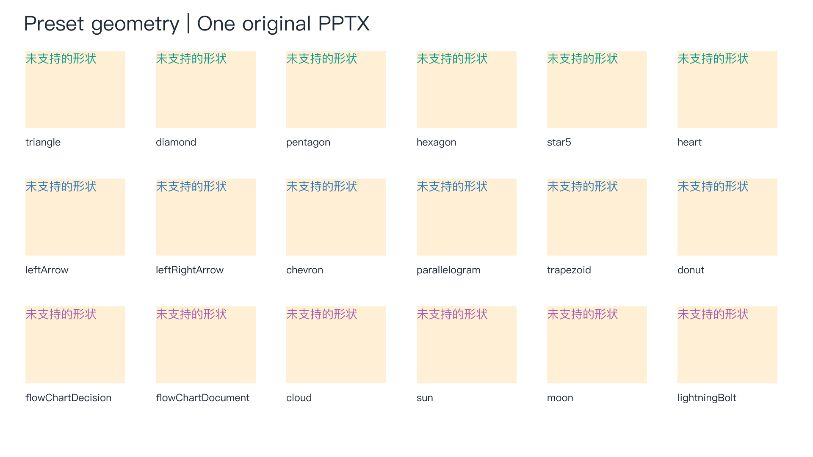
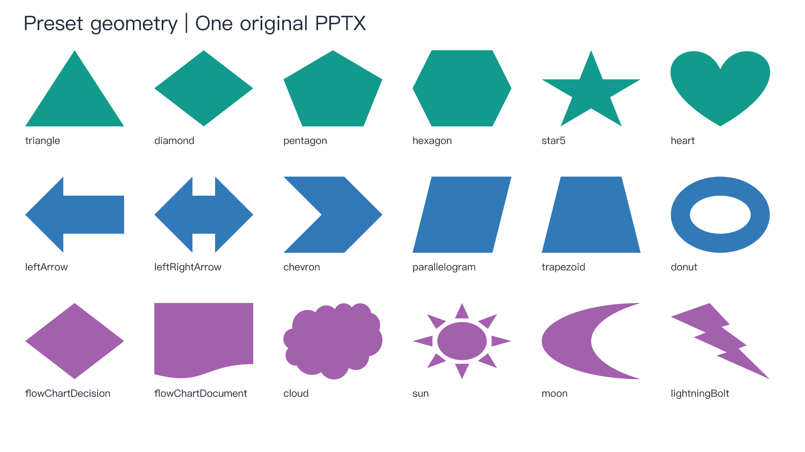
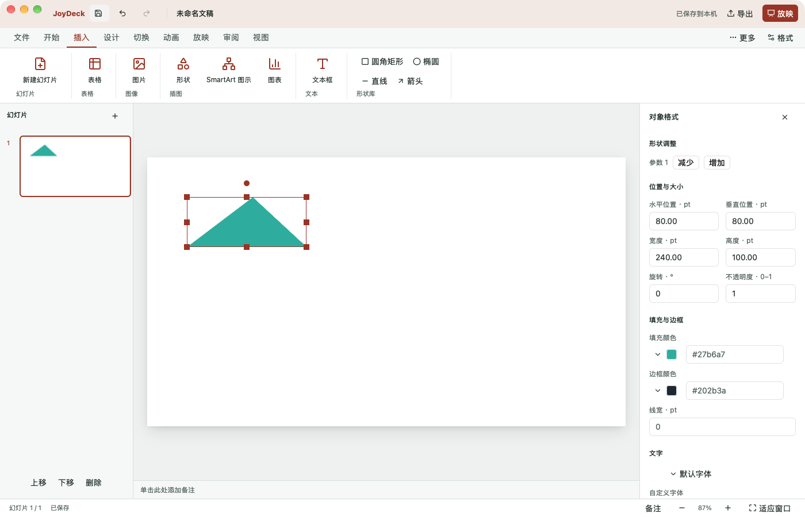

# 预设形状几何引入与价值对比

2026-11-01。用户在源码评估后明确授权引入最有价值的候选。基线为 JoyOffice `5c0dd3672089401a02aa49f17ffe52cab41f77cb`；任务分支 `codex/joydeck-preset-geometry`。本次只引入 DeckCraft 的纯预设几何，不包含它的模型、编辑器、渲染器、字体或资源。

## 来源与边界

上游固定为 [storytold/deckcraft@82573331a8f2b87ccb536b9b66d55b90295f2111](https://github.com/storytold/deckcraft/tree/82573331a8f2b87ccb536b9b66d55b90295f2111/crates/geom/src/preset)。采用 MIT，保留 ArtCraft Team / DeckCraft contributors 版权。文件级 Git blob 映射、许可和改动说明在 `licenses/joydeck/deckcraft-geometry/`。此部分及其原测试不声明为 JoyDeck 独立实现；本地适配和来源例外见 [净室边界](01-clean-room.md)。

仅提取 `preset.rs` 及 `preset/*.rs`。本地变化为格式化、移除未使用的重导出、把 extra.rs 的测试体移到同层级的 extra/tests.rs。保留29项上游预设测试。未引入 morph、warp、squircle 或任何应用模块。

`kurbo =0.13.1` 已在工作区锁文件中；本次新增 model 到该既有版本的直接依赖，不增加 feature、不升级依赖。几何计算仍为无 IO 的纯函数，与 model 原有 geometry 一起使用；engine 通过已有对象命令提交，scene 只读消费轮廓。

## 用户可见实现

- 183项几何目录（包含 textBox 别名），公共 PPTX 将 textBox 写成 rect；新增177个预设公共名称的往返回归，不把目录数量当成完整 Office 保真验收。
- 插入菜单新增18种常用形状，插入后自动选中并打开属性面板。
- 原生保存预设名称与整数调整参数；有调整手柄的形状在属性面板顶部提供增减按钮，使用一次普通 ReplaceMany 事务，可以撤销和重做。
- 显示和命中消费同一份路径，支持孔洞、曲线、多子路径、子路径填充与描边、旋转和无填充。
- 标准 PPTX 读写真实 prstGeom / avLst，不依赖私有快照证明兼容。按 adj / adj1…名称映射参数，XML顺序不影响结果。
- 参数只接受受限整数 val 公式；未知名称、重复项、未知属性/子节点和公式产生定位告警，原包仍由既有 source 保留机制保存。修改超出源包保留写回子集时继续拒绝，不静默丢失。

含预设的原生文件使用 schema1.11 / minReader12 和 preset-geometry-v1；当前内容及保留源模型都没有预设的文稿继续写 schema1.10 / minReader11。删除最后一个可见预设时，如果源模型仍含预设，版本下限不降级；读取时也校验这一条件。旧读取器明确拒绝新特性。单页 SVG 预览新增100000段预设路径预算，失败时不改文稿；场景缓存继续受既有字节预算约束。

## 同源前后对比

生成脚本为 `scripts/joydeck/verify-preset-geometry.py`，用纯标准库生成原创的公开 PPTX，不含私有模型或外部素材。before 使用修改前从基线构建并留存的 CLI，after 使用本次代码构建的 CLI。两边使用相同字体环境、画布与144 DPI输出，PNG为1920×1080。

输入 SHA-256 均为 `928e3f310e73289abff3f7bad52aba9ab2e7073e3aa23ab356e4c4691a8ab39f`。

| 同一页的测量 | 引入前 | 引入后 |
| --- | ---: | ---: |
| 新增预设的实际轮廓对象 | 0 | 18 |
| 未支持形状占位 | 18 | 0 |
| 原有文字对象 | 19 | 19 |
| 公共PPTX输入字节 | 2592 | 2592 |

引入前：

引入后：

这些是实际 CLI 渲染输出，不是设计稿或 Office 参考截图。本轮价值是功能覆盖和可编辑性提升，不声称性能加速。

## 自动验证与桌面验收

执行记录、测试计数、二进制/输入/图像哈希与桌面实测结果统一见 [证据索引](evidence/preset-geometry-20261101/verification.json)。核心回归包括公开 XML 与原生往返、旧 schema 保持、版本声明拒绝、调整单事务 undo/redo、未知公式保留/拒绝、圆环孔洞像素与命中、旋转无填充描边、别名规范化和页面预算拒绝。新增测试和导入测试相互独立，公开格式测试显式使私有快照失效。

工程检查使用 `cargo xtask check joydeck`；锁文件依赖边变化触发 Word、Sheet 分产品 headless 检查和 workspace 联合编译。文档与门禁按根 AGENTS.md 检查。桌面验收脚本为 `scripts/joydeck/verify-preset-ui.py`，通过真实 macOS AX 控件插入形状、调整、撤销、重做、保存，再由 CLI 独立重开核对。

| 本轮实际执行 | 结果 |
| --- | --- |
| Deck 分产品 fmt / 严格 Clippy / 测试 | 196项通过（含所选公共库测试） |
| Word headless 分产品 fmt / 严格 Clippy / 测试 | 1180项通过 |
| Sheet headless 分产品 fmt / 严格 Clippy / 测试 | 1383项通过 |
| workspace 联合编译 | 通过，包含三个桌面应用 |
| Deck 桌面与CLI开发构建 | 通过 |
| macOS 真实控件插入、参数、撤销、重做、保存与独立重开 | 通过 |
| 基线旧CLI读取新特性文件 | 明确拒绝，文件字节不变 |
| 文档检查 / 架构与生产panic门禁 / diff检查 | 通过 |

各产品计数包含其选择的公共库，不能相加当成不重复的全仓测试数。所有锁定包的版本、来源和校验和保持不变，Cargo.lock仅新增model到既有kurbo版本的依赖边。

实际桌面插入并调整三角形后，参数由默认50000变为55000；撤销后保存重开为默认值，重做后保存重开恢复55000。参数入口置于面板顶部。实际窗口截图：

## 未覆盖项

本轮不宣称完整母版/主题继承、复杂文字、阴影/渐变、翻转、自由路径、连接符吸附、全部调整手柄的直接拖拽或3D支持。属性调整为增减按钮，非黄点拖拽。PPTX 对这些既有缺口继续报告。未知调整公式不会解释执行。

对比语料为自建，未获得外部Office文稿与PowerPoint参考渲染；Windows/Linux GUI、信创真机、读屏与正式发布均未验收。本轮状态不关闭M5/M7等父任务。
