# 本机PowerPoint与JoyDeck对照审查

2026-10-30，product-design audit流程：先采集本机实际运行PowerPoint的开始/插入/动画/放映，再采集并修改JoyDeck。只创建本轮原创演示文稿，不修改用户原有文稿。对照1600×900窗口；证据01–05为改造前，11/13为最终布局，14为实际激光/墨迹操作。截图只证明当前平台与窗口，不能替代读屏、多DPI或硬件验收。

| 观察/影响 | 修改与复核 | 当前结果 |
|---|---|---|
| 开始功能区原为小文本按钮，分组与PowerPoint不同，常用操作难按习惯寻找（05对01） | 透明标题栏/快速访问、紧凑页签；剪贴板→幻灯片→字体→段落→绘图，主操作大图标/名称、次操作双行；系统字体/形状/表格尺寸入口 | 已改进，见11；功能子集较少，完整Office菜单和即时格式操作仍有差异 |
| 常驻空格式栏挤占画布，导航/备注空间比例不同（05） | 默认收起格式栏，250px导航栏/约200px缩略图，首缩略图约y150、画布约y166，与PowerPoint参照相近；32px折叠备注 | 已改进，见11；字体、图标/圆角、缩放算法和部分位置非像素级相同 |
| 插入缺图表/图示任务入口，动画/放映无法按相同任务路径发现（02–04） | 插入按新页→表格→图片→形状/图示/图表→文字，七类图表与三类图示；对象上下文页签、动画参数/顺序和从头/当前/演示者/排练入口 | 已实现可用子集；完整SmartArt/Excel、Office全部效果仍未实现 |
| 演示者初版高分辨率图像内在尺寸挤出下一页/备注，深色输入值不清楚（09/12） | 限制当前图像宽高且保持文稿比例，下一页320×180、备注可滚动，输入显式文字颜色；当前图像取实际观众采样 | 已修复，见13；真实双屏/DPI尚未验证 |
| 缺图标资源、部分图标无名称；退出放映后编辑快捷键失去焦点 | Lucide全量资产、名称/提示、Cmd+N/Cmd+Shift+N/F5/Shift+F5；退出观众/演示者后一次恢复编辑焦点 | 已修复并有原生焦点回归；完整键盘/读屏认证仍开放 |

实际操作：图表网格91→131并保存native；动画改900ms保存；预览/停止/键盘推进；演示者备注仅在演示者；P暂停、B/W黑白屏、L激光、I画笔；退出选择保留副本/放弃；排练计时另存。`gui-chart-131.joydeck`已核对131和900ms；`gui-ink.joydeck`有新增线段；`gui-rehearsal.joydeck`保存两页排练时间。14是暂停在淡化中间的观众帧，演示工具显示不依赖修改原稿。

PowerPoint实际打开JoyDeck公共PPTX无修复提示，识别五类初版图表、普通图示组、备注和600ms淡化。使用“在Excel中编辑数据”，B5从91经132改为133并保存；PowerPoint显示133（10），JoyDeck公共导入和固定测试确认133。另保留未刷新缓存91/工作簿132作为拒绝误读的负例。面积/环形为末轮补充，九页最终样例也已由本机PowerPoint无修复打开并实际显示，见16/17；独立公共读取/孔径/空值与图像验证另见31和最终验证索引。最终二进制只读可视端实际重读133见15。

本轮保留JoyDeck品牌与现有Lucide图标，独立实现代码。界面目标为命令组织、空间与用户操作习惯接近PowerPoint；完整功能、所有尺寸/平台、同一字体排版/可访问性和像素级一致尚未达成。

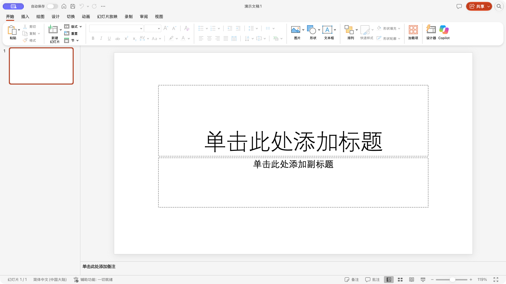
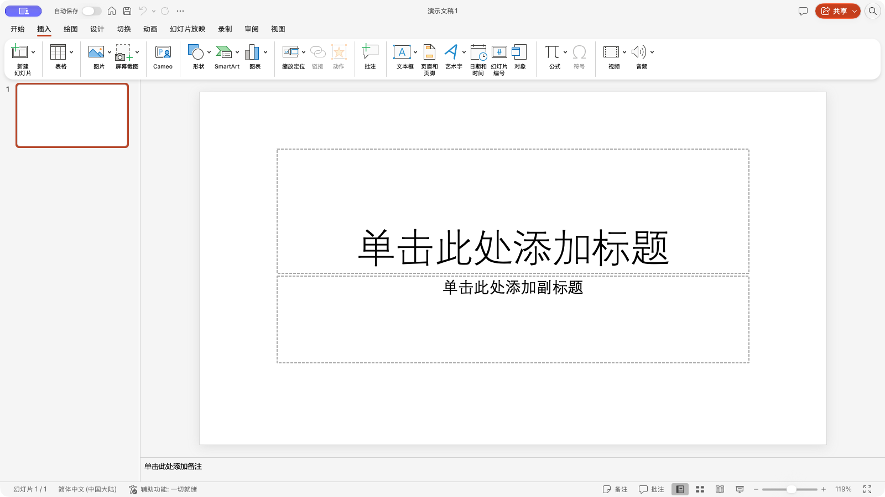
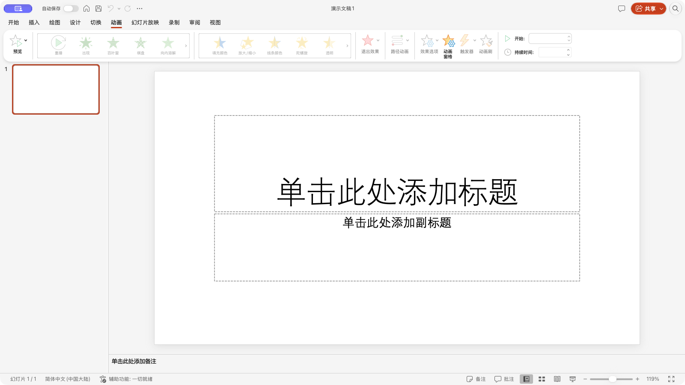
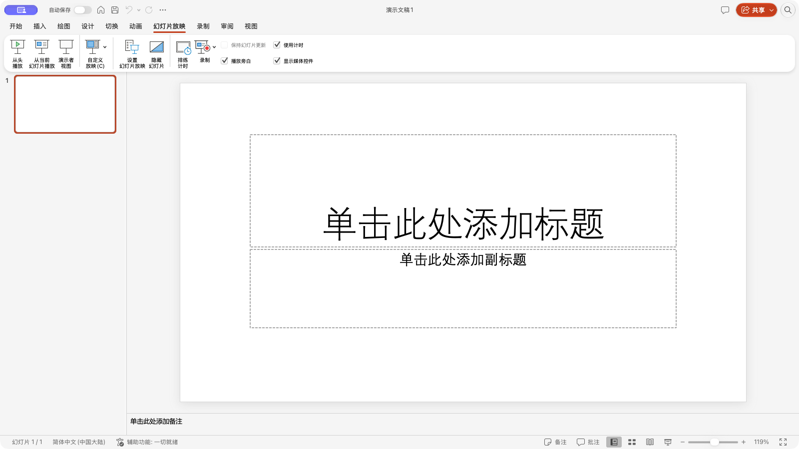
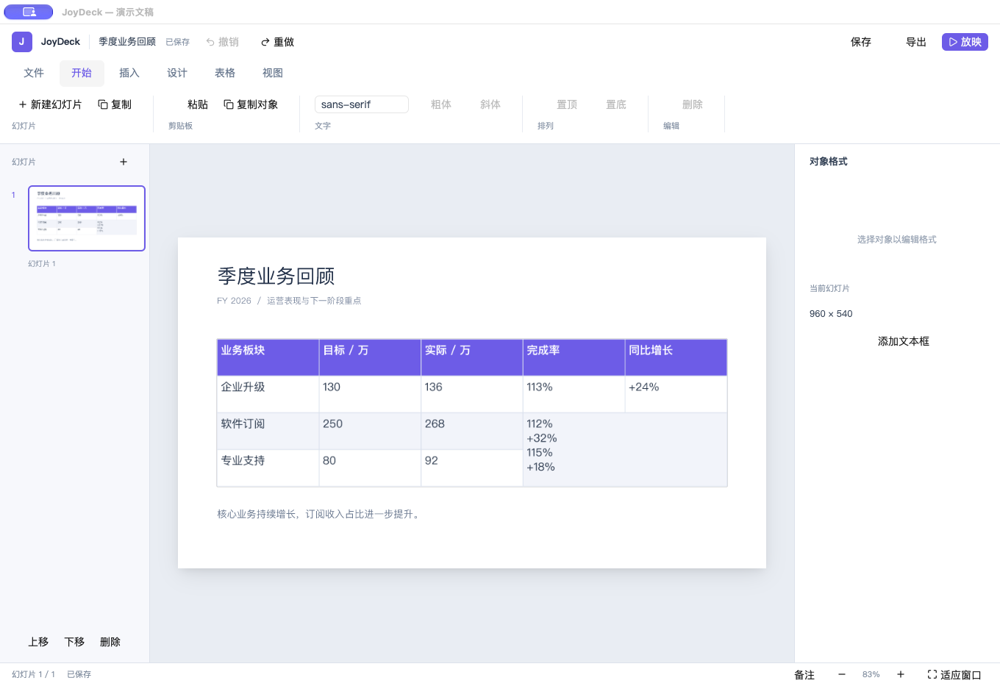
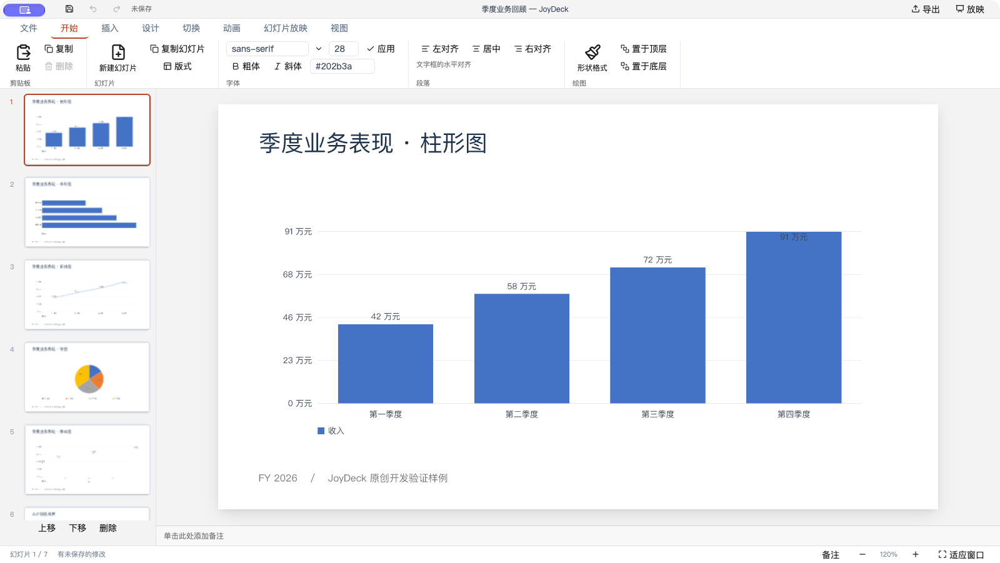
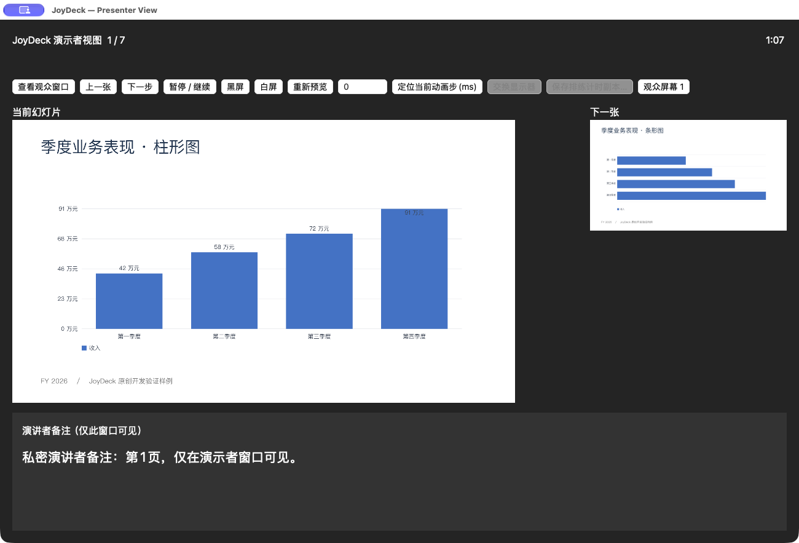
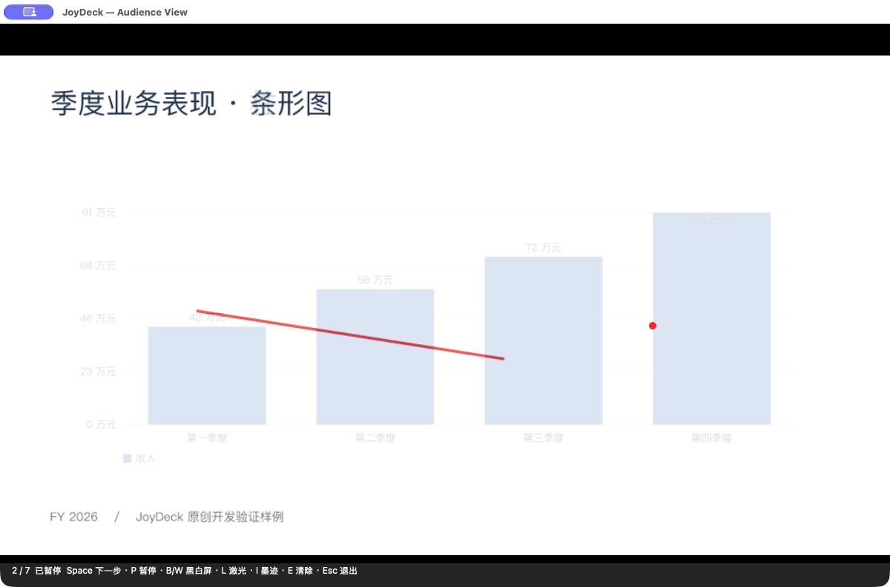
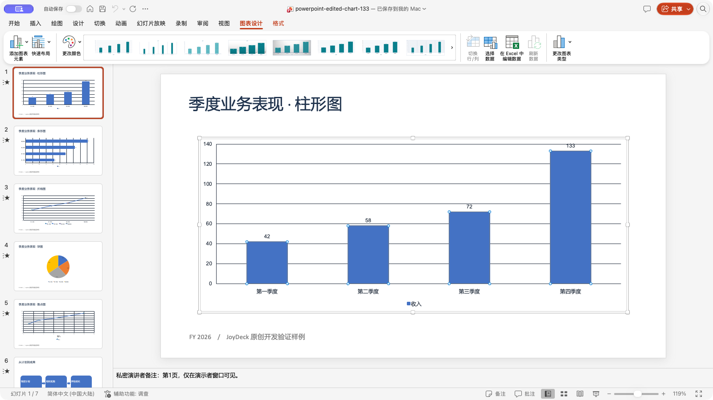

末轮GUI限制：最终默认编辑器正常绘制，截图18。CUA在连接此窗口及原生Open对话框Raise时多次超时；进程采样处于AppKit事件循环，未见应用锁等待。已终止仅本轮创建的空文稿QA进程。该额外编辑器导入未登记为人工通过；最终二进制以原生adapter测试和实际可视查看器重读133，前述网格/动画/演示工具GUI证据保持。不会因自动化超时推断所有人工路径已通过，也不把它伪装成硬件验收。

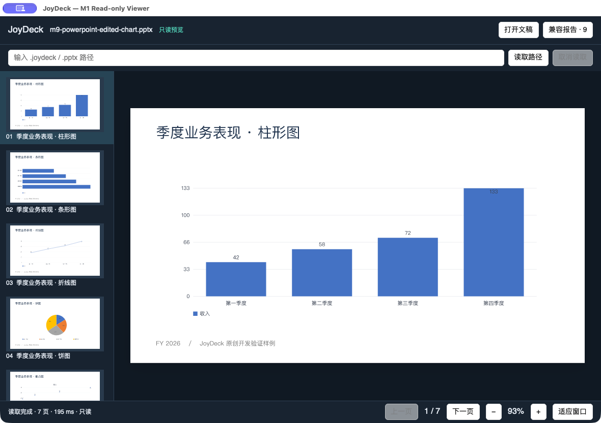
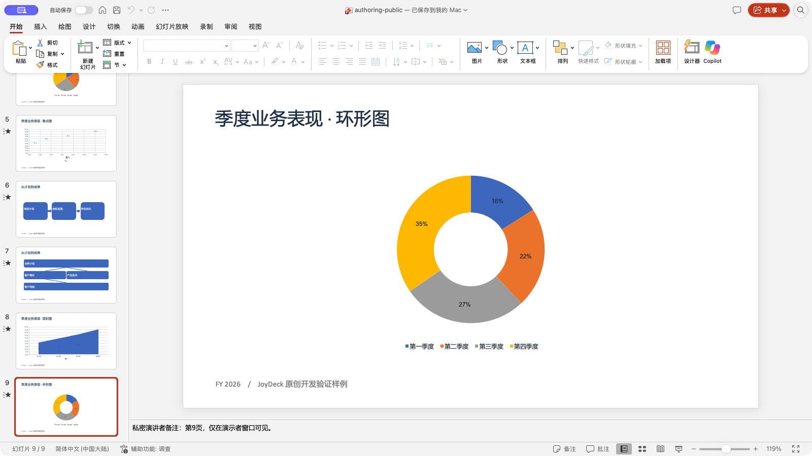
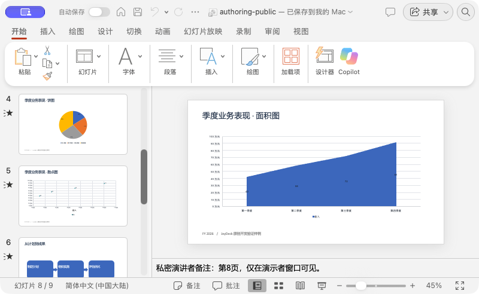
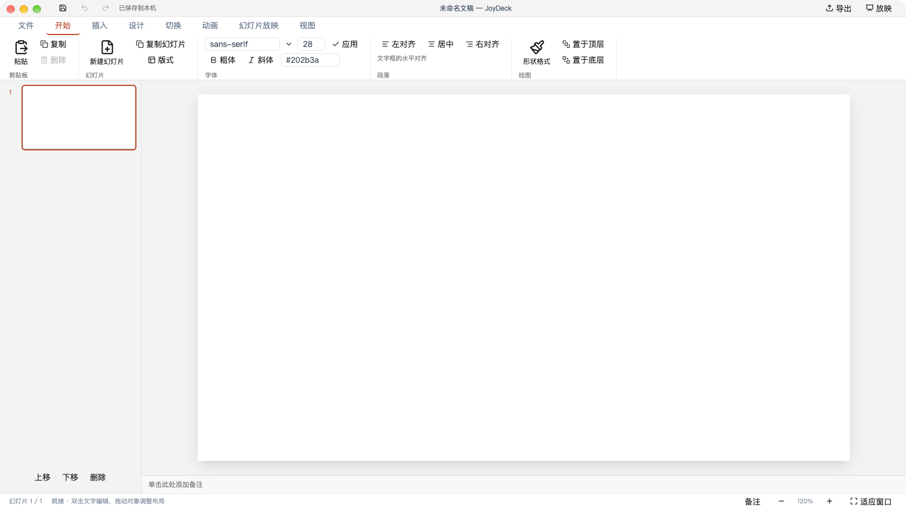
