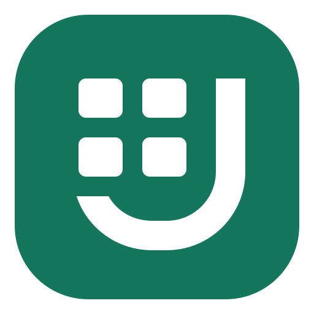

# JoyOffice 产品标识与图标

三款产品共用 J 形回钩与圆角底板。文档和发布包引用对应产品的 SVG 母版。

| 产品 | 图形 | 主色 | SVG |
| --- | --- | --- | --- |
|  JoyWord | 段落线 | `#3455D1` | [joyword.svg](../../assets/brand/joyword.svg) |
|  JoyDeck | 放映三角 | `#C04A30` | [joydeck.svg](../../assets/brand/joydeck.svg) |
|  JoySheet | 四格单元 | `#13765D` | [joysheet.svg](../../assets/brand/joysheet.svg) |

## 构建与分发

| 平台 | 图标接入 |
| --- | --- |
| Windows | Cargo 在桌面 EXE 中嵌入多尺寸 ICO，资源编号为 GPUI 加载的 `1`。JoySheet NSIS 安装器和卸载器也使用该 ICO。 |
| macOS | `cargo xtask package <产品> --release` 将 ICNS 放入 `.app/Contents/Resources/`，由 `Info.plist` 的 `CFBundleIconFile` 引用。JoyWord 的本地开发应用包使用同一入口函数。 |
| Linux | 桌面入口使用 `share/applications/` 下的 `.desktop`，可缩放图标位于 `share/icons/hicolor/scalable/apps/`。JoySheet 的 deb 与 AppDir 在 `usr/share/` 内使用同样布局。 |

JoyWord 和 JoyDeck 的 Linux 便携包可以直接运行解压后的应用。如需桌面菜单入口，将产品可执行文件放在 `PATH` 上，例如 `~/.local/bin/`，并将包中的 `share/` 内容合入 `${XDG_DATA_HOME:-$HOME/.local/share}/`。JoySheet 的 deb 由包管理器安装这些资源。

各包包含所属产品的 `assets/brand/<产品>.svg`。发布检查逐字节核对归档中的 SVG、macOS ICNS 和 Linux 桌面图标，并检查平台图标引用。

## 更新图标

修改 SVG 后，在 macOS 运行以下命令，检视 16 px 和 32 px 效果，并一并提交更新后的 SVG、ICO 和 ICNS。脚本默认生成三款产品，传入 `joyword`、`joydeck` 或 `joysheet` 可以只生成一款。

```sh
python3 scripts/generate_product_icons.py
```

常规构建和发布直接使用入库的资源。每次打包都将所选产品的图标计入源码指纹。
