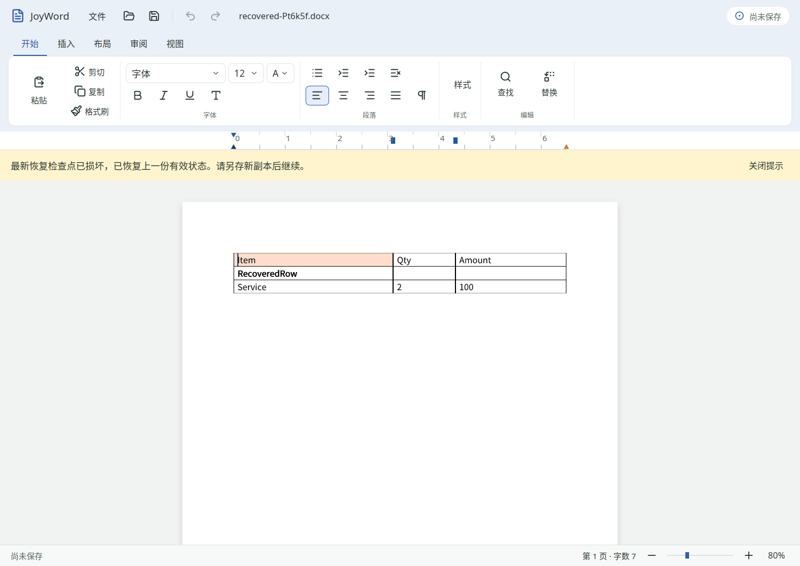

# 2026-11-01 JoyWord T104 完整检查点与恢复验收

T104 从 `in_progress` 改为 `done`。本轮补齐富文档检查点及恢复选择，完成原任务要求的自动验证和真实进程强制结束场景。JoyWord 当前 **19 done／36 in_progress／11 planned**；M1 为 **8 done／3 in_progress／1 planned**，M1 发布门槛继续开放。其余 [47 项 Word 任务](remaining-word-tasks.json)保留各自原准则。

## 发现并修复的问题

- 旧生产日志只保存原包与全文。格式、表格、页眉／页脚等操作虽然增加检查点代号，重启却无法恢复相应编辑。本轮 [旧程序负例](negative/report.json)在真实窗口编辑后独立解析日志，确认缺少完整状态。
- V3 在原始包基线、完整正文与文档版本之外，保存当前经验证导出的完整 DOCX。恢复以该完整包建立新的独立副本，不用全文覆盖富文档。未知包部件、关系、表格、格式及可导出的 story 随包保留；原始基线仍在检查点中。
- 页眉／页脚处于编辑状态时，旧链路把活动 story 的文字误当全文；现在从已提交模型读取完整正文，完整包仍包含其他 story，独立测试核对页眉编辑恢复。
- 富文档重导入可处于本地版本零，旧关闭判定只比较保存版本与当前版本，会直接关窗。现在恢复状态单独标为未接受，关闭时保留保存／丢弃选择；另存副本继续保留该选择，正式原件保存可标记已保存。
- 最新代损坏回退和双代损坏拒绝现在都有可访问 Alert 提示。原有脱敏诊断保留，失败不静默显示成成功恢复。
- 标尺移动、选区与预编辑不再重复发布检查点；只有已提交模型版本改变时才写入。
- 新增的显式分页／分栏符先前被 DOCX 重写拒绝，导致可恢复快照无法建立；现按已有类型写出正确 break 属性，带段落格式的三种 break 均经过语义往返。

## 协议、错误路径与边界

V3 标识为 `JWREC003`，沿用双发布槽、单调 generation、版本绑定、CRC、文件锁、同目录临时写入、flush、文件 sync、读回解码验证、原子发布及目录 sync。有效代的结构是：标识／代号／类型／版本／原包 blob／UTF-8 正文 blob／完整 DOCX blob／CRC。V1／V2 仍可读取，旧文本兼容 API 保持原字段；新 API `DocumentCheckpoint` 提供完整包和 degraded 状态。新生产写入不会在导出失败时降级为文本日志。

总记录上限保持原值 **128 MiB + 49 字节**，原包及完整包各自上限 96 MiB、文本上限 32 MiB，且三者合计仍受总上限限制。解析前检查文件大小、blob 长度、整数溢出、UTF-8、CRC 与尾随字节。加密 ZIP 和 CFB 加密包外壳在写任何恢复目录／锁／明文副本前拒绝。完整包与正文不匹配，在创建恢复 DOCX 前拒绝。

恢复只读选取最新有效代；坏槽保留，后续写入拒绝覆盖损坏证据。明确丢弃写入墓碑，使旧检查点与在途请求失效。恢复副本以独占随机名称创建，不覆盖前次副本或解除旧锁。保存中的 N／后续编辑 N+1、迟到发布、并发写者及正式源件的保护继续经过原有回归。

以下限制仍开放：

- 当前目录是一份活动文档的检查点，不是整个多窗口工作区或跨进程撤销历史。恢复后的撤销栈不伪造历史。
- 完整检查点遵循 DOCX 导出器的实际支持范围。T103 尚不支持的编辑组合（例如源包没有 settings 部件时新增 trackRevisions）显式报错，保留上一完整代与正式源件；错误到达 UI。对应拒绝已有测试，不能宣称这类编辑已持久化。
- 没有物理断电、设备掉电、网络文件系统、实际系统 IME 或跨平台 GUI 新认证。物理掉电后的设备／文件系统保证继续由 T702／T700 专项验证，不把 SIGKILL 或 StorageFull 注入称为物理断电。
- 同步恢复写入仍有大文档 I/O 成本，完整 p95／p99 与设备矩阵归 T702；本轮没有发布性能或全平台认证结论。

这些边界不替代 T104 原任务的自动故障注入、有效前缀、保存竞争和真实进程强制结束准则；本轮已逐条执行相应准则。

## 验证与证据

| 项目 | 本轮结果 | 证据 |
| --- | --- | --- |
| Word 分产品 fmt／严格 Clippy／测试 | 1314 通过，0 失败／忽略 | [产品日志](logs/word-check.log) |
| 逐提交完整语义恢复 | 文字、加粗、对齐、分页、替换、插表、修订开启／插入／拒绝，每步实际恢复并比较完整语义 | [周期快照测试](../../../../crates/joyword-shell/tests/t104_periodic_snapshots.rs) |
| 富文档、未知部件、story、拒绝路径 | 新增 7 项回归通过 | [恢复测试](../../../../crates/joyword-shell/tests/recovery_document.rs) |
| IO 故障注入 | V2／V3 各 10 个阶段；部分写入、StorageFull、发布后目录 sync 失败均检查有效代 | 产品日志中的 `real_io_faults_have_stages_and_keep_the_last_published_generation` |
| 解码器异常 | V3 每个字节截断、单 bit 篡改、伪造长度溢出；既有 CRC／旧格式／加密／竞争回归通过 | 产品日志中的 `bounded_decoder_rejects_lengths_overflow_utf8_truncation_and_generation_overflow` |
| 界面状态／提示 | 新增 2 项自动测试；真实 GUI 验证关闭、回退和失败提示 | [原生报告](native/report.json) |
| 显式 break 写回 | line／page／column 配合段落格式的 DOCX 语义往返通过 | [回归](../../../../crates/joyword-docx/tests/explicit_breaks.rs) |
| GUI 正例与负例 | 最终程序 5 组通过；旧程序同用例失败于缺少完整包 | [正例](native/report.json)、[负例](negative/report.json) |
| T201 原生回归 | 同一最终二进制的 6 组合同表格回归再次通过 | [报告](table-regression/report.json)、[重开截图](table-regression/10-reopened.png) |
| Python 工程脚本 | 146 项通过 | [日志](logs/python-tests.log) |
| 文档／原子验收／架构／IO／panic | 通过 | [文档](logs/docs.log)、[原子验收](logs/acceptance.log)、[门禁](logs/gates.log) |

真实 GUI 环境为 UOS Desktop 25 x86_64／Radeon 890M（RADV GFX1150）／X11、125% 桌面缩放、默认窗口。源件为上轮原创合同表格的独立副本。通过实际窗口操作改变列宽、单格底纹、插入行、输入、加粗和居中；独立另存的 [结束前 DOCX](native/01-before-kill.docx) 与日志完整包逐字节相同。SIGKILL 后原生重启的 [恢复保存件](native/02-restored.docx)再次逐字节相同，正式源件 hash 不变。最终完整提交为 generation 17／version 17，三行表格、列宽 4488／1752／3120 twips、FFDDCC 底纹、加粗与居中均保留。

另存后关闭恢复文档必须出现未保存提示，选择不保存后发布墓碑；随后重启不复活。复制原双槽并截断最新代，重启恢复上一有效完整包且出现回退提示；两槽都破坏时不生成恢复 DOCX，显示失败提示。截图已逐张检查。保留的 [原始检查点](journal/)可由独立 Python 解码器复核，测试配置与锁文件不提交。

复跑：

```bash
cargo xtask check joyword
cargo build --locked -p joyword
python3 scripts/smoke_word_recovery_linux.py --output <新的绝对输出目录>
python3 scripts/check_docs.py
python3 scripts/check_acceptance.py
python3 scripts/check_gates.py
```

GUI 输入来自 X11 合成键鼠，窗口像素真实捕获；测试只终止自己启动的进程。环境工具包装见 [UOS 基线报告](../20261101-uos/README.md)。源码／二进制身份见 [verification.json](verification.json)，交付散列见 [SHA256SUMS](SHA256SUMS)。控制台日志仅规范化末尾空白行；没有修改截图像素。本轮未改依赖、锁文件、resolver 或产品版本。

分页／分栏写出依据 ECMA-376 Part 1 §17.3.3.1 和 Microsoft 的公开 [Break](https://learn.microsoft.com/en-us/dotnet/api/documentformat.openxml.wordprocessing.break?view=openxml-3.0.1)／[BreakValues](https://learn.microsoft.com/en-us/dotnet/api/documentformat.openxml.wordprocessing.breakvalues?view=openxml-3.0.1) 规范说明，未读取 SDK 实现；来源登记见 [PROVENANCE](../../../joyword/PROVENANCE.md)。


