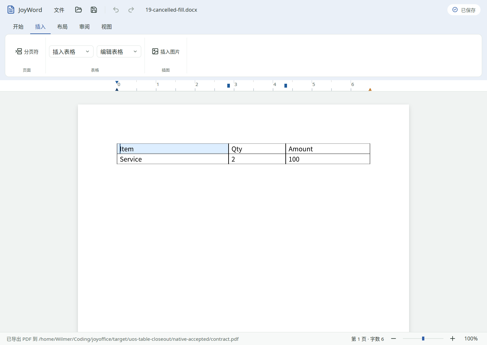

# 2026-11-01 UOS 深入核对与 T201 基础表格收口

T201 从 `in_progress` 改为 `done`。补齐实现后，在 UOS 原生窗口完成基础合同表格工作流，并用独立 ZIP／XML 和 Poppler 检查输出。Word 当前 **18 done／37 in_progress／11 planned**；M2 为 **4／7／1**，发布门槛继续开放。

## 未完成项核对

[完整任务快照](remaining-tasks.json)记录 Word 48 项开放任务的产物、自动准则、GUI／外部验收准则与原子清单缺口；同时登记 Deck 主待办表的 95 条未勾选行，以及 Sheet 迁移矩阵的 48 条后续事项。三份文档采用不同粒度，数量不能相加为统一完成率。Sheet 的维护性后续事项也不等于 48 个完全未实现任务。原子清单里的历史记录仍须按新证据逐项核对。

本轮按实现缺口、可在当前环境补验的条件、外部环境条件划分优先级：

| 范围 | 当前缺口与后续工作 |
| --- | --- |
| Word T201 | 本轮关闭：列宽拖拽、底纹编辑、Linux 表格命令入口、焦点和空白边距缺陷，以及合同表 GUI 验收 |
| Word T104 | 生产恢复仍主要覆盖原包与文字；富格式／表格结构事务的完整持久化与恢复须继续实现验证，不能用撤销测试替代 |
| Word T601 | 转换核心已有实现；文件入口／用户流程及损失说明的完整接入和 GUI 验收继续开放 |
| Word T003／T701／T806 | 前轮 UOS 系统搜狗／Fcitx5 拼音直通、选定 CJK 字体 emoji 缺字仍开放；本轮表格 ASCII 输入不替代系统 IME 或混合文字验收 |
| Word T103／T200／T202–T207／T300–T304 | 各自仍有子集、外部 Word／WPS 交换或 GUI／打印缺口；见任务快照及原子清单，不能由 T201 的基础表格通过一并关闭 |
| Word T700–T704 | Wayland、跨平台完整流程、读屏、性能／故障、安装签名与更新矩阵继续开放；信创真机按既定约定保留非阻塞待补验 |
| Deck | M3 统一文字布局／自动换行、M5 组／连接符等对象、M7 完整公开格式与外部语料、M12 jobs／取消、M14 三方合并等仍有实现缺口；双屏、设备丢失、完整平台矩阵也须补验 |
| Sheet | 原生打印取消／队列提交、其他平台运行、系统 IME／DPI／读屏／GPU 呈现认证和发行签名仍开放；迁移矩阵已实现的功能按各自已有证据保留 |
| Word planned 项 | T107、T206、T304、T403 和 M8 的 7 项 planned 保留原范围及依赖，未将未来产品能力当作补测即可完成 |

## 实现与修复

1. 标尺显示当前顶层表的内部列边界。拖拽走 shell → engine 的单个事务；用排版同源的 table metrics 换算列宽，保持整表的已绘制外宽，更新网格与单元格 preferred width，保留百分比表宽、合并状态、文字和其他格式。
2. 手柄绑定文档版本与表身份；跨会话取消手势，拖动期间几何改变取消。非法边界、整数溢出、过小宽度、无剩余内容区的边距、只读及未知保留结构拒绝，版本／历史不变。
3. 表格属性新增当前单元格 sRGB／auto 直接底纹和 `none` 清除；清除直接底纹后仍遵循已有样式。与同次确认的边框等属性组成一次撤销。
4. 插入页增加“编辑表格”，实际调用注册命令：表属性、行列增删、选择单元格、向右／向下合并、拆分。窄窗口沿用功能区溢出菜单。
5. 插表和其他表格命令成功后返回正文焦点，属性确认后可继续键盘操作。
6. 空白边距字段保持原值，不再把省略的默认边距写成四个零。[修复前保存件](regression/before-empty-margin-fix.docx)实际含四个零，[修复后保存件](native/16-cell-fill.docx)仍省略；[对照记录](regression/empty-margin-regression.json)含两次二进制身份。编辑与 layout 共用应用默认边距，避免拖拽生成无内容区的单元格。

没有升级依赖、修改锁文件或版本号。基础表格完成不表示主题底纹、四角条件、第二层嵌套、完整复杂表格及外部 Office 几何对照完成；相关拒绝／原样保留契约保留。

## 本轮验证

| 验证 | 结果 | 证据 |
| --- | --- | --- |
| Word 产品 fmt、严格 Clippy、测试 | 1304 通过，0 失败／忽略 | [日志](logs/word-check.log) |
| Deck validation 产品检查 | 194 通过，0 失败，1 忽略 | [日志](logs/deck-check.log) |
| Sheet automation 产品检查 | 1400 通过，0 失败，1 忽略 | [日志](logs/sheet-check.log) |
| Python 工程脚本测试 | 146 通过 | [日志](logs/python-tests.log)；发布包 hash 输出为测试临时样例 |
| 原生合同表格 | 6 组通过，20 份保存件、10 张窗口截图 | [结构／断言报告](native/report.json)、[最终 DOCX](native/20-reopened.docx)、[PDF](native/contract.pdf)、[独立抽取文字](native/pdf-text.txt) |
| 原有路径／焦点回归 | 3 组通过，同一最终二进制 | [报告](path-focus/report.json) |
| 文档、原子验收、层次／IO／panic 门禁 | 通过 | [docs](logs/docs.log)、[acceptance](logs/acceptance.log)、[gates](logs/gates.log) |

新增 6 个 Rust 回归覆盖：百分比列宽和合并保持／一次撤销，非法边界与溢出／零位移，保留结构／只读拒绝，DOCX 网格往返且底纹／边框不丢失，标尺采用布局度量且拒绝过期拖拽，单格底纹与整表边框的联合撤销。既有取消测试补充原生空白边距参数回归。测试位置见 [T201 原子清单](../../../joyword/acceptance/T201.md)。

GUI 运行于 UOS Desktop 25 x86_64、AMD Radeon 890M／RADV GFX1150、X11、125% 桌面缩放，默认 1200×850 逻辑窗口（实际捕获 1500×1063）。键鼠由 X11 合成，截图来自真实窗口并已检查；80% 文档缩放拖动 48 物理像素，网格为 3840／2400／3120 twips；100% 缩放再拖 24 像素，为 4128／2112／3120 twips。两次保存重开及 PDF 都保留文字、单格底纹、边框和列宽。另存始终写副本，重开时显式丢弃一次性原会话，原始空白源件 hash 不变。

复跑：

```bash
cargo xtask check joyword
cargo xtask check joydeck --validation
cargo xtask check joysheet --validation
cargo build --locked -p joyword
python3 scripts/smoke_word_table_linux.py --output <新的绝对输出目录>
python3 scripts/smoke_word_linux.py --binary "$PWD/target/debug/joyword" --output <另一个新的输出目录>
python3 scripts/check_docs.py
python3 scripts/check_acceptance.py
python3 scripts/check_gates.py
```

本机 runtime 的编译器／X11 工具包装与主机识别见[前轮环境记录](../20261101-uos/README.md)。[验证身份](verification.json)保存最终二进制与源码文件散列；[SHA256SUMS](SHA256SUMS)覆盖本目录交付证据。控制台日志只去掉末尾空白行以符合 diff 检查。

本轮没有执行其他 OS 的 GUI、实际系统候选框、读屏、真实打印或新的 Word／WPS 对照；Deck、Sheet GUI 沿用[前轮实际证据](../20261101-uos/README.md)，本轮只增加其产品自动回归。各忽略项保留原义，未计为通过；无依赖、resolver 或公共构建规则变更，未重复联合 workspace 矩阵。


