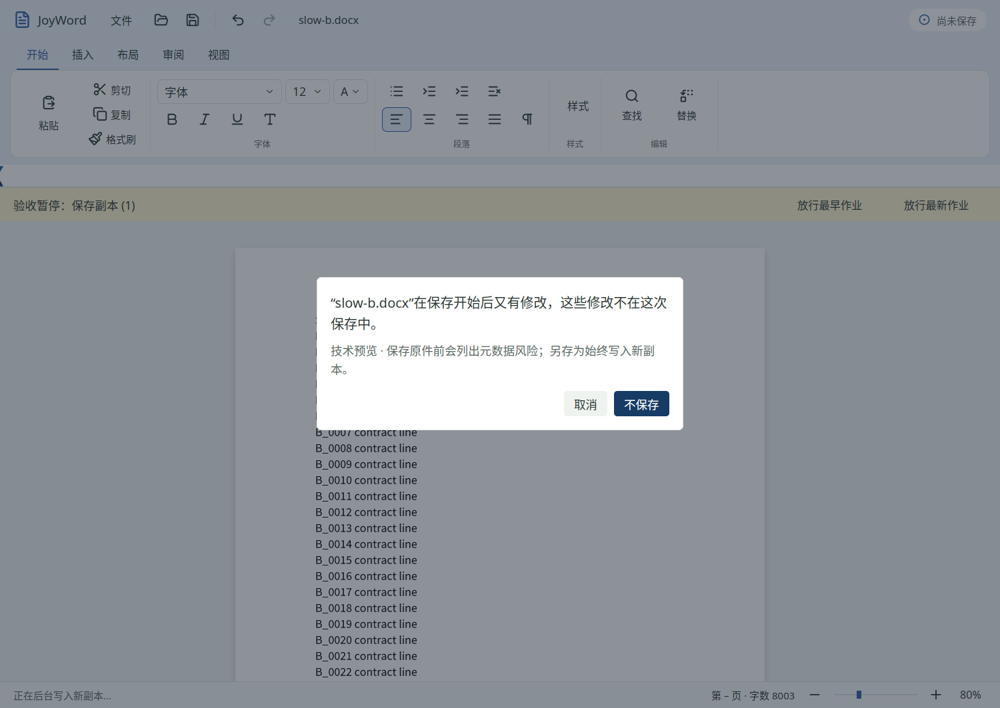

# 2026-11-02 JoyWord T109 打开／保存并发验收

T109 从 `in_progress` 改为 `done`。本批同时完成 [T104 完整恢复](../20261101-t104/README.md)，JoyWord 当前 **20 done／35 in_progress／11 planned**，M1 为 **9／2／1**。其余 [46 项](remaining-word-tasks.json)保留原准则；T103、T110、T107 与整阶段发布门槛继续开放。

## 实现与缺陷修复

- Office 的过期结束调用会先取走较新的 PendingOpen，错误地结束只读状态并写回其输入；新 begin_open 也会覆盖旧缓冲。现在旧结果不能消费新门，较新目标继承已有输入。
- 路径接纳与后台包接纳同样先取走 PendingOpen，旧结果会侵占新输入；没有待定打开时，重复／迟到接纳甚至直接安装包。两入口现统一调用 finish_open 核对代次，失败或重复结果不改变会话。当前路径打开失败时将缓冲写回仍在的文档。
- 窗口后台回调原先在核对身份之前清 open_gate；现仅当前代次能改门或安装结果。开始打开立即通知重绘，稳定展示只读状态。
- 新增应用专属 validation feature，必须再显式设置 JOYWORD_VALIDATION_IO_GATE=1 才启用。通过既有 StepGate 通道控制真实 BoundDocx／SaveCopyJob／SaveOriginalJob 的执行时机；按钮放行有事件日志确认。普通构建和普通启动均不暂停，不添加依赖、不修改锁文件、resolver、共享库或产品版本。

源码入口：[host.rs](../../../../crates/joyword-shell/src/host.rs)、[窗口接线](../../../../apps/joyword/src/input_ui.rs)、[可选时序控制](../../../../apps/joyword/src/io_validation.rs)。新增回归不仅检查状态位，还比较实际输入、文档身份和源文件。

## 验证结果

| 项目 | 结果 | 证据 |
| --- | --- | --- |
| Word 产品 fmt／严格 Clippy／测试 | 1317 通过，0 失败／忽略 | [日志](logs/word-check.log) |
| 打开与保存竞争／进程恢复 | 12 通过，含新增 3 项 | [定向日志](logs/unit-final.log) |
| 两条缺陷的自动负例 | 修复前失败：旧 finish 消费新缓冲；旧 accept 消费新缓冲 | [finish 负例](logs/unit-negative.log)、[accept 负例](logs/accept-negative.log) |
| validation feature 严格 Clippy／应用测试 | 通过，99 项应用测试 | [Clippy](logs/validation-clippy.log)、[测试](logs/validation-tests.log) |
| 原生打开／保存 GUI | 四组通过；全部源件 hash 不变 | [报告](native/report.json) |
| 普通构建 T104 GUI 回归 | 五组通过，无测试暂停条 | [报告](recovery-regression/report.json) |
| Python 工程脚本 | 146 通过 | [日志](logs/python-tests.log) |
| 文档／验收／架构与 IO 门禁 | 通过 | [文档](logs/docs.log)、[验收](logs/acceptance.log)、[门禁](logs/gates.log) |

UOS Desktop 25 x86_64、Radeon 890M／RADV、X11、125% 桌面缩放、默认窗口。合成原创源件为 2000 段 DOCX。实际系统键鼠事件驱动真实窗口，截图未修改；Python 独立解析导出的 DOCX，不从应用状态直接读“成功”。仅处理测试自己启动的进程和临时文档。

1. A 在真实导入入口等待，键入 BUF_A、触发 Ctrl+B 后 Esc 取消；另存旧文档，独立读回含输入且未加粗，源件不变。
2. A 仍等待时打开 B，输入 BUF_B；放行 A，再输入 LATE_B，放行 B；B 成功打开，最终保存件包含两个缓冲串。
3. 捕获保存版本 N 后暂停真实 IO，继续输入 PLUS 并关闭，实际提示“保存开始后又有修改”；Esc 取消保留会话。放行得到 N 不含 PLUS，再另存得到 N+1 含 PLUS。
4. B 的保存等待时切换到 C、输入 NEW_C，再放行 B；B 输出与 B 快照一致，C 标题、正文、未保存提示不变。



## 边界与复跑

时序用真实后台入口的通道控制，未伪造解析、保存或回调，不以自然磁盘耗时猜测是否覆盖竞争。该脚本验证原任务要求的慢作业交互，不测磁盘速度或发布 p95／p99。平台专项、真实系统拼音输入、物理断电、网络盘以及 Windows／macOS 本轮慢作业 GUI 均未验证；继续由 T003、T005、T700–T703 与 T110 对应项跟踪。

早期脚本误把回车当作“不保存”，产生的超时不作为产品缺陷证据；修正为实际按钮点击。后续一次固定等待后的点击早于暂停条绘制，已改为等待真实点击处理确认。归档为最终通过结果；历史候选程序在修正后的完整 GUI 用例也通过，因此不把它称为 GUI 负例。缺陷的可复现修复证据是上面两份失败的底层回归日志。界面回调修复另有代码检查与最终 GUI 回归，未夸大负例覆盖。

```bash
cargo xtask check joyword
cargo clippy --locked -p joyword --features validation --all-targets -- -D warnings
cargo test --locked -p joyword --features validation
cargo build --locked -p joyword --features validation
python3 scripts/smoke_word_io_linux.py --binary target/debug/joyword --output <全新绝对目录>
cargo build --locked -p joyword
python3 scripts/smoke_word_recovery_linux.py --output <另一全新绝对目录>
python3 scripts/check_docs.py
python3 scripts/check_acceptance.py
python3 scripts/check_gates.py
```

GUI 脚本仅给子进程设置验证标志；没有改系统环境。来源／二进制身份、计数与边界见 [verification.json](verification.json)；[SHA256SUMS](SHA256SUMS)覆盖本轮交付证据。日志仅整理末尾空白，不改截图像素。前轮证据保留原提交的 hash，不用后续代码覆盖历史记录。
