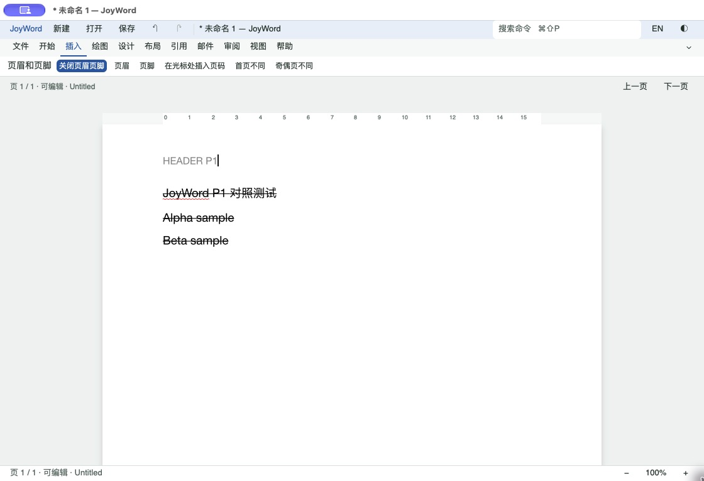
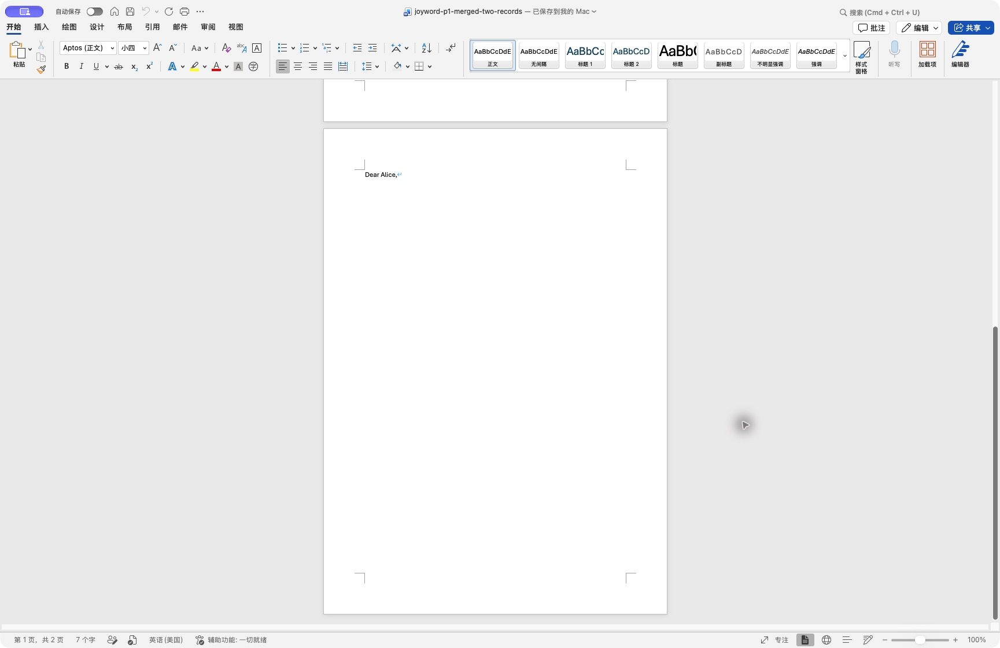

# JoyWord Ribbon P1 优化与本机 Word 回归

日期：2026-11-17。依据：[上一轮逐控件实机报告](../20261117-joyword-ribbon-word/README.md)。本轮完成优先批次：公共表单控件和长度单位、页眉关闭入口，以及表格、图片、对象和邮件的高频编辑链路。**这不是全部 P1 清零或原报告 376 个检查点的全量复验。**

代码位于 `fix/joyword-ribbon-p1-parity`，基于 `eb551e36622c32feaebcdb029d1b06abb26aea26`。尚未提交、推送或创建 PR；保留上一轮未提交的原始报告。没有升级依赖、修改公共锁文件或另建编辑模型。

## 实现与验收状态

| 原问题 | 本轮变更 | 验收状态与边界 |
| --- | --- | --- |
| RIB-01 / 03：参数控件、单位 | 公共表单新增中文选择项、复选框、字体搜索、调色板、多行文本、分页签；段落、表格、图片、对象等长度遵从厘米/毫米/英寸/磅偏好，显示合理小数位；未修改字段保留内部精度 | 指定流程已实测；不是所有旧表单已经迁移。首行/悬挂仍使用带正负号的长度，字符/行单位尚未提供 |
| RIB-02：关闭页眉溢出 | 页眉页脚独立上下文区域放在普通 Ribbon 之前，关闭按钮排在首位，可换行；折叠 Ribbon 后仍保留该区域 | 1440、1120 像素宽度及折叠状态已点击关闭；保存重开保留页眉。最终构建再次复核折叠与关闭 |
| RIB-04 / 19：平台习惯与可访问状态 | macOS 标准文件/编辑/插入菜单；⌘K 插入链接、⌘⇧P 搜索、⌘F1 折叠；常用格式、列表、对齐等使用 toggle 角色；字体候选可读名称、分页签选中状态 | ⌘K、⌘F1 和代表性 AX 状态已核对。修订/部分视图等状态及完整键盘和读屏回归仍未完成 |
| RIB-05：字体框 | “字体/高级”分页；西文/中文字体、字号、颜色、效果、字符间距等集中设置；预览常驻滚动区之外；应用为一次格式命令，取消保留原文 | 字号 14 与删除线应用、取消高级页草稿、一次撤销已实测；尚无 Word 同等完整的效果预览和兼容默认模板 |
| RIB-14：表格属性 | 按表格/行/列/单元格分页，读取当前或混合值；宽度方式/对齐/行高规则/跨页/标题行使用选择或复选控件；宽高、边距遵从单位 | 2×2 有内容表格列宽 7.96→2.5 厘米，重开并在 Word 属性中读回 2.5 厘米；行允许跨页、边距 0/0.19 厘米已检查。复杂跨页和嵌套表格未人工验收 |
| RIB-15：图片 | 带单位尺寸与锁定比例复选框；裁剪模式、八个黑色把手、裁剪预览，拖动释放为一次撤销；保留数值裁剪选项 | 10×5 厘米锁定比例、右边裁剪到约 7.49×5 厘米、撤销重做、Word 读回同尺寸已实测。旋转图片暂用数值裁剪；压缩流程未重做 |
| RIB-13：对象后续编辑 | 选择形状/SmartArt/图表显示上下文页；形状文字/填充/大小；SmartArt 文字、层级与布局；图表类别、系列、数值、标题和类型 | 形状中英文多行、SmartArt 层级、图表 Q1→9 与一次撤销已实测；Word 可读形状文字与图表值。**SmartArt 流程布局在 Word 回退基本列表，兼容性仍未完成** |
| RIB-12：邮件 | 可分页的字段/记录表格，增删和移动字段；中文字段匹配下拉；匹配用于地址块和问候语；合并范围选择；保留应用/取消和数据预算 | 两条中英文记录、逗号字段、编辑取消、字段映射、前后预览、输出 DOCX、双端重开两页已实测。数据源/映射仍为会话状态，不是可移植邮件主文档 |

另增加 Ribbon 左右滚动按钮；本轮没有成功把最终窗口缩到普通 Ribbon 实际溢出的宽度，因此**不将滚动箭头点击滚动列为实机通过项**。1120 像素的页眉关闭验证是独立有效证据。

## 环境与证据

| 项目 | 值 |
| --- | --- |
| JoyWord | 0.2.0，本机 debug 构建，Rust 1.98.1 |
| 平台 | macOS 27.2.1 / 26B131，ARM64，中文应用界面 |
| 对照 | Microsoft Word 16.115（16.115.26110837） |
| 隔离 | `/tmp/joyword-ribbon-p1-20261117/JoyWord P1 Regression.app`，独立 bundle id 和 `JOYWORD_CONFIG_DIR`；单位测试只影响该配置 |
| 最终程序 SHA-256 | `e7423612e743fd2119320e165f736d30f31f0ee7674ff350dbaf81037f24857d` |
| 合并修复验收程序 SHA-256 | `784049324911558c8e7bdabf5dc57a3b8a759bed6e87e12b258e9aa0e1088c60`；其后只增加图表/SmartArt 环绕的禁用说明 |

采用原生鼠标点击、输入、拖动、应用/取消、撤销重做、系统保存/打开和 Word 实屏对照。全部正文、图片、收件人均为本轮合成样本，没有编辑 Word 原先已打开的用户文档。临时包装不替代签名安装包验收，窗口尺寸不同也不做像素级一致性结论。

[状态采集记录](actions.json)保存捕获时 AX，不是每次原子输入的完整录像。截图保留 CUA 返回的原始 JPEG 字节，扩展名为 `.jpg`；[证据清单](evidence-manifest.json)标明尺寸、SHA-256、用途和排除原因。按渐进构建迭代取证；最终构建的新增验收是 j58–j60，不把所有早期图都描述为同一最终二进制上的重跑。

## 编号实机步骤与结果

1. **字体与撤销**：选择合成正文，打开字体设置，设置 14 磅及删除线并应用；重新打开高级页，将字符缩放草稿改为 99 后取消；一次撤销回到 12 磅且删除线关闭，随后恢复测试格式。Word 同样检查字体框和 14 磅删除线。证据：[Joy 字体框](screenshots/j03-font-final.jpg)、[高级草稿](screenshots/j04-font-advanced-draft.jpg)、[撤销](screenshots/j05-font-undo.jpg)、[Word 字体框](screenshots/w01-font.jpg)、[Word 应用](screenshots/w02-font-applied.jpg)。
2. **单位与快捷键**：段落输入 `1 in`，再次打开显示 2.54 厘米；单位从厘米切为英寸，裁剪后的图片尺寸显示 2.95×1.97 英寸。两端 ⌘K 都进入超链接。证据：[段落](screenshots/j07-paragraph-units.jpg)、[换算](screenshots/j08-paragraph-converted.jpg)、[单位选择](screenshots/j38-general-unit-choices.jpg)、[图片英寸](screenshots/j39-picture-inches.jpg)、[Joy ⌘K](screenshots/j06-command-k-hyperlink.jpg)、[Word ⌘K](screenshots/w03-command-k-hyperlink.jpg)。
3. **页眉关闭**：输入 `HEADER P1`，检查独立关闭入口；缩到 1120×766 后折叠 Ribbon，关闭按钮仍可见且点击退出页眉。保存后双端重开，页眉与正文均保留。最终构建重新进入已有页眉、⌘F1 折叠、点击关闭，专用区域消失。证据：[1120 窗口](screenshots/j10-header-narrow.jpg)、[窄窗折叠](screenshots/j11-header-narrow-collapsed.jpg)、[关闭](screenshots/j12-header-closed.jpg)、[最终折叠](screenshots/j58-final-header-collapsed.jpg)、[最终关闭](screenshots/j59-final-header-closed.jpg)、[Word 页眉](screenshots/w07-header-context.jpg)、[Word 读回](screenshots/w10-joyword-docx-opened.jpg)。
4. **表格当前值和应用**：逐格输入 A1/B1/A2/B2，查看表/行/列/单元格属性；列宽当前约 7.96 厘米，改为 2.5 后再开显示 2.5；边距显示上下 0、左右 0.19 厘米。原生保存并重开，再在 Word 检查同列属性。证据：[表属性](screenshots/j13-table-properties.jpg)、[行属性](screenshots/j14-table-row.jpg)、[原列宽](screenshots/j15-table-column-current.jpg)、[应用读回](screenshots/j16-table-column-applied.jpg)、[当前边距](screenshots/j18-table-margins-current.jpg)、[Word 2.5 厘米](screenshots/w11-joyword-table-column-readback.jpg)。
5. **对象插入后的继续编辑**：形状写入“形状文字\nShape P1”；SmartArt 把 Plan/Build 改为计划/构建，并将构建设为第二级；图表 Q1 第一系列先填 NaN，观察定位错误且未应用，再填 9，应用后一次撤销恢复 3.2，再重做。保存 DOCX，Word 中形状文字和图表值 9 保留；SmartArt 文字保留但流程箭头布局不同。证据：[形状](screenshots/j24-shape-text-applied.jpg)、[SmartArt 编辑器](screenshots/j25-smartart-editor.jpg)、[应用](screenshots/j26-smartart-text-applied.jpg)、[图表错误](screenshots/j28-chart-invalid-data.jpg)、[图表 9](screenshots/j29-chart-data-applied.jpg)、[撤销](screenshots/j30-chart-single-undo.jpg)、[Word 读回及差异](screenshots/w12-joyword-objects.jpg)。最终构建重开图表，编辑数据入口可见，未实现的图表/SmartArt 环绕明确禁用：[j60](screenshots/j60-final-chart-context-readback.jpg)。
6. **图片尺寸和鼠标裁剪**：使用同一张三色 PNG，锁定比例把宽度设为 10 厘米，得到 10×5；点击裁剪出现八个黑色把手，向左拖右中把手，宽度变为约 7.49 厘米，高度仍 5；一次撤销恢复 10 厘米，重做后保存。Word 打开产物，在裁剪模式中显示同宽高及右侧裁剪范围。证据：[比例设置](screenshots/j33-picture-size-units.jpg)、[应用](screenshots/j34-picture-ratio-applied.jpg)、[把手](screenshots/j35-picture-crop-handles.jpg)、[拖动](screenshots/j36-picture-mouse-cropped.jpg)、[撤销](screenshots/j37-picture-crop-undo.jpg)、[Word 把手及尺寸](screenshots/w14-crop-size-and-handles.jpg)。
7. **收件人草稿与映射**：新列表使用客户/城市两列，逐格写入“张三, QA”/上海、Alice/London；在编辑列表中添加第三字段后取消，重新打开仍为原两列两条。匹配“名字／姓名→客户”，预览问候语；首条中文、下一条 Alice。修复读取入口后匹配框才真正弹出，修复字体回退后中文才实际可见。证据：[新表格](screenshots/j40-new-recipient-grid.jpg)、[草稿字段](screenshots/j41-recipient-draft-field.jpg)、[取消保留](screenshots/j42-recipient-cancel-preserved.jpg)、[修复后的映射](screenshots/j44-field-mapping-fixed.jpg)、[最终中文预览](screenshots/j51-final-merge-chinese-preview.jpg)、[英文预览](screenshots/j50-mail-second-final.jpg)。重启后通过同内容 CSV 恢复数据源和映射。
8. **完成合并与双端读回**：选择全部记录，在系统保存框输出 `joyword-p1-merged-two-records.docx`。修复输出线程栈不足后，应用保持运行并提示已输出副本；Word 打开为两页，第一条中文、第二页 Alice；JoyWord 重新打开同一副本，下一页为 Alice。XML 独立确认两条不同正文和分页，不包含合并域。证据：[输出成功](screenshots/j52-merged-copy-published.jpg)、[Word 第一页](screenshots/w15-merged-records-opened.jpg)、[Word 第二页](screenshots/w16-merged-second-record.jpg)、[Joy 重开](screenshots/j53-merged-copy-reopened.jpg)、[Joy 第二页](screenshots/j54-merged-copy-second-page.jpg)。

## 回归中发现并修复的额外缺陷

| 触发 | 原因与修复 | 再验证 |
| --- | --- | --- |
| 点击匹配域没有弹框 | Shell 只读查询白名单缺少 `mailings.matchFields`；补入口并让读取错误可见 | j43 为失败旧证据；j44 和 j51 为修复后实际应用 |
| 中文问候语 AX 有值、屏幕缺字 | 原子域结果合并字体回退片段后，用首个西文字体绘制全部 glyph id；保留每个 glyph 的 shaping style，按真实字体拆绘制，同时保持域的原子光标/断行语义 | j45 为缺字旧证据；j49/j51 实屏可见中文；新增中西文混排域测试 |
| 系统保存框确认完成合并后进程退出 | macOS GCD 后台线程在 DOCX 读回校验中栈溢出；输出任务使用与普通桌面保存一致的 8 MiB 专用线程 | 两次旧崩溃的必要栈摘要见 [crash-summary.json](crash-summary.json)；新增 512 KiB 调用线程回归，输出通过校验且模板不变；j52–j54、w15–w16 成功 |

## 仍需继续的 P1 和优化顺序

| 优先级 | 未完成项 | 后续验收建议 |
| --- | --- | --- |
| P1 | SmartArt DOCX 流程布局回退基本列表；层级仍需输入 0 起始数字 | 先补跨 Word 保存重开的布局定义/箭头/分组，再把层级改为提升/降低和文本窗格；目前不能标对象兼容完成 |
| P1 | 邮件数据源、筛选和字段映射没有随主文档持久化；完成合并仍是保存副本流程 | 明确数据源重连/隐私和持久化契约，支持“编辑单个文档”打开结果；验证重启后的完整合并链。当前 DOCX 产物可独立查看 |
| P1 | 书签、交叉引用、引文源、目录/索引等管理对话框及视图多窗口未纳入本批次 | 按 RIB-09/10/16 的原报告继续独立流程；不得因本次公共控件升级标为完成 |
| P1 | 公共控件迁移尚未覆盖所有旧参数框；首行/悬挂、混合值和全部图形能力还有学习成本 | 特殊缩进使用类型+数值；替换剩余枚举/布尔输入；图表/SmartArt 环绕实现前保持禁用并解释 |
| P1 | Ribbon 溢出箭头的真实滚动、全部开关 AX 状态及键盘遍历未完成验收 | 在 700/900/1120 宽度覆盖每一组可达性；补 VoiceOver 和 IME 用例，尤其弹框关闭返回焦点 |
| P1 | 表格跨页、复杂选区；旋转图裁剪；形状文字内部点击后上下文消失 | 补长表、多节、合并单元格和跨产品往返样本；形状文字编辑时保持对象命令可发现 |

不将上述遗留项写回历史实现账本为 done。信创、Windows、Linux、高 DPI 矩阵、正式安装包、完整双向 DOCX 往返和全量 Ribbon 均未在本轮人工验收。

## 证据排除和解释

- j01/j02 是早期表单布局，后由 j03 替代；j43/j45/j48 是修复前的失败状态，不能用来证明最终通过。尤其 j48 名字虽有 exported，内容实际是崩溃后欢迎页。
- j17 没有成功打开预期边距框，使用 j18；j19 被 Word 正在打开的同一文件锁拦截，关闭 Word 测试文件后 j20 重开成功，不认定为正文损坏。
- j22、j55–j57 的缩窗尝试未形成所需溢出状态，不支持“左右箭头已验收”。j10/j11 的 1120×766 图片单独证明页眉区域可用。
- w06 没有充分证明 Word 新建表格改宽成功；列宽兼容以打开 JoyWord 产物后的 w11 为准。w09 是打开面板中间态；w08 处于页眉关闭动画/状态转换，不用于最终关闭结论。
- Word 第二页 AX 重复报告首条中文，但 w16 实屏显示 Alice，DOCX XML 也为 Alice；与上一轮相同，不以单次 AX 判断正文。部分早期 AX 文本是差异快照，截图清单会注明。
- 系统保存面板的文件名使用其可设置的 AX 值后成功；先前快捷键/粘贴定位不稳定未归为产品缺陷。未对真实收件人发送邮件，所有合并均为本地产物。

## 工程和交付验证

- `cargo xtask build joyword`：通过。
- `cargo xtask check joyword`：通过；包含 JoyWord 产品范围的 fmt、clippy（`-D warnings`）及 3,648 个通过测试，57 个结果组，0 失败。日志：[build.log](build.log)、[check.log](check.log)。
- 新增回归覆盖：不改字段保留长度精度、拖动裁剪与翻转/边界、图表非法值、形状文字的一次撤销/选区/DOCX 读回及拒绝结构化内容、中文自动/手动字段匹配、混排域真实字体，以及小栈线程完成合并输出。
- `python3 scripts/check_docs.py`、`git diff --check`、截图/本地链接/fixture ZIP 与 XML 核验结果见 [delivery-checks.json](delivery-checks.json)。
- 本轮自动测试不替代上述实机步骤；工程全绿不等同 Word 的 UI、对象布局和邮件主文档兼容全部通过。

测试文档：[表格与页眉](fixtures/joyword-p1-table-header.docx)、[对象](fixtures/joyword-p1-objects.docx)、[裁剪图片](fixtures/joyword-p1-cropped-image.docx)、[邮件主文档](fixtures/joyword-p1-mail-main.docx)、[两条记录合并副本](fixtures/joyword-p1-merged-two-records.docx)、[CSV 数据源](fixtures/recipients.csv)。主文档中的数据源/映射需要重连；它不是可移植邮件包。

