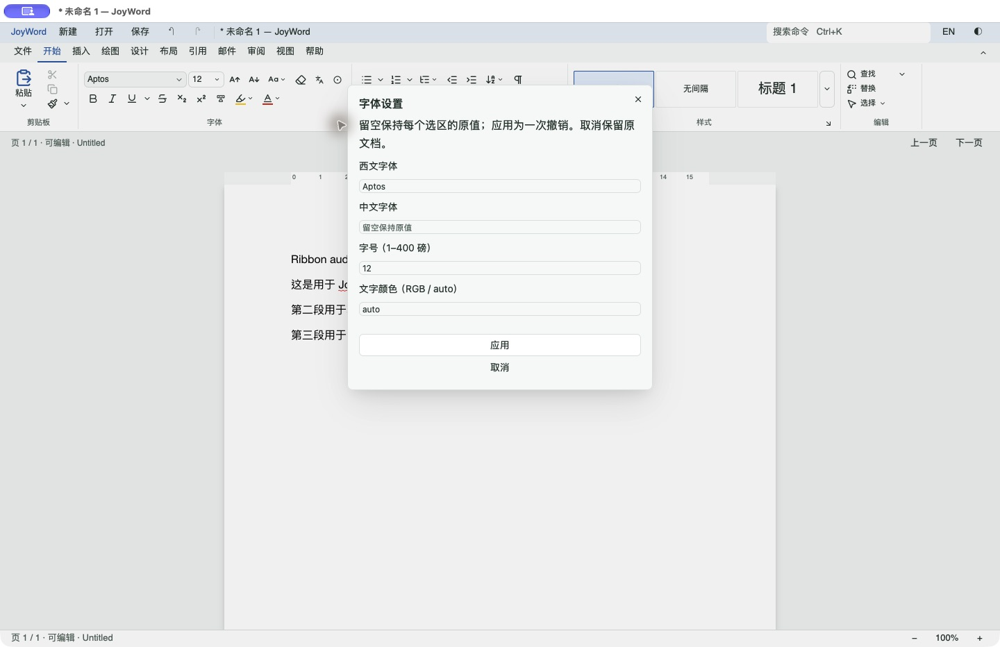
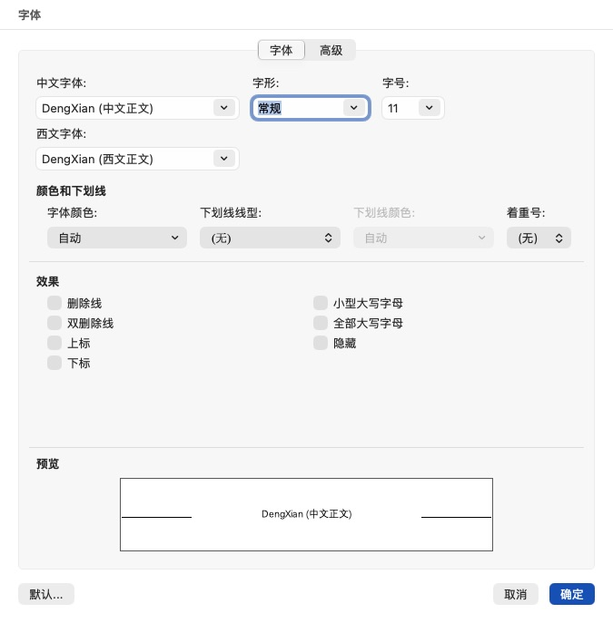
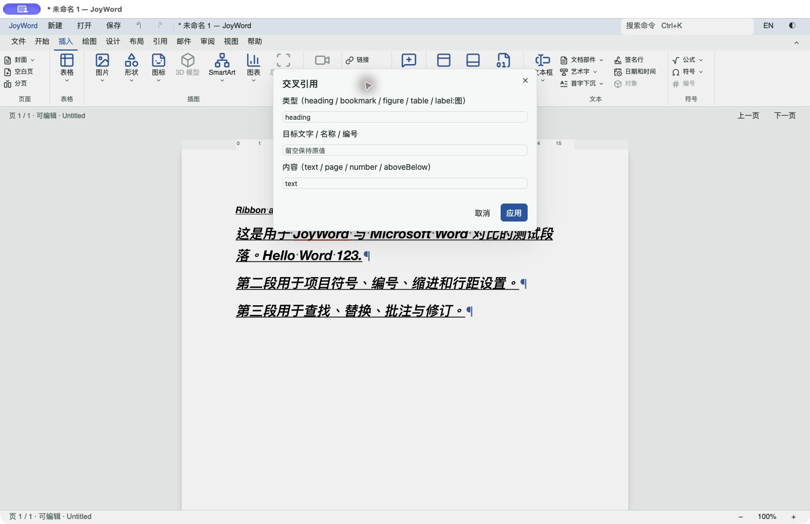
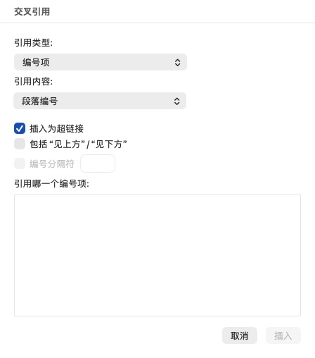
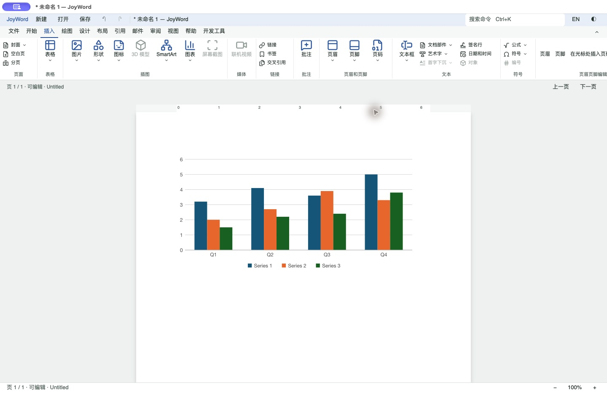

# JoyWord Ribbon 与本机 Microsoft Word 实机对比

日期：2026-11-17。范围：当前 JoyOffice 仓库的 JoyWord。目标：让已有 Word 使用习惯的用户切换后，不需要学习新的参数语法、寻找新的设置入口或重新理解同名按钮。

**结论：Ribbon 的分组和常用入口已接近 Word，基础编辑有实际生效证据；离“无额外学习成本”仍有明显距离。最应优先处理的是参数化表单、页眉编辑控件溢出、度量单位一致性，以及常用对象和管理型对话框的交互完整性。** 本轮只增加测试记录、截图和测试文档，没有修改产品代码、依赖或既有规格的完成状态。

## 环境与证据口径

| 项目 | 本轮环境 |
| --- | --- |
| 源码 | eb551e36622c32feaebcdb029d1b06abb26aea26；开始时 main 干净，与 origin/main 一致 |
| 记录分支 | feat/joyword-ribbon-native-audit；未提交、未推送 |
| JoyWord | 0.2.0；Rust 1.98.1；cargo build --locked -p joyword 成功；本机 debug 构建 |
| 运行隔离 | 临时 macOS 应用包装；独立 bundle id；JOYWORD_CONFIG_DIR 指向 /tmp/joyword-ribbon-audit-20261117/config |
| 对照软件 | Microsoft Word 16.115，完整版本 16.115.26110837 |
| 平台 | macOS 27.2.1 / 26B131，ARM64，中文应用界面 |
| 操作 | 原生窗口的鼠标点击、双击、右键、拖动、输入、粘贴、选项切换、应用/取消、保存和重开 |
| 样本 | 新建的中英文合成正文、空白文档、内置模板、2×2 表格、PNG 图片、墨迹、合成批注；JoyWord一条两字段记录，Word两条合成收件人记录 |

使用本轮新建的 Word 文档作为对照，没有编辑 Word 原先已经打开的文档。JoyWord 的主题、作者和单位测试均在隔离配置中进行。临时包装不等于正式签名发布包，因此原生窗口图标、系统文件面板语言和打包集成不作为正式包验收结论。两个应用窗口尺寸不同，本报告比较交互结构、字段、结果和可发现性，不进行像素级尺寸判定。

登记了 **15 个选项卡、376 个控件检查点**，其中 338 个已点击、切换或输入设置，38 个在所测状态禁用。文件页的“选项”“导出”和新建欢迎模板计入检查点；同一命令在不同选项卡的入口、主按钮与下拉箭头分别计数。这个数字是本轮登记的界面检查范围，不代表 376 项功能完整验收。

- [逐控件清单 TSV](control-checklist.tsv)：选项卡、控件名、控件类型、初始禁用状态、证据等级、截图路径。
- [逐控件清单 JSON](control-checklist.json)、[20条建议的结构化记录](findings.json)、[统计及边界](summary.json)、[原始操作前后 AX 记录](actions.json)。逐控件清单还标明了实际响应、Word对照深度和关联建议编号。
- [截图清单及 SHA-256](screenshots-manifest.json)：513 张采集图，其中 510 张纳入证据，96 张来自本机 Word，另有2张来自Word启动的Excel图表数据窗口。三张因操作定位/标题瞬态/弹窗未渲染被排除，不能作为通过证据。
- [保存后重新打开的测试 DOCX](fixtures/joyword-saved-session.docx)：含合成文字、格式、域和鼠标绘制的墨迹；不是未编辑基线。
- Word补测：[66次界面状态记录](word-followup-actions.json)、[补测截图索引](word-followup-contact-index.json)、[收件人数据源](fixtures/word-recipients.docx)、[邮件主文档](fixtures/word-mail-main.docx)、[两条记录合并结果](fixtures/word-merged-two-records.docx)。补测状态记录保存捕获时的AX，不是每次原子输入的完整日志。邮件主文档保留了原Word创建的临时目录数据源链接，不能据此视为可移植邮件包；合并结果是可独立查看的正文副本。

清单中的 CLICKED 仅表示点击入口并记录结果，可能是打开菜单、出现参数框、显示提示或执行命令；VALUE_APPLIED 表示四个布局输入框已输入并提交；TOGGLED 表示观察到开关值变化；DISABLED_OBSERVED 表示检查了当前禁用状态。**打开菜单不等于设置已经生效，空表格上的对齐点击不等于文字位置已验收，导出保存框出现不等于产物已验证。** 实际效果验证单列在下文。

## 逐选项卡步骤与结果

“已操作/禁用”统计本轮清单内的控件实例。状态描述是交互健康度，不是功能实现完成率。

| 步骤 | 选项卡 | 已操作 / 禁用 | 实机步骤和观察 | 健康度 |
| --- | --- | --- | --- | --- |
| 1 | 文件 | 45 / 0 | 新建/模板、打开页与原生选择器、保存/另存为、信息/恢复、关闭未保存提示；8 个主题、语言、用户单位及开发工具开关；逐项点开 15 种导出入口 | 主流程可达；选项和导出还有表单及包装层边界 |
| 2 | 开始 | 53 / 0 | 剪贴板、字体列表/字号、增减字号、B/I/U、删除线/上下标、大小写、拼音/圈字、颜色/效果、列表、缩进、排序、对齐、行距/边框、样式窗格、选择、查找/替换 | 基础格式和编辑有效；高级设置学习成本较高 |
| 3 | 插入 | 24 / 5 | 页面、表格网格、图片、形状/图标/SmartArt/图表、链接/书签/交叉引用、批注、页眉页脚/页码、文本/域/艺术字/日期、公式/符号 | 插入入口齐全度较高；对象后续编辑入口有缺口 |
| 4 | 绘图 | 17 / 4 | 绘图/选择/套索/橡皮擦、6 种笔、颜色粗细/添加笔、背景、形状转换、撤销重做及帮助；在页面实际拖动绘线 | 墨迹可绘制；高级工具禁用，参数框偏技术化 |
| 5 | 设计 | 15 / 2 | 主题、8 个设计预设、颜色/字体、段落间距、水印/页面颜色/边框；检查自定义参数 | 可操作；缺少与设置相匹配的直观选择和预览 |
| 6 | 布局 | 23 / 6 | 方向、边距、纸张、栏、分隔符、行号/断字；4 个数值框及8个加减按钮；选择窗格/对齐 | 数值输入生效；单位和复杂版式参数仍不统一 |
| 7 | 引用 | 22 / 0 | 目录/添加文字/更新，脚注尾注与设置，引文/源/样式/书目，题注/表目录/交叉引用，索引/引文目录及更新 | 入口可达；对象选择、格式设置和管理流程明显简化 |
| 8 | 邮件 | 21 / 1 | 先检查无数据状态，再新建 Name、City 两字段和一条记录；插入 Name 域、切换预览、导航/查找、编辑列表、规则/匹配域及完成菜单 | 数据加载后多项正确启用；列表和匹配流程需要改进 |
| 9 | 审阅 | 23 / 6 | 拼写/同义词/字数/语言、批注创建和导航、显示/筛选/审阅窗格、修订及接受拒绝入口、比较菜单、隐藏墨迹 | 批注与修订有实际结果；部分常用审阅能力禁用 |
| 10 | 视图 | 16 / 6 | 阅读/页面/Web/大纲/草稿、专注/沉浸、垂直、标尺/网格/导航、缩放/100%/单页/页宽、宏菜单 | 切换和缩放可见；多页与窗口功能存在明确差距 |
| 11 | 帮助 | 3 / 0 | 帮助、反馈、培训内容逐项打开 | 可达；培训和反馈交互较薄弱 |
| 12 | 开发工具 | 6 / 0 | 宏窗格、录制命名、录一条格式命令并停止、用户单位、MCP说明、导出副本参数 | 命令宏录制可见；语义与 Word VBA 宏不同 |
| 13 | 图片格式 | 23 / 4 | 调整、颜色/艺术效果/透明度/压缩/更换/重置，5种样式、边框效果、替代文字、位置/环绕/选择/对齐/旋转、裁剪/尺寸 | 尺寸和样式有实际结果；裁剪及尺寸设置不够直观 |
| 14 | 表设计 | 17 / 1 | 6个样式选项、7种可见样式、更多样式、底纹/边框/边框参数 | 可切换；本地化和参数型边框设置需优化 |
| 15 | 表布局 | 30 / 3 | 选择/属性、删除菜单、四向行列插入、合并/拆分、自动调整/高度宽度/分布、9种对齐、方向/边距、排序/标题行/转文本/公式 | 行列和整表合并可见；尺寸与属性对话框仍需完善 |

376 个登记点均有点击/设置或禁用状态记录。下拉菜单的后代选项以检查内容和代表性应用为主，没有穷举每种预设、每个数值、每种选区、每种文档状态的组合。

### Word控制恢复后的补测

用户确认Word正常可操作后，重新绑定应用，界面读取与操作恢复。以下是实际补做的步骤；不把原先的控制超时解释为Word产品故障。

| 步骤 | 对照流程 | 操作及可见结果 | 证据 |
| --- | --- | --- | --- |
| 1 | 邮件设置与数据 | 打开信封/标签、合并类型、收件人菜单；字段编辑器可增删和排序。创建本地数据源，逐字段填写两条记录，列表项编辑器可增删、前后导航和查找 | wf03 / wf04 / wf05 / wf07 / [记录编辑器](screenshots/wf55-recipient-record-editor.png) / wf56 |
| 2 | 邮件预览与合并 | 插入“姓名”域，预览Audit One，下一条变为Audit Two；打开筛选/排序设置并取消；“编辑单个文档”生成两页，第二页实屏为Audit Two。原生保存后，DOCX XML含Audit One与Audit Two | [第一条](screenshots/wf58-merge-preview-first.png)、[第二条](screenshots/wf59-merge-preview-second.png)、wf60 / wf61 / wf62 / [第二页](screenshots/wf64-merge-second-page.png)、[产物](fixtures/word-merged-two-records.docx) |
| 3 | 表格属性与设置 | 插入2×2表格并逐格输入；检查表格设计/布局、表/行/列/单元格四页属性，以及单元格选项/表格边距、拆分、公式和转文本对话框。列宽显示当前7.32厘米，边距显示当前0/0.19厘米；设置检查后取消 | wf14 / wf15 / [属性](screenshots/wf16-table-properties.png)、wf17 / wf18 / wf19 / wf20 / wf21 / wf22 / wf23 / wf24 |
| 4 | 图片裁剪与格式 | 插入与JoyWord相同的PNG；点击裁剪出现黑色把手，鼠标拖动右边后宽度14.66→12.42厘米。检查压缩质量/删除裁剪区/作用范围，以及格式窗格 | [裁剪把手](screenshots/wf26-picture-crop.png)、[拖动结果](screenshots/wf27-picture-crop-drag.png)、[压缩](screenshots/wf28-picture-compress.png)、wf29 / wf30 |
| 5 | 形状、SmartArt和图表 | 拖出矩形后出现形状格式命令；插入基本流程后出现SmartArt文本窗口及设计命令。插入柱形图后出现图表设计、“选择数据”及Excel编辑入口；在Excel把B2改为9，回到Word后复核第一系列第一点为9 | wf31 / wf33 / wf34 / [形状上下文](screenshots/wf39-shape-context.png)、wf35 / [数据源](screenshots/wf36-chart-select-data.png)、wf37 / [回写结果](screenshots/wf54-chart-data-update-verified.png) |
| 6 | 页眉与审阅 | 编辑页眉出现专用Ribbon和可见的“关闭页眉和页脚”，点击后返回开始页。打开字数/语言，创建本地批注；启用修订后插入TRACK-AUDIT，再拒绝，复核正文中该文字消失；比较菜单检查后取消 | [页眉上下文](screenshots/wf41-header-context.png)、wf42 / wf10 / [语言](screenshots/wf11-proofing-language.png)、wf43 / wf44 / wf45 / wf47 / [拒绝结果](screenshots/wf53-revision-result.png) |
| 7 | 视图与宏 | 打开缩放对话框；单页和页宽分别显示108%和199%，有可见缩放变化；宏主按钮打开含位置选择、管理器、运行/编辑等控件的对话框。窗口尺寸与Joy不同，不比较适配百分比是否相等 | wf12 / wf49 / wf50 / [宏](screenshots/wf51-macro-dialog.png) |

Word的形状/SmartArt中文文字输入尝试没有得到预期内容，未标记文字编辑通过，也不据此判断Word不支持该功能；本轮可确认的是编辑入口与上下文的存在。Word表格九种对齐和尺寸的逐项生效、图片所有特效、合并筛选条件及宏实际运行仍未穷举。

## 有实际效果证据的操作

| 操作 | 本轮看到的结果 | 证据 |
| --- | --- | --- |
| 选择正文并点击加粗、倾斜、下划线；字号设为18并应用 | 选区文字的格式和排版发生改变，字号显示18 | [字号应用](screenshots/j09-font-18-applied.png)；j05/j06/j07 |
| 复制、剪切、粘贴合成正文 | 剪切后正文清空，粘贴后恢复；不能据此推断所有富文本互操作已通过 | [剪切](screenshots/jh-cut.png)、[粘贴](screenshots/jh-paste.png) |
| 查找 Test 并列出匹配；替换为 Sample | 列出2处，全部替换显示“已替换2处”，正文变为 Alpha Sample / Beta Sample | [查找结果](screenshots/j20-find-results.png)、[替换结果](screenshots/j21-replace-confirmation.png) |
| 布局的左/右缩进、段前/段后输入后回车；加减按钮 | 输入值1.5、0.5、12、6被显示；加减分别改变缩进和间距 | jl-input-left/right/before/after；jl-left-plus 等 |
| 插入2×2表格，再点四向行列插入 | 表格变为4×4；表格转文字后可撤销恢复 | [行列结果](screenshots/j23-table-4x4-result.png)、jt-to-text |
| 选择整张2×2表格，点击合并单元格 | 四格合并为一格；另记录了未多选时的英文提示 | [成功合并](screenshots/j65-table-merge-all-cells.png)、[未多选提示](screenshots/jt-merge.png) |
| 插入PNG，将宽度改为144磅并保持比例 | 图片尺寸明显缩小；框架/圆角/阴影等也出现视觉变化 | [尺寸结果](screenshots/j25-picture-resized.png)、jp-thick-frame 等 |
| 黑色笔鼠标拖动 | 页面出现斜线，保存重开后仍可见 | [绘图](screenshots/j14-ink-drag.png)、[重开](screenshots/j63-saved-document-reopened.png) |
| 新建批注，开启修订后输入文字 | 批注窗格显示作者和内容；新增文字出现修订颜色和侧线；接受后标记消失 | [批注](screenshots/j27-comment-created.png)、[修订](screenshots/j28-tracked-change.png)、jv-accept |
| 两字段一条记录，插入 Name 域并开启预览 | 域显示由 «Name» 切换成 Audit One | [字段](screenshots/j31-merge-two-fields.png)、[预览](screenshots/j33-merge-preview-on.png) |
| 录制 AuditMacro，执行一次加粗后停止 | 宏列表出现 AuditMacro，窗格显示1条格式命令 | [录制结果](screenshots/j36-macro-recorded.png) |
| 单页、页宽、专注、网格和导航 | 缩放显示54%/173%；专注隐藏工具栏且Esc返回；网格和导航显示 | jw-one-page / jw-page-width；[专注](screenshots/j34-focus.png) |
| 选择信函模板；原生保存并从最近文档重开 | 信函正文创建；已保存的测试正文、格式、域及墨迹可重新显示 | [模板](screenshots/j64-letter-template-verified.png)、[保存重开](screenshots/j63-saved-document-reopened.png) |
| 进入页眉编辑后直接输入 | Header actual 位于正文上方，正文仍在；点击正文会退出该编辑状态 | [页眉输入](screenshots/j59-header-typed.png) |

## 差异与优化建议

下表区分：**双端已观察**（本轮两个软件均有实屏/AX证据）、**JoyWord 已观察**（JoyWord现象明确，但Word对应深层路径未完成本轮操作）、**能力范围差异**（明确禁用或界面文字声明的范围）。优先级P1表示优先解决日常切换摩擦，P2表示后续完善；不是对未测试底层实现的缺陷定级。

| 编号 / 优先级 | 现象与对照 | 对用户的影响与建议 | 本轮证据 |
| --- | --- | --- | --- |
| RIB-01 / P1 | 双端已观察：JoyWord将对齐、线型、类型、布尔值、作用范围等放在普通输入框，提示要求填写 center、shrink、heading、aboveBelow、exact:磅 等；Word对应对话框使用选择控件、复选框和预览 | 先把所有有限枚举改为中文下拉/单选，布尔值改为复选框，尺寸使用带单位的数值框。内部参数不应成为用户必须掌握的语法 | [Joy圈字](screenshots/jh-enclosed.png)、[Word圈字](screenshots/wh-enclosed.png)、[Joy交叉引用](screenshots/j12-cross-reference-dialog.png)、[Word交叉引用](screenshots/wi-cross-reference.png) |
| RIB-02 / P1 | 双端已观察：JoyWord页眉编辑控件追加在插入Ribbon末尾；1440×936窗口中关闭入口在右边界之外，横滚未露出，点击后仍处于页眉编辑。Word提供专用页眉页脚Ribbon，可见关闭按钮点击后返回正文 | 为页眉页脚提供可见、固定的关闭入口和专用上下文区域；Ribbon窄化时折叠分组/显示溢出箭头，不能依赖不可见按钮 | [Joy溢出](screenshots/j53-header-edit.png)、[横滚后](screenshots/j54-header-ribbon-scroll.png)、[关闭未生效](screenshots/j60-header-close-offscreen-noop.png)、[Word上下文](screenshots/wf41-header-context.png)、wf42 |
| RIB-03 / P1 | 双端/同端已观察：JoyWord布局区遵从厘米/英寸偏好，但段落、表格、图片面板仍固定磅；切到英寸后同一缩进在布局为0.59，在段落为42.52。Word段落面板明确显示字符/行/磅等语义单位 | 统一长度类字段的偏好和单位转换；缩进应可选字符/厘米等，特殊缩进用“首行/悬挂+数值”。限制展示小数位，保存内部精度 | [英寸布局](screenshots/j43-units-inches.png)、[固定磅弹窗](screenshots/j44-paragraph-still-points.png)、[Word段落](screenshots/w03-paragraph-dialog.png) |
| RIB-04 / P1 | 双端已观察：JoyWord macOS界面仍标Ctrl+B/Ctrl+K/Ctrl+F1；原生菜单仅应用菜单和View。Word有文件、编辑、插入、格式、工具等原生菜单，搜索提示使用Cmd体系 | 做平台命令映射和一致的显示名称，补齐标准菜单入口；本轮没有证明所有Cmd绑定失效，需逐条验证后再改快捷键行为 | [Joy开始](screenshots/j02-home-text.png)及同名AX；[Word开始](screenshots/w01-home.png)及AX |
| RIB-05 / P1 | 双端已观察：Joy字体设置只有西文/中文字体、字号、RGB/auto文本框；Word字体框包含字形、下划线、效果、高级页和预览。此机新建文档的字体/字号栏分别为Joy的Aptos 12与Word的等线11；这是当前本机默认值，不是所有Word的统一标准 | 建立一个完整字体对话框，读取当前/混合值，支持字体和颜色选择、效果组合、预览、确定/取消；提供兼容默认样式/模板选项，保留Ribbon快速入口 | [Joy字体](screenshots/j03-font-dialog.png)、[Word字体](screenshots/w02-font-dialog.png) |
| RIB-06 / P1 | 双端已观察：Joy主题/颜色多为少量文字菜单，字体颜色和突出显示也只有少量固定项；Word主题菜单是带名称的视觉库。完整Word颜色面板本轮未深测 | 增加视觉主题/颜色样本、当前项、最近色和自定义色入口；对更改前的效果给出预览，不要求用户记RGB | jd-theme / jd-colors / jh-font-color；[Word主题](screenshots/wd-theme.png) |
| RIB-07 / P2 | 双端已观察：中文Joy更多样式中出现Heading 3、Title、Subtitle等，样式窗格直接显示Normal等内部名；Word库显示中文样式名。Joy表格样式也多为英文 | 分离内部样式ID与本地化显示名；按Word用户熟悉的名称和层级组织。字体搜索框Search...和英文错误也一起本地化 | [Joy样式](screenshots/jh-styles.png)、[Joy窗格](screenshots/jh-styles-pane.png)、[Word开始](screenshots/w01-home.png)、[英文错误](screenshots/jt-merge.png) |
| RIB-08 / P1 | 双端已观察：正文“排序”在Joy仅提供升序/降序；Word显示排序依据、类型、三个关键字和选项 | 保持同名功能的预期：先显示排序字段、文本/数字/日期或中文排序类型、标题行及预览/确认。选区条件不满足时解释原因 | [Joy排序](screenshots/jh-sort.png)、[Word排序](screenshots/wh-sort.png) |
| RIB-09 / P1 | 双端已观察：Joy书签只有名称输入；Word有书签列表、名称/位置排序、定位、添加和删除 | 书签应是管理器，可看见现有项、跳转、重命名/删除，并验证名称；不能让用户靠记忆输入既有名称 | [Joy书签](screenshots/ji-bookmark.png)、[Word书签](screenshots/wi-bookmark.png) |
| RIB-10 / P1 | 双端已观察：交叉引用要手输类型和目标；引文要先知道来源标记。Word交叉引用提供类型/引用内容和目标列表，插入引文可进入创建源；Word索引/图表目录有格式和预览，Joy插入索引会直接写入Index标题 | 从文档实际对象生成目标选择器，显示可插入项、空状态和结果预览；整合“新建源→引用→管理源”。目录/索引应提供常见格式与应用范围 | ji-cross-reference / jr-citation / jr-index；wi-cross-reference / wr-citation / wr-figures / wr-index |
| RIB-11 / P2 | 双端已观察：Joy日期时间要输入yyyy-MM-dd，自动更新的默认值是false；Word列出真实日期样式，自动更新为复选框 | 用本地化日期预览列表和复选框；自定义格式作为高级入口，避免最常见操作先学习格式代码 | [Joy日期](screenshots/ji-datetime.png)、[Word日期](screenshots/wi-datetime.png) |
| RIB-12 / P1 | 双端已观察：Joy新建收件人要输入字段CSV和记录CSV；匹配域展示映射JSON，无对应编辑控件。Word使用字段列表和逐记录表单，可增删、调整字段顺序及导航，预览两条记录并合并为两页成功。Word字段匹配深层界面仍未验证 | 提供字段列表与可编辑记录表格/表单、增删行列、导入预览、中文字段匹配下拉和错误定位。完成按钮应解释输出范围和结果，不能只展示内部映射 | [Joy新列表](screenshots/j29-new-recipients.png)、j31 / j33 / jm-match；[Word字段](screenshots/wf07-new-recipient-list.png)、[记录](screenshots/wf55-recipient-record-editor.png)、wf58 / wf59 / wf64 |
| RIB-13 / P1 | 双端已观察：Joy形状/SmartArt/图表插入固定初始对象后，本轮选择、双击图表、右键未找到相应编辑数据/布局或上下文Ribbon。Word有形状格式、SmartArt文本/设计、图表设计和数据源入口；通过Excel把图表值4.3改为9，Word实屏与AX复核更新。不能据此断言Joy底层永远不可编辑 | 每个插入对象都应有清晰的下一步：形状尺寸/填充/文字，SmartArt文字和层级，图表数据/类型/系列。选择对象后显露上下文命令 | j46 / j48 / j50 / j51；[Word形状](screenshots/wf39-shape-context.png)、wf31 / wf33 / wf35 / wf36 / [图表回写](screenshots/wf54-chart-data-update-verified.png) |
| RIB-14 / P1 | 双端已观察：Joy表格属性/宽高/边距多字段空白，只提示留空保持原值；边框和排序参数要求英文关键字。Word属性按表/行/列/单元格分页，显示当前列宽7.32厘米、边距0/0.19厘米，并用复选框、单选和下拉控制跨页、对齐及尺寸约束 | 读取并展示当前表/行/列/单元格值和混合值，按对象范围分组；提供可选择的对齐/跨页/标题行、带单位的尺寸和边框预览 | [Joy属性](screenshots/jt-properties.png)、jt-margins / jtd-border-style；[Word属性](screenshots/wf16-table-properties.png)、wf17 / wf18 / wf19 / [边距](screenshots/wf21-table-options.png) |
| RIB-15 / P1 | 双端已观察：Joy裁剪是四个百分比框；尺寸显示451.28003等磅值，锁定比例是“是/否”文本框。Word提供鼠标裁剪把手、厘米宽高和比例复选框，拖动裁剪后宽度14.66→12.42厘米。Joy宽度144磅应用成功，不把不直观误记成设置无效 | 增加鼠标裁剪把手/裁剪预览、边界和重置；宽高遵从单位偏好，合理舍入显示，比例用复选框；压缩应解释分辨率与质量及作用范围 | [Joy裁剪](screenshots/jp-crop.png)、jp-size / j25；[Word裁剪](screenshots/wf26-picture-crop.png)、wf27 / [压缩](screenshots/wf28-picture-compress.png) |
| RIB-16 / P1 | 能力范围差异：Joy多页、新建窗口、全部重排、拆分、切换窗口等禁用，其中提示明确说尚未接入；本机Word视图页相应入口可用。Joy已有Web/草稿/大纲等视觉变化，不能当作完全无效果 | 优先补齐并排/多页阅读和文档窗口能力；将未提供与“缺少前置条件”分开解释。对各视图另做任务级验证，尤其大纲编辑和重排 | [Joy视图](screenshots/j13-view.png)、[Word视图](screenshots/wtab-%E8%A7%86%E5%9B%BE.png)、jw-web / jw-draft / jw-outline |
| RIB-17 / P2 | 能力范围差异/双端语言设置已观察：Joy朗读、辅助功能、翻译、简繁、保护等在所测文档禁用；Word审阅页相应多项有入口，焦点在批注中时也可能条件禁用。Joy校对语言要求zh-CN/en-US，Word提供中文语言名称列表及自动检测/不检查复选框 | 校对语言改为可搜索语言列表；先完成高频校对/批注/修订任务，再按明确支持范围补齐能力；禁用提示应说明具体原因及可行替代路径 | jtab-审阅 / wtab-审阅；[Joy语言](screenshots/jv-proofing-language.png)、[Word语言](screenshots/wf11-proofing-language.png)、jv-spelling / jv-thesaurus |
| RIB-18 / P2 | 能力范围差异：Joy宏窗格说明仅本会话保存、支持文档命令、不执行VBA/文件/网络；录制一条命令成功。Word宏对话框有活动模板/文档位置、管理器及运行/编辑控件；本轮没有运行或创建VBA宏，不能把两个同名入口等同于宏兼容 | 在命名和说明中明确“命令宏”的范围；提供持久化、编辑和导入导出计划，单独定义VBA文档的提示/保留契约，避免同名误导 | [Joy宏](screenshots/j35-developer-after.png)、j36；[Word宏](screenshots/wf51-macro-dialog.png) |
| RIB-19 / P1 | AX已观察：Joy B/I/U、修订及部分视图只是普通button，无selected/on/off；字体列表项是无名称container；Word多项为带Value的开关或库项 | 开关使用正确角色和状态；为字体候选、菜单项和弹窗提供可读名称、标题和当前值；验证键盘焦点与返回正文。此项是可访问性风险，不是完整读屏/WCAG验收 | j05-bold.txt / jh-font-picker.txt / j28-tracked-change.txt；w01-home.txt / wtab-审阅.txt |
| RIB-20 / P2 | JoyWord已观察：培训入口主要是简短入门文字，反馈框是版本与URL文字；多种参数框含中英双语技术提示。临时包装的原生面板显示英文，尚需正式包复核 | 统一中文文案、确认/取消位置和错误格式；让帮助直接定位当前命令，反馈链接可操作；常见动作首次使用时给简短任务提示 | jhelp-help / jhelp-training / jhelp-feedback；[原生保存](screenshots/j16-save-dialog.png) |

### 最值得先做的改进

1. **统一交互控件与单位（RIB-01/02/03/04/19）**：下拉、复选框、数值框、混合值、单位转换、平台快捷键、选中状态和Ribbon溢出一次形成公共规则。以“用户不输入英文枚举或布尔字符串，就能完成常用格式/段落/页边距设置”为验收条件。
2. **完成高频对话框（RIB-05/08/09/10/14/15）**：优先字体、段落、书签/交叉引用、表格属性、图片裁剪；先显示当前值和可选对象，再提供预览、确定、取消与一次撤销。不要仅追求按钮位置相似。
3. **完成对象与邮件的后半程（RIB-12/13）**：确保插入后能编辑，而非只有默认对象；收件人使用表格和字段映射界面，并用两条以上记录验证实际导航和输出。
4. **再补能力与本地化（RIB-06/07/11/16/17/18/20）**：区分平台布局差异、功能范围差异与缺陷。macOS Word没有JoyWord式“文件”标签，不能把Windows后台页的像素相同当作本机无缝切换标准。

## 关键截图对照

字体设置：JoyWord当前需要输入参数；本机Word有组合控件、效果和预览。

| JoyWord | Microsoft Word |
| --- | --- |
|  |  |

交叉引用：JoyWord手填目标；本机Word先选择引用类型、内容和文档内对象。

| JoyWord | Microsoft Word |
| --- | --- |
|  |  |

已复现的页眉Ribbon溢出：右侧关闭入口不可见。

## 未完成的验证和应排除的误判

- **控制超时已恢复，不能归为产品故障**：先前Word的CUA读取/截图/Esc连续返回 -10005；用户确认Word正常后，重新绑定恢复，补做上表7组流程。图表“选择数据”又使Word绑定超时，但应用清单显示Excel已启动；选中Excel后成功读取数据源对话框并完成回写复核。两次超时均无Word崩溃证据，没有强退应用。
- **条件性禁用**：邮件的编辑收件人/合并域/预览/导航/完成在加载数据后启用，不列为功能缺失；布局排列在无对象时禁用，也不作为缺陷。更新标签在本轮选标签合并类型后仍禁用，完整标签生成链未完成，保留为待验条件项。
- **对象验证深度**：Joy选择、双击和右键未找到可见对象编辑入口，不宣称底层编辑能力不存在。Word已补做上下文和图表值回写；形状/SmartArt文字输入尝试没有得到预期中文内容，未标记通过；两端对象保存重开与双向DOCX往返仍未验证。
- **正文和页眉状态**：点击“文档正文”会返回正文，不能把随后输入的文字误认成页眉写入失败。初次复核因该点击改变编辑位置被排除；直接在页眉模式输入的后续截图证明页眉文字可以出现。本轮没有确认正文丢失。
- **输入和捕获误差**：Joy收件人初次逐键输入未保留逗号，随后粘贴并核对值，成功得到Name/City，不归为CSV解析缺陷。Word中文逐键输入也出现内容不完整；本轮批注实际内容为“ UI ”。原生保存文件名输入发生前缀保留，最终按实际保存文件取证，不视为产品故障。三张截图已标rejected；新增一张Word警告截图未渲染，保留AX但排除视觉结论。
- **AX不是唯一结果依据**：Word合并后的第二页实屏为Audit Two，AX却重复返回Audit One；DOCX XML已独立确认两条不同记录。Word图表首次返回仍显示旧值4.3，后续重新选中文档才更新为9；使用最终截图与AX作为回写成功证据。不能只靠单次AX就判断正文/对象结果。
- **保存边界**：一个合成DOCX完成原生保存、应用内读回提示和从最近文档重开；原生面板的若干路径/文件名输入尝试未稳定，不据此声称文件面板存在普遍输入故障。正式包/其他路径/系统关联未验。
- **未穷举**：各样式/调色/形状库的所有预设、全部参数合法值/非法值、混合选区、多节、长文档、复杂嵌套对象、对象跨应用剪贴板及完整双向DOCX往返均未在本轮穷举。
- **尚未落盘校验的操作**：所有Joy导出入口已点击，但没有逐格式生成和独立读回产物；Joy邮件最终输出、真实打印、宏重启后持久化、所有修订拒绝/接受范围组合未验。Word两条邮件合并已生成并保存，包内XML核对通过，但未做双端邮件输出兼容性验收。Joy空单元格九宫格对齐不能替代有内容单元格的排版验证。
- **平台与辅助技术**：只有本机macOS实屏；不是Windows、Linux、信创真机验收。未做真实读屏、完整键盘焦点遍历、中文IME、触控笔、高DPI矩阵或完整WCAG检查。debug构建不用于性能结论。

## 后续对照验收用例

建议每条用同一份新DOCX、相同字号/字体/页面设置，在两个软件各完成一次；每一步保存截图与结果，再以保存重开和一次撤销核对，而不是只勾选按钮已存在。

| 用例 | 必须覆盖的动作与结果 |
| --- | --- |
| 常用排版 | 鼠标选中混合格式文字→字体/字号/颜色/段落设置→取消与确认→恢复正文焦点→一次撤销→保存重开；全程不用参数关键字 |
| 版式 | 厘米/英寸切换→页边距/首行或悬挂缩进/分栏→本节与整篇范围→重开；确认数值、单位和实际页面效果一致 |
| 表格 | 有多行内容的单元格→9种对齐/高度/宽度/边距→选择行列/合并拆分/标题跨页→保存重开；与Word逐项对照 |
| 图片与对象 | 鼠标裁剪/锁定比例/旋转/环绕→替代文字→更换与重置；形状文字、SmartArt层级和图表数据可继续编辑 |
| 引用 | 创建/跳转/删除书签→选择标题或题注交叉引用→更新；插入引文→创建与管理源→目录/索引格式设置 |
| 审阅 | 批注创建/回复/编辑/解决/删除；修订插入/删除→上一处/下一处→逐条及全部接受/拒绝→保存重开 |
| 邮件 | 至少两条中文/英文记录和带引号的CSV→字段匹配→预览与前后导航→筛选/排序→合并新文档→独立重开核对 |
| macOS习惯 | 标准菜单与快捷键、选中/禁用状态、Esc/回车/Tab、关闭页眉、窄窗口溢出，均可通过鼠标和键盘完成 |

## 本轮交付验证

产品代码未改动，因此没有声称Rust测试、fmt、clippy或跨产品回归在本轮重新通过。当前源码的JoyWord本机构建成功；人工界面操作与上述效果核对已记录。文档检查、清单/截图路径和DOCX包完整性检查的结果见 [交付检查记录](delivery-checks.json)。本报告不会将点击覆盖写回实现账本的done状态。
