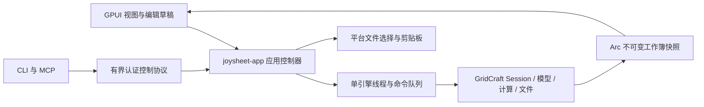

# Joysheet 架构

`Session` 只存在于 `joysheet-engine` 线程。UI 通过 `submit` 和非阻塞 Ticket 轮询获取结果，CLI/控制服务在工作线程等待结果。队列最多 256 条；快照带序列、窗口、文档和修订身份。旧快照保留 Arc 工作簿，不会被后续写入改变。编辑提交使用修订保护，并核对原单元格内容和工作表身份。

UI 以一个真实文本控件覆盖当前单元格，另一个控件作为公式栏，两者共享草稿；未提交文本不进入引擎。GPUI 的 IME 预编辑没有普通 Change 事件，因此额外观察 marked text。工作表专用按键上下文覆盖输入控件的表格导航键，编辑时仍保留文本光标操作。

网格通过自定义 `Element` 绘制。共享几何使用稀疏 `LineIndex` 和 f64 全局位置，投影到局部 f32 绘制坐标；绘制、选区、冻结、编辑框和命中使用同一布局。GPUI 文字布局由框架缓存；条件格式和图表布局按文档修订失效。当前几何在文档修订变化时重建，大量自定义行尺寸下的增量优化仍须基准指导。

自动列宽使用独立 `WindowTextSystem` 的测量闭包和有界缓存；引擎不等待 UI 线程。图表沿用 `gridcraft-chart` 的布局和绘图指令，由 UI 层适配为 GPUI 路径、图元和文字。

`joysheet-protocol` 不依赖 GPUI。控制仅在传入 `--control PORT` 后启用，绑定 IPv4 回环，使用随机 token、最大 8 个连接、64 条 UI 请求、8 MiB 请求行和 1 MiB 输入预算。截图最多 4 个并发请求，等待当前快照绘制完成后读回真实 GPU 图像；CPU 绘制采样与 GPU 呈现指标分别记录。

平台服务和配置位于 `joysheet-platform`。设置默认保存在 Windows 的 `%LOCALAPPDATA%\Joysheet`，可用 `JOYSHEET_CONFIG_DIR` 隔离测试。桌面窗口共享偏好设置和富剪贴板所有权；文档数据共享引擎快照，滚动和草稿留在各自视图。

M8 的系统打开/本地文件 URL 和拖入共用受限路径队列；先经应用生命周期提交目标草稿，再打开已存在且扩展名受支持的文件。设置经 SharedPreferences 同步到各窗口；平台配置目录使用系统约定路径。

恢复服务在专用有界后台线程中序列化不可变 Workbook 快照与各视图草稿，原始文件不受影响。恢复时经 `file.open` 创建独立未保存文档，遵循原有脚本信任规则；草稿仍由 UI 持有。文档关闭使用关闭标记保护序列化/重命名阶段，阻止已关闭文档被排队写入复活。错误通过 UI 提示，恢复文件有尺寸/扫描数量限制。

警告/信息验证的确认留在 UI 模态状态，绑定原草稿和文档修订；确认后由应用 worker 再校验并执行原 `cell.set`。停止型验证不接受绕过。虚拟网格按可见单元格向 AccessKit 输出节点，避免为整张表创建控件；这只是接入基础，真实读屏验收仍开放。

Windows 窗口排列在 joysheet-platform 使用 winsafe 安全 API 包装，校验句柄属于当前进程，仅移动登记的已有窗口，不重建视图；引擎仍只负责返回排列请求。窗口身份、独立草稿和共享不可变工作簿快照保持原架构。

UI 复杂文字使用后台系统字体数据库和有界 SVG 字体轮廓缓存（128 块/16 MiB），复用 usvg 将旋转中文/形状整对象字体转为路径；普通文字继续使用 GPUI 字形缓存。系统字体不分发。复杂图案和虚线先裁剪再展开；对象绘制、选框与命中共用冻结象限裁剪。

多对象操作通过应用私有批处理调用原命令，使用 Session.grouped 保证一次撤销和失败回滚；不向导入核心添加 GPUI 或平台依赖。键盘捕获仅在无编辑草稿且焦点位于表格输入层时接管导航动作；真正编辑时保留输入控件光标和组合态。参数表单重建后聚焦实际可见输入实体，确保 Esc/快捷键继续传递。

原生激活使用共享意图/确认状态，关闭 HWND 临时激活旧窗口时不覆盖新文档意图。应用私有激活通知在单引擎队列核对先前活动窗口，拒绝过期通知；原核心 window.activate 命令保持不变。

W5–W8：IME 生命周期保护检查两个真实输入状态，几何/DPI 变化调用 GPUI 的候选坐标失效接口；候选诊断复用 EntityInputHandler 的 UTF-16 排版。虚拟辅助功能节点共用生产冻结/合并裁剪，边界乘实际 DPI；原生 UIA 的 Focus/Click 经原命令和草稿提交选择单元格。辅助功能只在需要时生成可见节点并公布完整逻辑行列数。

打印预览绑定文档、工作表、修订和代次；关闭使异步结果失效。原生对话框独立持有 Arc<PrintDocument>，晚到结果不会更新较新的预览。WPF 使用驱动 imageable area 和用户页码生成分页，PNG 单页/累计内存有预算，辅助进程监听宿主退出；实际队列和物理设备不由离线 XPS 测试代替。

Windows 性能专项：引擎在快照及 Ticket 回复可见后，用每窗口容量 1 的异步通知唤醒 GPUI，合并积压通知且不阻塞引擎。16 ms 定时器继续处理控制队列、拖选和恢复检查，Ticket 仍非阻塞读取。SheetGeometry 按文档/工作表/revision 缓存已用末端，绘制和滚动条命中共用该缓存；版本变化保守重建以覆盖清空、撤销和公式溢出。恢复服务仅缓存已成功保存的版本和草稿元数据，不持有历史 Workbook；相同快照跳过写入，失败保留重试。诊断按请求及文档版本关联提交到首次匹配 CPU 绘制，并分别暴露引擎/布局/文字/绘制阶段，见 PERFORMANCE.md。

M8-preview5：CellStore 在 64 行 COW 块上缓存范围和保守公式标记，缓存不序列化也不参与内容相等比较；单列查询使用直接查找。求值 pass 最多复用 64 个已验证常量区域的完整 SUM 数值，输入仍按原顺序求值；多参数、公式/溢出/迭代/错误路径保持原逻辑。线程局部重算采样由应用 worker 逐命令启动/结束，WASM 不启用原生时钟。
