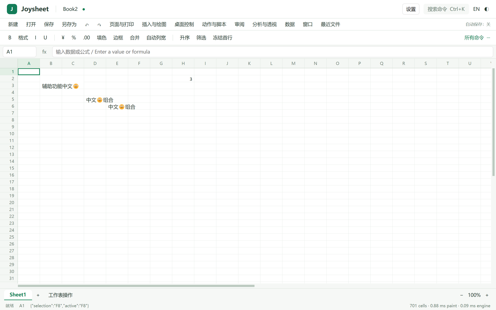

# Windows 几何与复杂重算专项（M8-preview5）

范围：Windows x64 Release；macOS/Linux 和签名继续跳过。原始来源哈希保留，核心的行为兼容优化在 UPSTREAM-PATCHES.md 单列。

| ID | 任务 | 当前结果 |
| --- | --- | --- |
| Q1 | 重算分段采样与可复现基线 | 已实现线程局部的依赖/求值/写回/范围读取/已用范围/行高采样，应用/UI/计算回归通过；Release 已运行并通过低依赖、聚合、条件聚合、乘积、嵌套和依赖扇出检查；见 [Q1 采样](evidence/Q1-performance.json)、[原生报告](evidence/Q1-native.json) |
| Q2 | 已用范围的分块缓存 | 已实现分块范围缓存，新增 extentMs/dimensionsMs；保留清空、撤销、COW 快照和序列化语义，152 项模型/计算/应用/UI 测试通过；Release 构建及原生编辑/滚动/SUM 回归通过，见 [Q2 采样](evidence/Q2-performance.json)、[原生报告](evidence/Q2-native.json) |
| Q3 | 范围内公式定位与复杂重算 | 已实现空公式块索引、单列一次查找、同一 pass 内纯常量 SUM 完整结果复用；兼容测试、完整 CI 1,387 通过、前版 CLI 差异与原生性能复核通过；保持求值和错误顺序，52 项 Windows 串联回归通过 |
| Q4 | 最终回归和测试包 | 已完成：1,387 测试通过、1 忽略；普通桌面/WASM 检查、前版差异、解压包 52 项原生串联、包内独立脚本、打印宿主退出和安装/运行/安全卸载通过；M8-preview5 三种包已生成 |

`ui.perf` 新增 recalcMs/dependencyMs/evaluationMs/writebackMs/rangeReadMs/usedRangeMs/rowFitMs，原始编辑同时附带 formulasEvaluated/rangesRead。`engine.profile` 的 timing.calculation 提供同样字段。每个命令独立清零，线程局部收集不污染其他会话；普通核心调用不启用收集，WASM 不读取原生时钟。范围读取包含其内部按需求值，重算包含求值/写回，不能叠加这些嵌套阶段。

基准继续用 10k/100k ×20 CSV，60 次滚动、5 次预热、30 次低依赖编辑和 10 次 SUM。新增 `-FormulaCases` 各执行 10 次 SUMIFS、SUMPRODUCT、嵌套 SUM，以及 8 个大范围聚合加下游汇总的依赖扇出；每种场景核对真实结果、采样数量及版本关联。新增复杂组不混入低依赖指标，不把 CPU paint 认定为 GPU 呈现或物理输入延迟。基线和优化使用同一脚本、窗口、恢复设置，并关闭额外控制台细分日志，以结构化采样记录瓶颈。

Q1 优化前 100k：低依赖总 P95 27.54 ms / geometry 5.60 ms；SUM 总 50.50 ms / rangeRead 26.46 ms；SUMIFS 56.92 / 32.40 ms；SUMPRODUCT 56.23 / 29.08 ms；嵌套 97.72 / 78.98 ms；依赖扇出 299.81 / 277.49 ms。各阶段是独立分位数，且范围读取包含于求值，不相加解释。

Q2 原生单轮：10k/100k geometry P95 0.01/0.05 ms，extent 查询 0.01/0.05 ms，尺寸索引低于 0.01 ms；低依赖响应 19.13/19.21 ms。100k SUM 总响应 44.32 ms。缓存使修改时的范围查询从全行扫描变为合并每个 64 行块的边界，冷构建仍需扫描一次；大批自定义行列尺寸仍有独立的索引成本。

Q3 的重复 SUM 复用在每个不可变计算 pass 内最多保留 64 个数字结果，下一次重算不复用。仅优化单参数、单区域的完整 SUM，避免对多参数累加引入不同舍入；任何公式单元格、迭代读、既有/新溢出、错误值都走原路径。原生基准要求普通复杂场景仍计算 1 个公式、依赖扇出仍计算 10 个公式，并核对最终真实结果，避免以少算公式获得速度。

Q3 首轮 100k 原生复测：SUM 32.82 ms（引擎 12.55 ms），SUMIFS 41.29 ms（24.70 ms），SUMPRODUCT 41.59 ms（25.51 ms），嵌套 40.57 ms（23.99 ms），依赖扇出 40.78 ms（22.97 ms）。扇出仍计算 10 个公式，范围调用由 12 降为 3、SUM 命中 9 次。见 [Q3 采样](evidence/Q3-performance.json)、[原生报告](evidence/Q3-native.json)。[与上一版 CLI 的差异检查](evidence/Q3-parity.json)比较完整持久化 JSON 及双方保存、双方读取 XLSX 的值和公式，全部通过。

最终冷索引补充：格式等不透明单元格修改把块标为“可能含公式”，限定范围查询仅查所需列，不为单列读初始化全块所有列的索引；完整常量读取自身提供 SUM 复用证明，不再另扫一次做资格判断。全局图重建仍枚举全部原始位置，规范化前的数据边界也与原遍历一致。最终包将再次验证该补充。

## 最终解压包性能复核

相同机器（Intel Core Ultra 9 285H）、Release、1440×900 逻辑窗口/125% 系统缩放、同一脚本与数据；恢复开启，额外 GRIDCRAFT_PROFILE 控制台日志关闭。每组 10 次复杂编辑，30 次低依赖编辑。下表每列是该次运行自身 P95，不将不同运行的分位数合并或相加。

| 100k×20 场景 | Q1 总响应 / 引擎 | 最终包总响应 / 引擎 |
| --- | --- | --- |
| 低依赖编辑 | 27.54 / 0.49 ms | 21.18 / 0.57 ms |
| SUM | 50.50 / 26.86 ms | 26.28 / 12.29 ms |
| SUMIFS | 56.92 / 34.03 ms | 41.31 / 24.93 ms |
| SUMPRODUCT | 56.23 / 29.97 ms | 40.88 / 22.94 ms |
| 嵌套聚合 | 97.72 / 79.42 ms | 40.66 / 25.11 ms |
| 依赖扇出 | 299.81 / 278.04 ms | 42.12 / 24.20 ms |

最终 100k 低依赖 geometry/extent P95 约 0.05 ms，dimensions 低于 0.01 ms。嵌套仍计算 1 个公式，范围读取从 3 次变 2 次，SUM 命中 1 次；扇出仍计算全部 10 个公式，范围读取从 12 次变 3 次，命中 9 次。上述变化对应减少重复工作，而没有跳过依赖重算。所有正式编辑均正确匹配窗口/文档/版本，无 pending/discarded 样本，真实结果断言通过。原始数据见 [GeometryCalc-performance.json](evidence/GeometryCalc-performance.json)。

较少样本的复杂组 P95 即本次最大值；最终 M3 串联入口和 Q1/Q3 的 M1 入口所留下的其他工作簿不同，UI 总耗时还受帧调度影响，因此更关注同一输入下引擎阶段与计算/读取次数，不把该单轮数字当作任意复杂工作簿的长期上界。普通编辑也保留全部原始样本，不因某轮 19 ms、另一轮 24 ms 就归因为计算回归。

剩余边界：范围缓存冷构建仍需扫描，几何尺寸变化仍需处理自定义行列索引；不透明修改后的“可能含公式”块只对请求列保守检查。SUM 复用只针对安全的单区域常量输入，密集公式、动态数组、迭代、多区域/多参数等继续使用兼容路径。原有单线程重算、大文件解析和复杂条件格式仍可成为瓶颈。GPU 呈现、物理键盘/IME、多显示器和其他系统未由这些 CPU 数据认证；既有人工步骤仍保留。

## 回归与交付

[完整 CI](evidence/Q4-ci.json)、[最终解压包 52 项回归](evidence/GeometryCalc-release.json)、[包内脚本独立运行](evidence/GeometryCalc-standalone.json)、[打印宿主退出](evidence/GeometryCalc-print-owner.json)、[安装及安全卸载](evidence/GeometryCalc-installer.json)、[已安装程序原生运行](evidence/GeometryCalc-installed.json)。隔离安装 TEST 模式不修改用户的快捷方式或注册表；卸载保留额外用户文件。打印检查没有提交队列。实际原生系统输入法、物理 DPI/读屏和打印队列仍使用 WINDOWS-QUALITY.md 人工步骤。



测试包内双击 Run performance benchmark.cmd：无需 Rust，需 PowerShell 7；自动测试 10k/100k 编辑、SUM、SUMIFS、SUMPRODUCT、嵌套和扇出。原始 JSON、CSV 和截图写入独立 artifacts/desktop。开发启动仍为 `cargo run --locked -p joysheet -- --sample sales`，构建为 `cargo xtask dist`。可手动执行：

```powershell
pwsh -NoProfile -File scripts/joysheet/desktop-smoke.ps1 -BinaryDirectory . -Stage M1 -Performance -FormulaCases
```

源码中的 `scripts/core-parity.ps1 -Reference <旧版CLI> -Candidate <新版CLI>` 可重跑跨版差异检查。最终桌面二进制 SHA256：`d9a1ae169ffda09a330fb394709b2dda2283c6f326965069e9acd7d7c6a5197a`。导入核心的原始哈希仍保留，新增兼容优化逐文件记录于 UPSTREAM-PATCHES.md；源码版本由 source-checkpoint.json 记录。

交付文件：joysheet-0.1.0-M8-preview5-windows-x86_64.zip、同名 -setup.exe、joysheet-0.1.0-M8-preview5-source.zip。macOS/Linux 和发行签名继续跳过。
