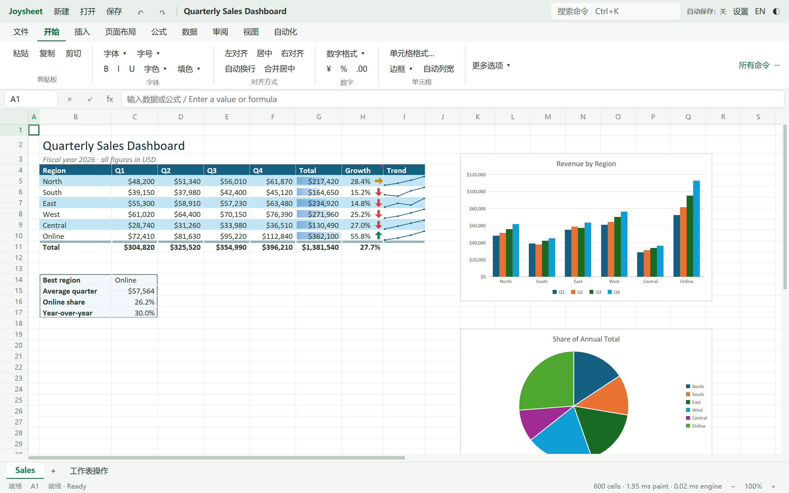

# Windows 功能区与密集表专项（M8-preview6）

范围：Windows x64；macOS/Linux 和签名继续跳过。不宣称 M8 全部完成。

| ID | 任务 | 证据与进度 |
| --- | --- | --- |
| R1 | 自定义尺寸、密集公式、动态数组分段基线 | 旧版 preview5 Release 已运行；10k/100k 三组、每组 12 次真实草稿提交与结果断言，见 evidence/R1-baseline-10k.json、R1-baseline-100k.json、R1-baseline-native.json |
| R2 | 常见电子表格功能区和尺寸共享 | 已实现文档快捷操作、9 个功能选项卡、分组工具栏、公式确认/取消、状态栏缩放；行列元数据 COW 与不可变索引共享；Release 构建、实际 Windows 点击切换/排序表单、M3 F6 草稿保留回归通过（R2-focus-final.json），完整解压包 49 项串联通过（R4-release-native.json） |
| R3 | 密集公式与动态数组 | 已实现按存储块写回、范围依赖种子、交集数组读取、浅层求值免分配；新增 preparationMs/spillSeedMs；分层 161 项通过/1 忽略，完整 CI 1,390 项通过/1 忽略；包内六组压力复测通过（R3-stress-final.json），每次真实结果和求值数量断言通过 |
| R4 | 完整 CI、原生回归与测试包 | 最终 CI 通过（R4-ci.json）；最终 Release 构建通过（R4-build-final.log），包内压力通过；完整解压包 49 项串联通过；安装后运行与安全卸载通过（R4-installer.json、R4-installed-native.json）；M8-preview6 三种交付已生成，最终归档按 SHA256 校核；最终交付以测试报告与二进制哈希为准 |

基准入口：`pwsh.exe -NoProfile -File scripts/desktop-smoke.ps1 -Stage M1 -StressCases -BinaryDirectory <包目录>`。默认分别测试 10,000/100,000 个自定义行高和 1,000 个列宽、同等数量的依赖公式加汇总、同等长度的 SEQUENCE 动态数组加 SUM 读取。每组保留 12 条身份/版本匹配的 CPU 首帧编辑样本，并核对每次真实结果；动态数组额外检查缩小、阻塞、撤销，自定义尺寸额外检查改高/撤销和远行命中。JSON 写入 artifacts/desktop/stress-performance.json。原先的普通 CSV 和复杂聚合基准继续保留。

首次探索性旧版 100k 基线 P95（12 条样本中即本次最大值）：

| 场景 | 总响应 ms | 引擎 ms | 尺寸索引 ms | 依赖 ms | 求值 ms | 写回 ms |
| --- | --- | --- | --- | --- | --- | --- |
| 自定义行列尺寸 | 22.42 | 3.14 | 1.38 | 0.00 | 0.00 | 0.00 |
| 密集依赖公式 | 161.76 | 146.62 | <0.01 | 6.93 | 69.13 | 45.96 |
| 动态数组 | 45.75 | 26.06 | <0.01 | 2.88 | 10.28 | 9.82 |

分段有包含关系，不能将各列分位数相加；范围读取属于求值，准备阶段覆盖排序/表达式提取，spillSeedMs 覆盖编辑后的溢出依赖种子生成。未测 GPU 呈现、物理按键延迟、真实输入法候选框或物理多显示器 DPI；既有人工验收项继续保留。UI 的原生鼠标/键盘检查与生产 GPUI 合成事件检查分开记录。

兼容性：行列 Lines 保持原 BTreeMap 的 JSON 内容与顺序；缓存不序列化、不参与内容相等性，任何可变借用先失效索引再 COW。默认尺寸/最大行列数属于索引键。批量计算写回只更新 value；公式、样式和范围索引保留。溢出范围种子同时包含区内公式和所有读取该范围的公式，继续使用原 dirty_closure；不减少依赖公式或更改累加顺序。

首次全串联回归捕获 F6 工具区失焦（artifacts/R4-native-initial.log，未计通过）：原代码通过名称框的 focus_prev 推断工具区，新功能区的可聚焦控件改变后失效。改为独立、稳定的 ribbon_focus，保留原五段循环与草稿；基础 M3 与 W3 均执行焦点链断言。首次严格 Clippy 检出的多余 String 转换已移除；最终 CI/原生报告以 final 记录为准。

普通桌面编译与 WASM 核心检查通过（artifacts/R4-desktop-check.log、R4-wasm.log）；WASM 保留原有 MAX_READ_BYTES 未使用警告，未把它计为严格 Clippy。引擎 M8 往返检查通过（R4-engine-smoke.log）。跨版差异检查见 evidence/R3-parity.json：完整持久化 JSON、双方写入/双方读取 XLSX 的值和公式一致。脚本支持独立 Report 路径，不再覆盖旧 Q3 证据。

## 最终解压包压力复测

见 [原始样本](evidence/R3-stress-final.json)、[原生报告](evidence/R3-stress-native.json)、[新旧对比](evidence/R3-comparison.json)。最终 Release SHA256：`80c862341e77cb60c731ff5d95bf3dba8f6ecfe6f02b694a0377c12492642169`。测试直接使用解压包内脚本，不需 Rust；六组各 12 条样本全部通过，pending/discarded 都为 0。密集组始终求值 n+1 个公式；数组组始终 3 次，真实尾值/汇总、缩小/阻塞/撤销均通过。

| 100k 场景 | 串行复核旧版总响应 / 引擎 P95 ms | 新包总响应 / 引擎 P95 ms | 定位阶段变化 |
| --- | --- | --- | --- |
| 自定义尺寸 | 23.39 / 3.51 | 14.77 / 0.11 | dimensions 1.26→约 0.001 ms |
| 密集公式 | 180.22 / 163.27 | 140.33 / 123.80 | 写回 45.03→24.80 ms |
| 动态数组 | 42.69 / 25.98 | 37.17 / 18.33 | 依赖 3.01→0.02 ms，求值 9.82→6.14 ms |

10k 总响应 P95：尺寸 19.46→14.08 ms、密集 31.43→28.52 ms、数组 24.68→22.40 ms。10k 密集引擎 P50 为 11.86→11.06 ms，但本轮有一次求值 9.66 ms，引擎 P95 12.65→15.36 ms；不隐去该样本、不宣称每组每个分位数都改善。这是单机少样本对比，不能视为长期响应上界。两版窗口均为 1440×900 逻辑尺寸；功能区改变可见网格高度，CPU paint/调度变化也会影响总响应，因此分开报告引擎阶段。

剩余热点：100k 密集求值仍约 69 ms；动态数组的 BTreeMap 溢出撤销/重新铺设仍约 11 ms。自定义尺寸发生修改时仍有冷构建和 COW 成本；静态尺寸普通编辑复用已有索引。保持单线程引擎语义，本轮未引入并行重算或放宽溢出/迭代兼容规则。

首次解压包串联检查发现 M8 验收脚本仍只允许 preview5，虽已存在 BUILD.json 与许可证清单，仍将 preview6 判为缺失（R4-native-final.log，未计通过）。已将新阶段加入明确允许列表，继续执行更新后的完整回归。

## 最终原生串联

[evidence/R4-release-native.json](evidence/R4-release-native.json)：最终解压 Release 49 项串联全部通过，SHA256 与压力采样一致。入口为 `-Stage M3 -M4Task 4 -M5Task 4 -M6Task 4 -M7Task 4 -M8Task 4 -WindowsTask 4 -WindowsQualityTask 2 -SaveDialog`，覆盖中英/公式编辑、F6 保留草稿、文件往返、数据/分析/自动化、图形打印预览、恢复重启、窗口排列、对象/冻结/尺寸边界、合成 IME/DPI 及保存弹窗真实生产按钮。事件来源仍是生产 GPUI 合成输入和 GPU 读回，不把它当作人类物理输入。W7/W8 的独立 UIA 焦点/打印取消脚本不是本轮这 49 项的范围；旧报告保留为历史，不计作本轮新运行。真实系统 IME、物理多显示器/读屏、设备打印等门槛继续保留。

100k 主表使用追加的 [串行旧版复核](evidence/R1-baseline-clean-100k.json)、[原生报告](evidence/R1-baseline-clean-native.json)，复核时无并发 cargo/构建或其他测试。首次旧基线采集期间曾有编译进程，因此首次数据只作探索性定位，原始数据保留，不用它单独证明提速。复核使用与新包相同脚本、12 次编辑和结果/求值数量断言；两版的实际帧调度和机器负载仍会波动。主表降低的是该次 CPU 样本的耗时，不是通用延迟保证。

最终 Windows 实际原生点击单列为 [R2-native-ui.json](evidence/R2-native-ui.json)，配合 [排序表单截图](screenshots/R2-native-sort.png)，不与 GPUI 合成事件混记。[安装/安全卸载](evidence/R4-installer.json)、[安装后运行](evidence/R4-installed-native.json)通过，隔离 TEST 模式不改快捷方式/注册表，保留额外用户文件。[原生打印宿主退出](evidence/R4-print-owner.json)通过，未提交打印队列。

交付：`joysheet-0.1.0-M8-preview6-windows-x86_64.zip`、同名 `-setup.exe`、`joysheet-0.1.0-M8-preview6-source.zip`。包内双击 `Run dense sheet benchmark.cmd` 复测本轮三类场景，或 `Run performance benchmark.cmd` 复测原 CSV/复杂聚合场景；需要 PowerShell 7，不需要 Rust。最终归档及源码 SHA256 校核记录在 dist/M8-preview6-verification.json；macOS/Linux 和签名按要求跳过。
