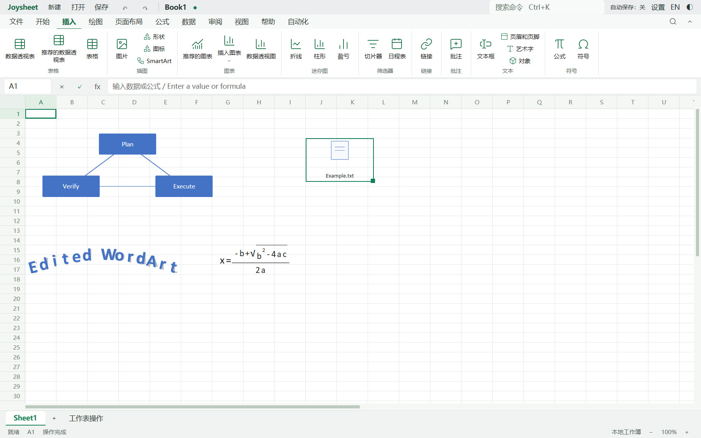

# 2026-11-11 对象、分页、公式审核与细线 Ribbon 验证

本页保留续验前的阶段结果。后续实际 Excel 打开此处样例出现修复提示，兼容性修改和当前状态见[本机续验](../20261111-excel-live/README.md)；本页样例不是已通过 Excel 接受性验证的文件。

本页记录第二轮 `feat/joysheet-excel-ribbon` 的实际结果。产品版本仍为 0.1.3，基础提交为 `4c7a951b73e62fcc3b71bbb7acc83abc99efa291`。实现范围和未覆盖能力见[对象与分页记录](../../STRUCTURED-OBJECTS-AND-PAGING.md)，第一轮 Excel Ribbon 参照见[历史对照](../20261111-excel-ribbon/README.md)。本轮未提交、推送、发布或覆盖已安装程序。

## 自动验证

- 完整产品检查：**1,412 项通过、0 失败、1 项忽略**；产品 fmt、严格 Clippy 通过。最后一轮在原生窗口回归结束后串行运行，日志为本机忽略目录 `artifacts/joysheet/object-parity-20261111/product-post-native-check.log`。
- Windows 生产 GPUI：**33 组检查通过**，详见[原生报告](native-report.json)。包括全部 Ribbon 选项卡、四类对象的实际插入表单/预览、WordArt 双击编辑与撤消/重做、嵌入文件逐字节提取、XLSX 独立重开、日程表点击/拖选/清除/层级/滚动、纸张中的页眉与单元格编辑、分页断点拖动、多级追踪箭头/缩放刷新/移除。
- 截图像素回归验证分页网格线可见、非打印区域没有蓝色断点线；视觉复查确认页码位于对应打印页内，公式追踪不会弹出通用结果侧栏。
- 公共锁文件仅增加 Sheet 对已有 `joyoffice-cfb` / `serde_json` 的依赖引用。跨产品引擎回归：JoyWord **1,157 项通过**，JoyDeck **6 项通过**。Word 首次未加载语言数据而失败的日志保留；设置 `CRAFT_I18N_DIR=third-party/craft-i18n` 的绝对路径和 `CRAFT_I18N_REQUIRED=1` 后完整重跑通过，未修改其他产品代码。这不是 Word/Deck 的 GUI 或发行包验收。
- 文档检查和本轮 Markdown 本地链接检查通过。汇总见[验证数据](verification.json)。

原生报告绑定 GUI 二进制 SHA-256：`781c3bae63f1534773f7eff1113f4c8cdf448bc2ed11402a40a22e618e3b1d4f`。事件由生产 GPUI 指针/键盘处理器处理，截图来自原生 GPU 读回；`physicalInputVerified=false`，不代表系统物理键鼠、IME、读屏、物理 DPI 或其他平台已经验收。

## 界面证据

下列图片由最终回归的完整 PNG 转为 JPEG，未调整元素或拼接模拟效果；原始 PNG 在本机忽略目录留存。

| 内容 | 截图 |
| --- | --- |
| 开始页细线图标、输入框和分组线 | [开始](tab-home.jpg) |
| SmartArt、WordArt、公式与嵌入文件 | [工作表对象](objects-on-sheet.jpg) |
| 公式输入与内建预览 | [公式表单](dialog-equation.jpg) |
| 真实透视表和日期筛选 | [日程表](timeline-filtered.jpg) |
| 纸张、页眉和 B2 编辑 | [页面布局](page-layout-edit.jpg) |
| 拖动断点后的打印范围与页码 | [分页预览](page-break-dragged.jpg) |
| A1 → B1 → C1 多级引用 | [追踪箭头](formula-trace-arrows.jpg) |



## 文件格式验证与 Excel 验收边界

[导出样例](objects-native.xlsx) 包含五类对象、透视表和页眉页脚，来自真实引擎命令。SmartArt 使用图示部件，WordArt 使用 DrawingML 文字变换，公式使用 OMML，嵌入文件使用 OLE Package/MS-CFB，日程表使用 Timeline view/cache。相关回归还覆盖外部 SmartArt 未知 XML/关系部件保留，以及已有外部 OLE 对象在混合保存时不丢失。

[独立 Open XML SDK 报告](openxml-report.json)：普通模式检查 **0 项发现**，另行验证 **1 个 OMML 子树**；保留 **1 项 SDK 3.0.1 模型差异**。该 SDK 将 `a14:m` 视为叶节点，但 MS-ODRAWXML 要求 `m:oMath` 子节点。验证脚本只对这个明确差异分别处理，其他错误仍导致失败。报告记录样例 SHA-256，不能据此替代 Excel 实际打开或交互验收。

本轮 Excel 可访问树可读取，但原生窗口无法激活，工具返回 `failed to activate captured window`，截图仅得到桌面背景。因此新增对象的 Excel 打开、布局重算、视觉与交互对照**尚未验收**；第一轮截图仅作为历史 Ribbon 参考。没有把格式检查或 JoySheet 合成输入回归标记为 Excel 实机通过。

完整效果图库、宿主 OLE 内嵌编辑、OLAP/多报表日程表连接、所有原生公式结构、分页标尺/页边距拖动和跨表箭头双击导航等限制仍见[实现矩阵](../../STRUCTURED-OBJECTS-AND-PAGING.md)。复杂外部 SmartArt 和未支持的原生公式以保留源 XML 的只读对象处理，不静默转成可编辑普通文本框。

## 重跑

先完成产品构建/检查，再启动窗口脚本；Windows 上两者同时使用或重建 CLI 会造成可执行文件占用。

```powershell
pwsh -File scripts/joysheet/dev.ps1 xtask check joysheet --validation
pwsh -File scripts/joysheet/dev.ps1 xtask build joysheet --validation
python scripts/joysheet/ribbon-smoke.py --output artifacts/joysheet/new-unique-run
python scripts/check_docs.py
```

窗口脚本需要 Python 与 Pillow，输出目录必须不存在，并只结束自己启动的隔离进程。所有试验轮次及文件占用失败日志保留在 `artifacts/joysheet/object-parity-20261111/`。
