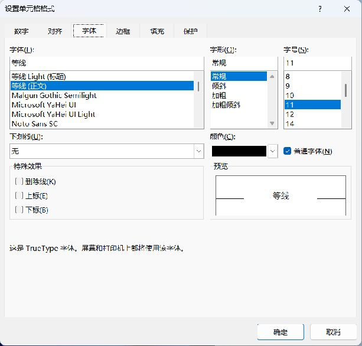
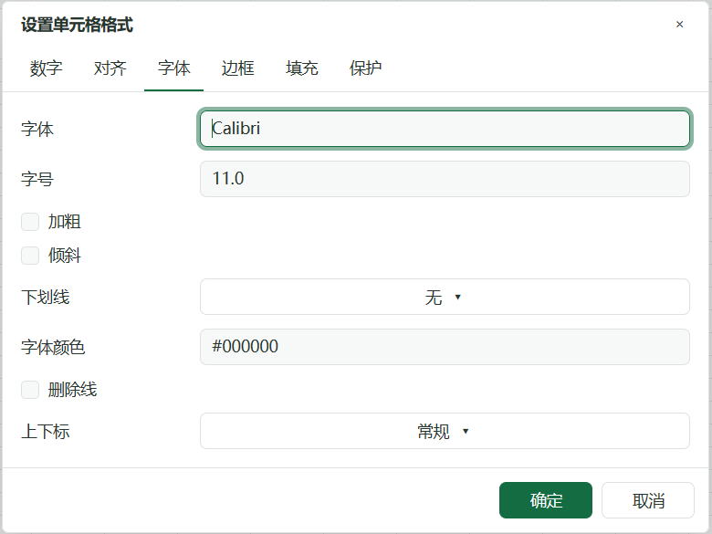
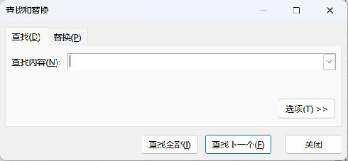

# Ribbon 控件与对话框续验

日期：2026-11-16。分支：`fix/joysheet-ribbon-excel-dialogs`；起点 `974f06c3d9c456a436ebd17e03aed7de9f88d4dc`。仅修改 JoySheet UI 和验证脚本，不修改公共依赖、锁文件或引擎命令协议。

## 本机参照与方法

使用本机中文 Microsoft Excel **16.0.20527.20196**（从本次运行的 EXCEL.EXE 文件版本读取；与 11 月 11 日基线不同），在新建空白工作簿中实际点击文件、开始、插入、绘图、页面布局、公式、数据、审阅、视图、帮助；另外打开字体/对齐、页面设置/页边距、数据验证、缩放弹窗。窗口截图、可访问树在忽略目录 `artifacts/joysheet/ribbon-click-20261116/`。文件后台包含最近文件，仅本地保留，不提交。没有读取或移植 Excel 私有实现、图标、模板或字体。

JoySheet 使用隔离配置和临时工作簿。`ribbon-dialog-smoke.py` 通过生产 GPUI 指针和按键路径检查全部选项卡、主控件及菜单项目，保存 GPU 截图和逐项结果；专门检查取消、确定、换页、混合格式、页面缩放模式、单位、输入错误和查找。此自动输入与本机实际鼠标比对分别记录，不将“命令返回”当作完整业务语义通过。

## 修复

| 差异 | 更新后的行为 |
| --- | --- |
| 功能按钮统一打开右侧命令中心，混入搜索、参数说明和其他命令 | 直接打开居中专用对话框；标题、关闭、确定/取消、复选框、单选框、下拉选项；Tab 焦点限制在对话框内。Ctrl+K 保留独立命令搜索 |
| 格式设置没有分页，字体/对齐/数字启动按钮进入相同入口 | 数字、对齐、字体、边框、填充、保护六页；各分组启动按钮和“其他边框/数字格式”进入对应页；数字类别和示例；换页保留输入 |
| 确定格式时发送活动单元格的全部样式，覆盖选区内不同字号和主题颜色 | 只发送改过的属性；不编辑直接确定不产生格式事务；保留主题颜色和混合字号，边框/保护可分别设置 |
| 页面设置从固定默认值开始，缩放比例与适应页数同时提交 | 回填实际纸张、方向、页边距、页眉页脚、标题、打印区域与缩放；页面/页边距/页眉页脚/工作表四页；互斥提交两种缩放模式；未改设置不重写 |
| 中文页面边距、行高、列宽显示内部像素或英寸 | 中文页边距使用厘米，行高使用磅，列宽使用字符；内部单位及既有命令协议保持兼容 |
| 粘贴、下划线、边框、颜色、合并、自动求和及插入/删除只有下拉 | 分离主按钮与箭头；主按钮执行默认操作，箭头打开菜单；下划线/边框/颜色重复最近选择；宽屏样式图库补充展开菜单 |
| 打印标题、分隔符、计算选项进入通用参数表 | 打印标题进入页面设置的工作表页；分隔符提供插入/删除/重置菜单；计算选项提供自动/除模拟运算表外自动/手动菜单 |
| 数据验证默认整数规则且无分页、已有规则不回填 | 新规则默认任何值；已有验证规则回填；设置/输入信息/出错警告三页；错误样式使用选项 |
| 查找/替换执行一次就关闭 | 查找和替换页签、查找下一个/全部与替换/全部替换按钮；执行后保留窗口及结果；输入错误显示在窗口中 |
| 取消隐藏直接恢复最近窗口 | 先显示隐藏窗口选择，再按确定恢复所选窗口；取消保留隐藏状态；没有隐藏窗口时确定不可用 |

截取的实际窗口示例（仅裁去外围工作簿，未改变窗体像素）：

| 本机 Excel | JoySheet |
| --- | --- |
|  |  |
|  |  |

[取消隐藏窗口截图](joysheet-unhide.png)与[逐控件覆盖清单](coverage.json)单独保留。清单分别标明全量点按构建与最后对话框增量构建的 SHA256，不将两者混为同一轮。

## 自动验证

- 产品 fmt、严格 Clippy 与全量测试通过：1,426 项通过、1 项既有忽略。日志为本机 `check-all-controls.log`；最后 UI 增量另通过严格 Clippy 和 23 项 UI crate 测试。
- 原 Ribbon/对象/分页/追踪回归：35 组通过。最终二进制复跑记录在本机 `regression-verified/`。
- 逐控件检查：**186 个主控件、149 个菜单项目、16 组专项检查**；其中 61 个参数窗完成打开/取消与工作簿版本不变断言，9 个直接操作和 3 个对象相关入口因前置条件不足返回提示，3 个窗口生命周期按钮单列。宽屏样式图库另点击 10 个样式。结果保存于本机 `verified-controls/report.json`、`inventory-progress.json` 和对应截图。前置条件错误（无剪贴板、无批注、无公式、无笔迹、无可推荐数据等）逐项保留，不算相应功能的业务验收。
- `python scripts/check_docs.py`：文档检查通过。
- 最后补验：`window-picker-final/` **7 组通过**，含新建视图、隐藏视图、取消隐藏选择器的取消/确定、查找保留窗口及全部格式/页面设置状态回归。取消隐藏是全量点按后发现并修复的增量；此前清单中单列的窗口生命周期由此补验，不回写原始结果。
- Windows 实际鼠标复测：字体分组启动按钮打开字体页并取消；新建视图/隐藏按钮；最终构建的取消隐藏选择窗打开、取消及确定。独立读取确认取消后目标仍隐藏、确定后恢复同一窗口，工作簿版本仍为 14。最终构建另复跑原 35 组回归通过，SHA256 与覆盖清单中的最终构建一致。

可重复入口（输出目录必须尚不存在）：

```powershell
pwsh -File scripts/joysheet/dev.ps1 xtask check joysheet --validation
pwsh -File scripts/joysheet/dev.ps1 xtask build joysheet --validation
python scripts/joysheet/ribbon-dialog-smoke.py --output artifacts/joysheet/ribbon-dialog-new-run
python scripts/joysheet/ribbon-smoke.py --output artifacts/joysheet/ribbon-regression-new-run
python scripts/check_docs.py
```

## 尚存差异与验收边界

这是受支持功能的交互与弹窗增量，不是所有 Excel 按钮的完整业务验收。对话框使用 JoyOffice 主题和 GPUI 控件，并非 Win32 原生弹窗；字体列表、颜色选择器、边框预览、图库、打印后台、名称管理、条件格式、多级排序和导入/分列等向导仍保留不同程度的布局或能力差异。数据验证的系统输入法模式等未实现能力不显示为空壳入口。

模板、账户/在线服务、加载项、复杂上下文功能区及原迁移矩阵中的未支持项保持开放。单个按钮的启用条件和多工作簿/对象/复杂选区组合不能由空白工作簿点按替代；未将这些未覆盖项标为完成。实体打印机、真实 IME、读屏、多显示器/DPI、其他系统与信创真机均不由本次 Windows 截图和自动输入验收。
