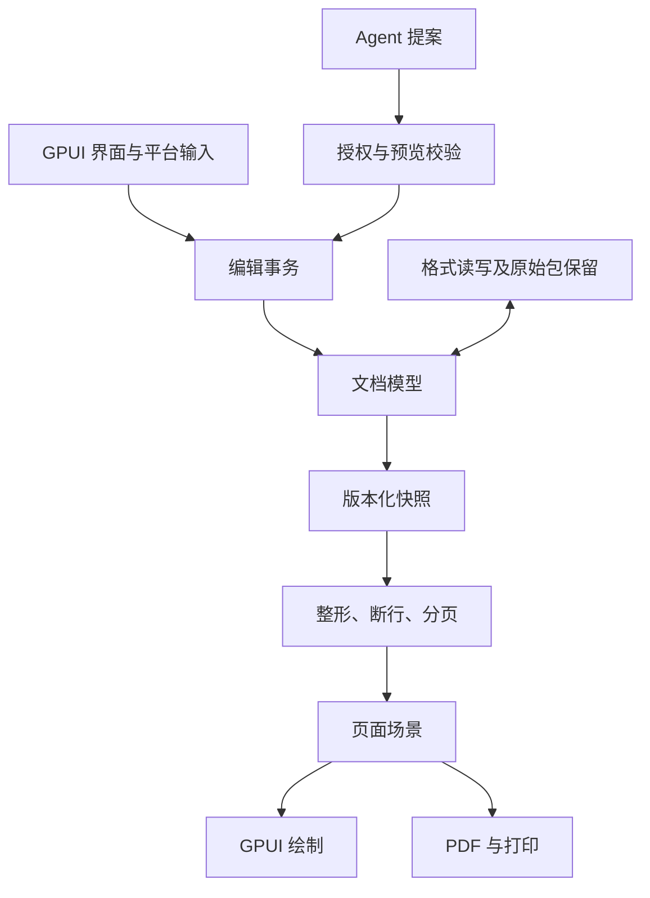

# JoyWord 技术架构

版本 0.2 · 2026-10-13。约束来自 [SPEC](SPEC.md)，执行项见 [TASKS](TASKS.md)。本文件区分目标架构与当前工程，不将设计类型视为已实现 API。

## 1. 模块与依赖方向

目标采用 Rust workspace，按能力真实引入 crate，避免先创建大量空模块。应用逻辑命名使用 `joyword-*`，成熟后再抽取；OPC、DrawingML（形状、图表、主题、图片）、OMML、文档属性、CFB 与加密等标准层面跨应用共享的格式层，首次引入即放入格式中立的 `joyoffice-*` crate（ADR-011）。

| 模块 | 拥有的状态与职责 | 禁止依赖 |
| --- | --- | --- |
| model | 文档结构、文本、样式、资源标识、修订、批注、不变量 | GPUI、文件对话框、网络、Provider |
| engine | 会话、命令、事务、撤销、位置映射与变更事件 | 具体 UI、具体模型服务 |
| formats | DOCX 等容器和语义映射、兼容诊断、导出计划 | GPUI、在线转换服务 |
| text / layout | 字体身份、Unicode 分析、整形、断行、分页、命中测试 | UI 状态、网络、文档写入 |
| render / pdf | 消费统一页面场景，输出屏幕绘制和 PDF | 重新解释 Word 段落／分页规则 |
| platform | IME、剪贴板、打印、文件操作、凭据及可访问性 | 文档内部结构的直接修改 |
| agent | 授权、Provider、工具校验、修改提案和取消 | 不受限文件／Shell／网络工具 |
| app / cli | 用户交互、任务调度、命令入口 | 绕过 engine 修改模型 |

app 组合 engine、formats、layout、platform、agent。engine 依赖 model；formats 和 layout 使用 model 的只读结构；agent 使用 engine 的受限接口。engine 不反向依赖 agent，避免循环。

## 2. 文档模型

Document 包含元数据、sections、stories、styles、numbering、resources、revisions 和 comments。Story 独立表达正文、页眉页脚、脚注尾注、文本框及批注正文；表格内容属于其所在 story 的结构树。

Block 至少表达 Paragraph、Table、内容控件（SDT，作为透明容器并保留锁定语义）和明确类型的对象／不透明内容。行内对象、超链接、软换行、格式范围与标注由类型化结构表达，不通过魔法字符伪装真实结构；行内对象在位置空间中占一个原子位置：实现上以 Unicode 非字符 U+FDD0 为占位码点，按出现顺序对应段落的类型化行内对象表；普通文本拒绝该码点，源文件中出现时由导入器作为保留内容表达；占位符不得泄漏到导出、剪贴板或 Agent，消费方读取类型化片段。复杂域（begin／separate／end）可以跨段落，与书签、批注、权限范围同属标注层，分别保存域代码和结果区间。叶子节点和文本区域都有稳定 NodeId／StoryId，导入器维护源格式 ID 与内部 ID 的映射。

文本存储由 T100 基准选定（结果见 [IMPLEMENTATION](IMPLEMENTATION.md)）：story 的块序列与段落文本使用同一种持久化 B 树（扇出 16，路径复制）；段落文本按不超过 1 KiB 的 UTF-8 块存放，节点缓存字节、标量、UTF-16 与对象位置计数，偏移换算为 O(log n)。DocumentSnapshot 为 O(1) 克隆，一次编辑只复制 O(log n) 个节点，后台排版不复制全文。每段一个 Ropey 实测约 1 KiB（短段落为本方案的 4.4 倍）；整段 `Arc<str>` 写时复制在百万字符段落中单次插入约 1–2 ms 且随长度线性增长；两者均未采用。属性保留原始单位：字符单位（firstLineChars 等）、行单位（beforeLines 等）、百分比和 auto 在排版时解析，导入时不折算为 EMU。

### 2.1 位置与编辑边界

Position 包含 StoryId、NodeId、Unicode scalar 偏移以及 Before／After 边界偏向。类型上区分 UTF-8 字节、Unicode scalar、UTF-16 code unit 和布局字形索引。字素簇只定义用户编辑边界，不作为持久偏移单位。布局保留 glyph cluster 到逻辑位置的映射，支持双向文本和连字。

PositionMap 必须覆盖插入、删除、段落分裂／合并、节点移动和节点删除；可顺序组合。映射结果可以是有效位置、删除边界或失锚诊断，不能静默落到另一个无关段落。批注、书签、选择区和修订共享这套机制。

### 2.2 样式、表格与对象

样式保存基于关系、属性缺省与直接格式，解析缓存与持久属性分离。OOXML toggle 属性按相应规范解析，不能用一个简单覆盖顺序解释全部属性。非法继承环返回诊断和有界回退，不无限递归。内置样式按规范名称（w:name）识别：中文 Word 的 Normal 样式 ID 为 `a`、标题 1 为 `1`，WPS 另用数字 ID；本地化显示名与规范名分离。字体按 ascii／hAnsi／eastAsia／cs 四槽选择，受 `w:hint`、语言属性和主题字体影响。

表格持有网格、行、单元格、合并关系和单元格内容；网格不依赖 UI 像素坐标。合并／拆分事务必须处理内容归属和修订原始状态。对象引用资源表，资源以内容散列和来源身份区分，修改资源不得意外替换共享实例。

修订是具有作者、时间、类型、范围／结构目标、原始值／删除内容和分组关系的语义对象；不等同于撤销命令。删除内容仍可用于 Original 投影与拒绝操作。格式及结构修订（含段落标记插入／删除、编号、节属性和表格单元格修订）必须保留逆向恢复所需信息。批注线程引用范围锚点和本地作者；云身份以后通过独立映射接入。

## 3. 核心接口契约

以下为语义接口，非当前可调用代码；M1 实现时不得放宽契约。1.0 前 workspace 内接口可演进，持久格式版本必须迁移。

| 类型／接口 | 输入与输出 | 不变量 |
| --- | --- | --- |
| DocumentSnapshot | 文档只读状态 + DocumentVersion | 构造后不变；后台任务不得借此修改会话 |
| Transaction | base_version、来源、权限、命令列表、前置条件 | 全部成功或全部失败；版本不匹配显式拒绝 |
| Command | 类型化编辑操作和逻辑目标 | 不能携带任意脚本、SQL 或原始 XML 修改 |
| ApplyResult | 新版本、ChangeSet、PositionMap、撤销记录 | 不泄漏半次修改；空操作有明确 no-op 结果 |
| ImportResult | Document、PackageBacking、诊断、可编辑边界 | 原始内容保留与编辑语义分别可检查 |
| LayoutSnapshot | document_version、审阅投影、影响排版的视图选项（隐藏文字、域代码）、font_environment、layout_profile（含兼容模式）、页面场景 | 只对应一个文档版本、投影和字体环境 |
| ExportPlan | 目标类型、保留／转换／损失清单、目标策略 | 所有损失可定位，不能保存后才提示 |
| ExportResult | 临时产物校验结果、最终路径、诊断 | 成功仅在目标替换完成后返回 |
| ChangeProposal | 提案 ID、base_version、目标范围、commands、解释 | 提交需重新校验授权和版本 |

UI 功能区、菜单、快捷键与 CLI 通过同一命令注册表查询名称、可用状态和执行入口。Agent 只能访问显式允许的子集。早期 CLI 使用 inspect、validate、convert 和 benchmark 子命令；对应能力未实现前不暴露假成功入口。

## 4. 事务、撤销与恢复

编辑流程：校验版本和权限 → 在候选状态应用所有命令 → 检查不变量 → 生成位置映射和撤销记录 → 发布新版本 → 发出布局失效通知。失败销毁候选状态。版本单调递增，撤销不会复用旧版本号，以避免陈旧 Agent 或布局结果被接受。

当前实现（T101，joyword-engine）的具体约定：同一事务内后一条命令的位置以前一条命令执行后的文档为准；PositionMap 由插入、段内删除、跨段删除（含段落标记）、拆分和移除五种基本步骤组成，组合即顺序拼接；书签、域、权限范围被整体删除后收缩为空范围，批注锚点被整体删除则转为可见的失锚状态；撤销记录保存事务前后的共享快照，恢复时保留当前版本计数与标识分配器，因此撤销和重做都发布新版本且不复用标识。跨段删除后合并段落暂沿用首段的段落属性，Word 的确切规则待 T004 黑盒登记。

组合输入作为暂态 overlay；commit 一次进入事务，cancel 清除 overlay。组字中切换焦点按平台契约提交或取消，不让两种路径同时触发。

撤销保存语义逆操作或共享快照，不通过重放 OOXML 片段实现。审阅接受／拒绝单独形成可撤销操作；本地历史不是审阅历史。文档恢复使用格式化日志记录、长度、校验和、schema_version 与周期快照。启动恢复只重放连续有效前缀，截断尾部保留供诊断。恢复副本先展示再覆盖正式文件。

保存状态绑定被保存的版本；保存任务运行期间继续编辑时，只清除已保存版本的 dirty 标记，不能误标最新内容为已保存。外部修改检测结合文件身份和内容指纹；不同平台的原子替换由 platform 负责。

## 5. 格式层与安全保存

DOCX 使用语义模型与 PackageBacking 双层表示。PackageBacking 记录原始 ZIP 条目、未解释的 XML 片段、关系图、内容类型、命名空间上下文和源节点映射。未改动包可直接复制；编辑后保留未受影响部件的解压后内容及关系语义，不承诺压缩布局不变。

部分可解释 XML 不能先丢弃未知属性再宣称保真。编辑影响未知片段的父节点、编号、资源或关系时，导出计划必须分析受影响范围；不能确定安全性就阻止该修改或强制另存副本。所有格式的诊断都归一为可定位的严重度、原因和建议操作。

标记兼容（ECMA-376 Part 3）按 Choice 优先处理 AlternateContent；JoyWord 编辑 Choice 内容后，保存时重新生成或删除对应 Fallback（例如文本框的 VML 副本），不留下陈旧副本；未理解的分支整体保留并限制相关编辑，MustUnderstand 不满足时只读。settings 缺少 compatibilityMode 时按 12 解释；新文档写 15，既有文档保留原值，排版 profile 按模式与 compat 标志分支，不静默升级。

OPC 层（joyoffice-opc，ADR-011）使用自写的严格 ZIP 读取器：只接受 stored 与 deflate，拒绝加密与多卷，中央目录与本地头必须一致，条目数据区不得重叠，以声明大小为解压上限并校验 CRC-32；外部关系目标只记录与分类（网页、本地文件、网络共享等），不解析、不访问。ZIP 条目数、压缩比和解压总量，XML 深度与节点数，关系数量和图像像素预算从 M1 起在解析层执行，禁用 DTD 与外部实体，读取器入口提供 fuzz 目标。解析和图片解码在可取消的后台任务中执行；高风险转换与不可信活动内容隔离到受限工作进程。线程不等于安全沙箱，必须区分资源限制、进程隔离和 OS 沙箱的实际覆盖。

标准保存流程：检查路径／外部变化 → 建立同目录临时文件 → 导出 → 完整性校验 → flush／平台持久化 → 原子替换 → 更新会话保存版本。校验失败、权限拒绝、磁盘不足和目标冲突都保留原件。文件系统不支持所需原子语义时明确退化为新副本，不模拟成功。原子替换保留目标文件的元数据：符号链接写入其目标而不替换链接本身，硬链接、权限／ACL、扩展属性、创建时间、只读属性及来源标记（Windows Mark of the Web、macOS quarantine）不因替换丢失；无法保留时明确提示。打开时检测 Office 所有者文件（`~$` 前缀）和 JoyWord 锁文件，提示共同打开冲突。

## 6. 字体、排版与呈现

### 6.1 单位与字体身份

文档几何采用有符号 64 位 EMU：1 inch = 914400 EMU，1 point = 12700 EMU，1 twip = 635 EMU。输入单位由不同类型包装，计算使用有界／溢出检查。整形结果从字体 units-per-em 转换时保留累加精度，避免逐字舍入导致整段漂移。转为屏幕和 PDF 浮点坐标只发生在输出边界。

字体身份至少包含字体字节散列、collection face index、variation axes、特性及语言／方向参数。Fontique 枚举和回退，HarfRust 整形，Skrifa 提供字形与度量，ICU4X 提供分析；这些库与 Parley 系列须对齐到同一组版本，避免同一字体经两套解析栈处理。当前选定（T003）：HarfRust 0.8.4、read-fonts 0.39.2 与 krilla 0.8.2（经 skrifa 0.42.1）共用一套 read-fonts；HarfRust 0.14 需要 read-fonts 0.45，待 krilla 跟进后整体升级。GPUI 自带的另一套字体栈只用于界面文字。整形特性完全由文档属性驱动：kern、liga 等不沿用 HarfRust 默认值，而按 `w:kern` 阈值、`w14:ligatures` 等显式设置启用。JoyWord 决定段落断行、中文兼容规则和分页。UI 标签可以使用 GPUI 默认文字系统，文档正文必须使用统一字体身份和定位结果。

采用 GPUI 原生字形通道时，FontId 与文档 FontKey 的映射必须通过 M0 测试验证；不能假设同名字体或同一 glyph ID 必然属于同一 face。GPUI 0.2.2 的 GlyphId 不可在外部构造，按字节加载字体也不返回 FontId，按名称解析会与系统同名字体冲突；来源与补丁策略见 ADR-010。若公共 API 不足，使用独立适配补丁并记录来源，不能修改排版结果凑合显示。krilla 使用定位字形接口消费相同场景，不再自行整形文本。

### 6.2 排版数据流

样式解析 → 脚本／语言／方向分析 → 四槽字体选择 → glyph cluster 整形 → 中西文间距与标点压缩 → 行断点（含禁则）与对齐 → 文档网格吸附与段落几何 → 表格／对象约束 → 分节分页 → 字段更新 → 稳定快照。

Word 的排版行为（单倍行距取哪组字体度量、网格吸附、禁则字符表、中西文间距宽度、页首段前距抑制等）以固定 Word 版本的黑盒实测为准，逐条登记到规则目录并引用样例 ID（T004）。

段落布局缓存以内容、解析样式、可用宽度、字体环境和兼容配置为键。分页从最早失效位置开始，直到页尾状态和后续内容边界稳定；布局缓存不写入文档语义。显示只绘制视口及邻近页，但打印和 PDF 必须等待完整稳定快照。

浮动对象、脚注和页码域形成反馈时使用迭代与收敛检查；检测重复状态或超过预算返回“布局未稳定”，保留已知可用视图，不将临时结果当正式输出。UI 的滚动锚点以逻辑位置保持，后台重排不能把用户跳到无关内容。

PageScene 表达页面尺寸、裁剪、字形位置、原文映射、路径、图像、链接和结构标签。PDF 可检索性要求保留 Unicode 与 glyph cluster 映射，不能将正文全部轮廓化。打印适配器消费同一场景，并将打印设备的不可打印区域作为用户可见选择。PageScene 另有 CPU 光栅后端，用于打印预览、页面图片、无窗口测试和无 GPU 环境兜底。C06 已实现单色轮廓页面的 CPU 消费者，并由 GPUI 图像元素呈现同一像素；该路径直接读取 FontKey 对应字节／face，PDF 仍保留文字。像素倍率不进入布局键。GPUI 窗口自身仍使用平台 GPU 后端，因此 CPU 页面实现不能计为无 GPU 窗口或 ADR-010 的 GL／CPU 退路验收。

## 7. 平台边界与并发

UI 线程只处理输入、状态提交和绘制；IO、解析、整形大任务、导出及 AI 不阻塞 UI。后台任务携带文档版本、font_environment 和取消 token；返回前校验，陈旧结果丢弃。关闭文档撤销其会话句柄，迟到任务不得重新创建会话。

平台差异集中在 IME、剪贴板、菜单、文件对话框、文件替换、打印、凭据、无障碍及安装器。Linux 同时记录 Wayland 和 X11 覆盖；三端构建与三端人工运行是不同证据。可访问树表达文档结构和选择状态，而非仅把画布声明成一张图片。

GPUI 不提供打印接口，0.2.2 的剪贴板只有文本和图片，两者均由 JoyWord platform 层实现；Linux 上 0.2.2 只支持 Vulkan 渲染；信创平台在 1.0 范围内，国产 GPU 多只提供 OpenGL，因此 GL 或 CPU 渲染退路是硬性要求（ADR-010，T005 实测）。Linux 平台层同时覆盖信创发行版（统信 UOS、银河麒麟）与 x86_64／ARM64／LoongArch64 架构。一个文档会话可有多个视图（新窗口、拆分），各视图独立持有选择、滚动位置和视图选项。

## 8. ADR 决策记录

| ADR | 决策 | 理由与后果 |
| --- | --- | --- |
| ADR-001 | 自研 Office 语义与分页；复用通用基础库 | 保持独立实现与可控兼容规则；承担长期格式测试成本 |
| ADR-002 | GPUI 为 UI；无界面内核 | CLI、性质测试、转换不依赖窗口或 GPU；平台缺口隔离 |
| ADR-003 | 结构树 + 持久化 B 树块序列与分块段落文本（T100 基准选定）+ 独立标注 + 原始包保留 | 可编辑性和保真分别表达；未知内容修改需保守分析；快照 O(1)、编辑 O(log n)；短段落存储约 236 B，长文档内存预算不足时再评估单块段落的小字符串快路径 |
| ADR-004 | 文档修订、撤销、本地恢复三者独立 | 避免关闭审阅丢历史或撤销破坏修订语义 |
| ADR-005 | 单一 PageScene 驱动屏幕／PDF／打印 | 一致分页与可比较几何；M0 必须验证字体映射 |
| ADR-006 | DOCX 默认工作格式，无公开私有原生格式 | 降低交换成本；恢复日志使用独立版本化内部格式 |
| ADR-007 | AI 权限与事务层集成，默认关闭 | 所有入口服从总开关；网络 Provider 与核心解耦 |
| ADR-008 | 单用户内核先成熟，协作另立规格 | 稳定标识与操作边界不预设 CRDT；不背负未定义云协议 |
| ADR-009 | 工具链和依赖固定，升级以语料回归为门槛 | GPUI 与文本生态演进快；不使用浮动 git main 或通配版本 |
| ADR-010 | GPUI 不以 crates.io 0.2.2 为长期来源；T001 依据 T003、T005 的实测，在固定 Zed commit、gpui-pre 与自维护补丁分支中选定并精确固定；所选来源必须支持 GL 或 CPU 渲染。2026-10-16 选用 crates.io gpui-pre =0.3.9（Zed 主干 93d745668805029476e6d7fbb19652116fed51de 的快照），平台 crate gpui-pre-platform =0.3.9 开 font-kit、wayland、x11（[迁移报告](../coordination/reports/GPUI-PRE-MIGRATION.md)）；其 wgpu GL 后端仍待 T005 信创真机验证 | 0.2.2 为最后官方版本（2025-10），缺外部 GlyphId、AccessKit 与 Linux 非 Vulkan 渲染；第三方发布需供应链审查；打印与富剪贴板无论哪种来源都需自建。gpui-pre 由个人发布且发布包无 .cargo_vcs_info.json，补偿措施为 CI provenance 作业：19 个包按 Cargo.lock 校验和取包，要求声明提交在 Zed main 历史中，并逐文件对照 Zed 源码；16 个一致，3 个包共 9 处发布适配经 2026-10-16 审查接受，按内容钉死于 scripts/gpui_pre_reviewed_deviations.json。升级快照须同步更新 CI 的提交号并重新审查（[来源校验报告](../coordination/reports/GPUI-PRE-PROVENANCE.md)） |
| ADR-011 | 标准层面跨应用共享的格式层（OPC、DrawingML、OMML、文档属性、CFB／加密）首次引入即格式中立 | 避免 Word 假设渗入共享层，JoySheet／JoyDeck 可复用；需更早约束其接口 |

