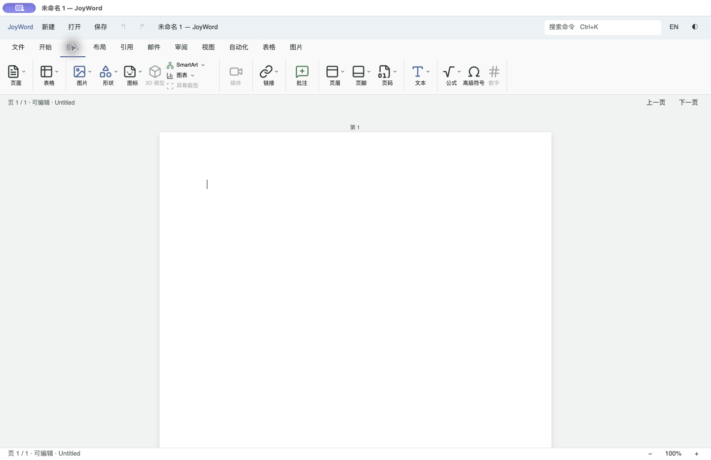
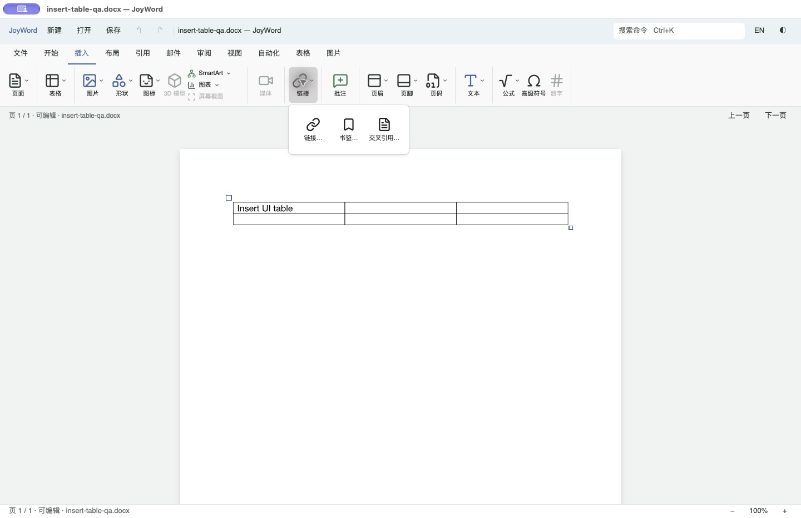
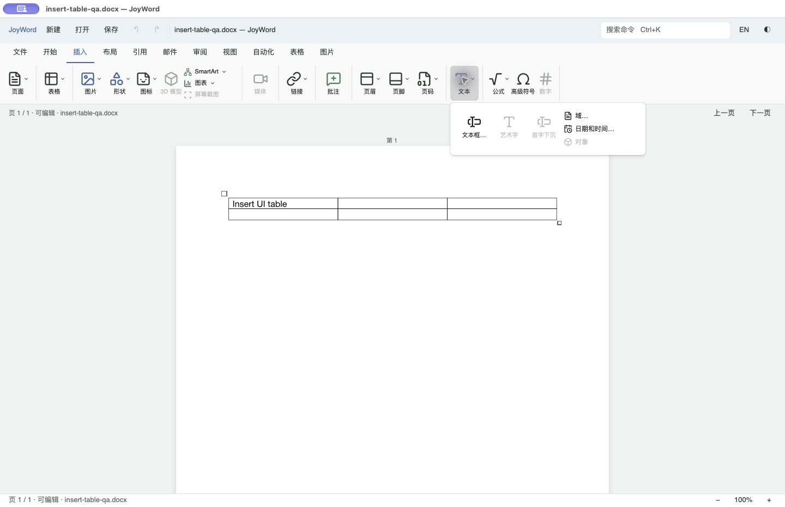
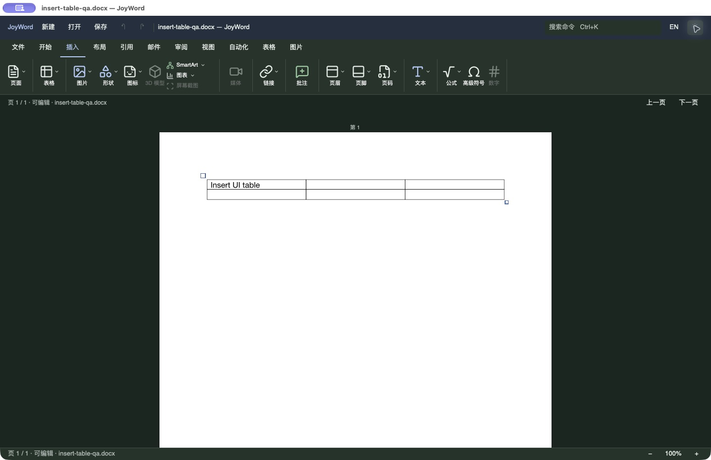

# JoyWord「插入」功能区对照

2026-11-08。参照本机 Microsoft Word for Mac **16.114.4（16.114.26110224）** 中文界面的新建 DOCX。只观察原生界面，没有复制 Microsoft 的图标或编辑器实现。改动位于当前 JoyOffice R8，入口为 `crates/joyword-ui-gpui/src/insert.rs`。

## 现场对照与改动

1. Word 的「插入」按页面、表格、插图、媒体、链接、批注、页眉页脚、文本、符号排列，主按钮为上图标下文字，SmartArt／图表／屏幕截图使用紧凑纵列。原 JoyWord 仅有表格、图片、页眉页脚及禁用的符号文字按钮。本轮采用相同的分组顺序、大图标与紧凑列、分隔线和下拉箭头；功能区高度由 88 调整为 76 逻辑像素。Word 产品配色改用已有 `Brand::Word`，不再使用 Sheet 品牌色。
2. 对照 Word 的页面、链接和文本浮层，将对应入口组织为图标面板；文本面板保留前三个大按钮与后三个紧凑按钮的层级。菜单项绑定文档身份、修订、呈现修订和选区，变化后拒绝执行旧菜单项。启用状态沿用真实命令预检，控件使用 Kit Button 的焦点、键盘和辅助功能行为。
3. 接通现有引擎的页面、常用形状、图标、SmartArt、图表、链接、书签、交叉引用、批注、页眉页脚预设／编辑、页码、文本框、首字下沉、域、日期时间、公式和符号入口。没有新增第二套模型。表格选择器扩展为 10 列 × 8 行，保留更多行列表单和插入后进入表格工具页的行为。
4. 3D 模型、媒体、屏幕截图、艺术字、嵌入对象和数字转换尚无本轮可交付的完整入口，明确禁用；上下文不适用的现有命令也按引擎状态禁用。菜单和表单使用已有编辑事务、撤销及保存路径。

最终浅色界面：

链接与文本面板：

深色显示复验：

Word 参照和修改前截图保留在本机忽略目录 `artifacts/joyword-insert-ui-20261108/`。对比图按相同逻辑像素比例裁取共同的 1120 像素宽功能区，没有缩放图标；原 Word 窗口为 1120 × 720，JoyWord 为 1440 × 932。截图并不构成完整像素一致或所有窗口尺寸验收。

## 保存复验发现与修复

原生界面插入 2 × 3 表格后，首次另存在 macOS 未优化开发构建中触发栈溢出。系统崩溃栈定位于 `SaveJob::run → ExportPlan::build → DOCX reader → StyleSheet::builtin`，调用来自 GPUI 的小栈后台线程。

`save.rs` 现在为保存读回校验提供与现有打开流程相同的 **8 MiB 专用线程栈**，等待工作线程结束并返回错误；仍由原有单次保存状态、文档身份和 SaveJob 控制发布。未更改原件替换、外部变更检查或新路径拒绝覆盖契约。

新增回归从 **512 KiB 调用线程**执行实际表格保存与 DOCX 读回，核对单元格中的中文正文、保存后的 clean 状态，并确认重复向已存在新路径发布失败且文件字节不变。修复后的同类原生保存与重开成功。

## 本轮验证

| 范围 | 结果 |
| --- | --- |
| `cargo xtask check joyword` | 产品格式、生产 `--lib --bins` 严格 Clippy、3,607 项测试通过，0 失败，2 项既有忽略 |
| UI crate 定向回归 | 11 项通过，包含新增小栈保存回归；后续标签换行调整再次构建通过 |
| 开发构建 | `cargo xtask build joyword` 通过，最终实际窗口使用该构建的隔离 App 副本 |
| 工程与文档 | `python3 scripts/check_gates.py`、`python3 scripts/check_docs.py` 和 `git diff --check` 通过 |
| 原生功能 | 页面菜单插入分页与单步撤销；向右箭头和柱形图插入／撤销；10 × 8 表格选择器中选择 2 × 3 并进入真实表格工具；符号 `§`、链接显示文字及勾股公式插入；页面底端页码 `1` 实际可见 |
| 保存与重开 | 原生另存 `insert-table-qa.docx` 后重开；独立 Python ZIP/XML 读回为一张 2 行 3 列表格且单元格文字保留；独立 CLI `inspect --session` 一致 |
| 视觉状态 | 中文浅色、英文标签换行、深色图标／文字和禁用状态实屏检查；未保存确认期间新增编辑入口均禁用 |

本机日志、原始截图、验证文稿和二进制 SHA-256 索引位于忽略目录 `artifacts/joyword-insert-ui-20261108/`；提交的精简来源、命令和产物指纹见 [验证索引](evidence/insert-ui/verification.json)。实际窗口操作由系统合成输入完成，不等同物理键盘、真实输入法或读屏认证。

额外尝试 UI crate 的 `cargo clippy --all-targets -- -D warnings` 未通过：已有测试模块报告 95 项 `unwrap_used` 等 lint；本轮未清理无关测试或添加豁免。产品工程入口按既定生产 lint 范围通过，新增回归不使用 `unwrap`／`expect`。

## 尚未覆盖

- 完整 Word 图库、预设预览、所有形状与图表属性编辑、符号字符网格及原生 Word 对话框的逐项等价。
- 700 像素窄窗口、其他 DPI／显示器、完整键盘与读屏流程，以及 Windows／Linux 原生界面。本轮保留既有横向溢出滚动，没有据此声明这些场景验收完成。
- 3D、媒体、屏幕截图、艺术字、嵌入对象和数字转换等禁用能力的实现。

本切片改善「插入」页及其可用入口，不关闭 R8 的完整功能并集、跨平台或正式发行验收。
