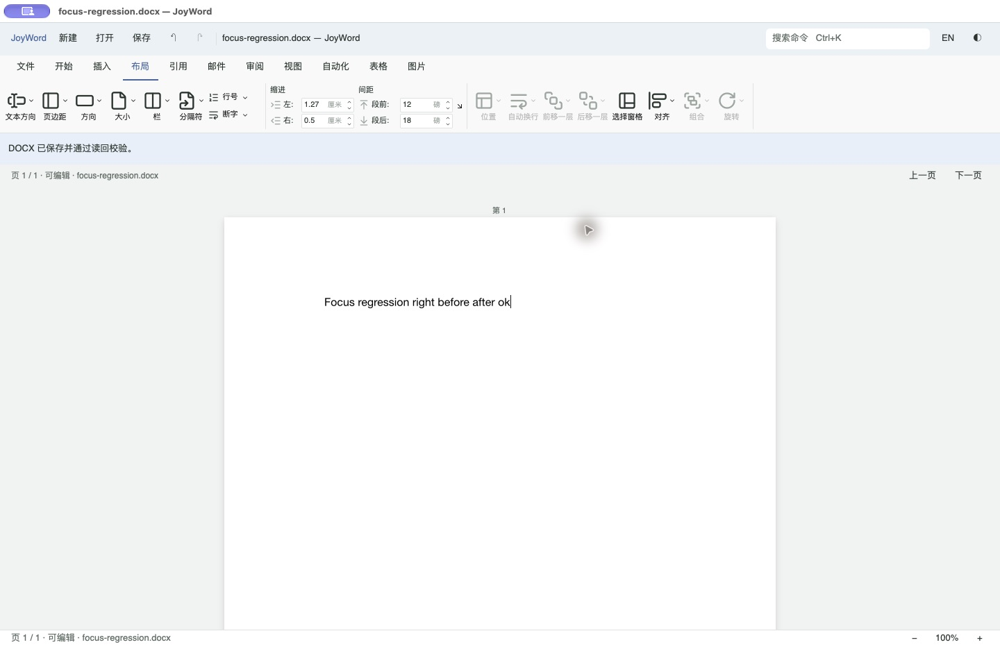

# JoyWord 布局数值框崩溃复核

2026-11-08。本轮依据用户粘贴的 macOS 崩溃报告核对代码、原生进程日志和构建身份，并补充回归。

## 报告定位

| 项目 | 核对结果 |
| --- | --- |
| 进程 | `JoyWordLayoutUI`，PID **93446** |
| 时间 | **2026-11-08 13:37:58 +0800** |
| 原崩溃构建 UUID | `227B7653-D5A3-3164-B6A6-C528EEFFA6A9` |
| 异常 | 主线程 `EXC_CRASH / SIGABRT`，`abort()` |
| 关键栈 | `gpui::window::a11y::A11y::set_focus` → Div/Input 预绘制；同栈包含 `gpui_base::number_input::NumberInput` |
| 对应日志 | `window/a11y.rs:533`：`set_focus called more than once in a single frame` |

附件与本机 `JoyWordLayoutUI-2026-11-08-133802.ips` 的 incident、PID、时间和镜像 UUID 一致，属于上一轮「布局」原生验收发现的同一个崩溃事件。收到报告时，该路径上的应用已是修复后的构建，UUID 为 `A93A4D7E-7487-318F-9C02-5B9B41691AFF`。本轮再次构建与验证的 UUID 见[证据索引](evidence/layout-focus/verification.json)。原始报告未复制进仓库，避免附带用户目录、硬件及其他无关诊断信息。

## 原因和修复

布局数值控件原先组合 Kit `NumberInput` 和内部 `Input`。外框跟踪输入状态的焦点，而内部输入同样申报该焦点。辅助功能激活后，同一帧的预绘制把两个节点都设为焦点，违反 GPUI AccessKit 的单焦点约束，触发断言，随后进程中止。问题位于界面焦点／辅助功能树构建路径。

上一轮已改成不持有焦点的 spinbutton 外框、唯一持有文本焦点的输入框及不抢焦点的上下箭头。本轮将该外框明确封装为 `layout_spin_frame`，并增加针对实际辅助功能语义的回归约束。保留数值、标签和可编辑文本语义。

新增交互回归还发现：步进已经提交值后，再按 Enter，因为数值没有变化而提前返回，焦点仍留在输入框。本轮补齐 Enter 的焦点交接：有效值完成提交后返回正文；无效草稿继续停留在输入框供修正。没有新增编辑事务来处理未改变的值。

## 验证范围

| 验证 | 结果 |
| --- | --- |
| 辅助功能语义回归 | 四个实际外框均为 SpinButton、保留数值且不支持 Focus 动作；旧 Kit NumberInput 组合确实支持 Focus，作为缺陷前提的对照 |
| 四框交互回归 | 四个编辑器逐个聚焦并绘制，键盘步进后仍保持输入焦点，Enter 后焦点返回正文；已有混合值、撤销、旧草稿与单位／范围回归继续通过 |
| 原生 macOS | 通过辅助功能读取实际控件，逐个点击左／右缩进、段前／段后输入框，输入、点击递增、按 Down、Enter 后直接录入正文，进程未退出 |
| 错误输入 | 段后输入 `bad`，Enter 后再输入 `X` 得到 `badX`，正文未受影响；Escape 恢复 18 磅并可继续录入正文 |
| 保存核对 | 原生另存 `focus-regression.docx`，显示已保存并通过读回校验；独立 ZIP/XML 检查正文与 720／283 twip 左右缩进、240／360 twip 段前后距一致 |
| 产品检查 | `cargo xtask build joyword`、`cargo xtask check joyword` 通过：格式、生产 `--lib --bins` 严格 Clippy、**3,612 项测试通过，0 失败、2 项既有忽略**；UI crate 为 15 项通过 |

GPUI TestPlatform 不激活原生 AccessKit，所以自动测试显式核对外框焦点语义并验证输入交接；原生预绘制路径由 macOS 窗口操作独立复验。没有把普通 GUI 测试通过当成读屏或完整辅助功能验收。Windows／Linux、物理键盘、真实输入法和读屏流程未在本轮实测。

构建、测试和原生日志、回归文稿位于本机忽略目录 `artifacts/joyword-layout-focus-20261108/`。专用复验包为该目录的 `JoyWord Focus Fix.app`，包含版本元数据以便后续报告识别；它是开发验证包。此前的布局 UI 对照记录及其构建指纹作为历史证据保留，见[布局记录](LAYOUT-UI.md)。
