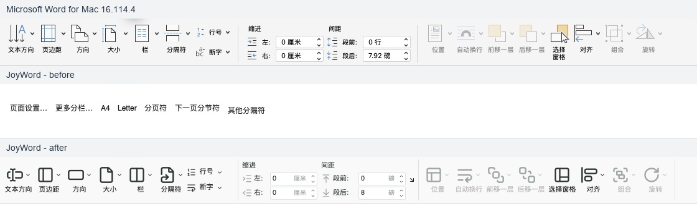
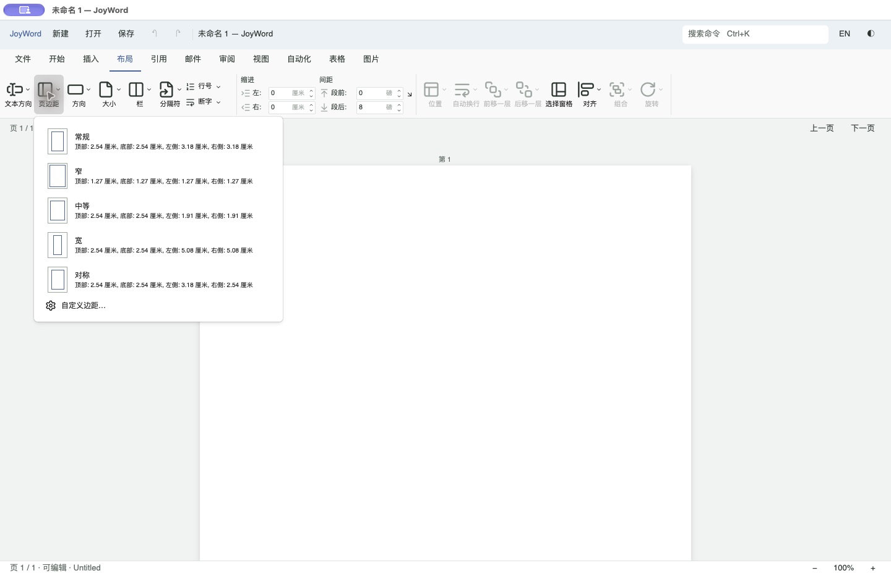
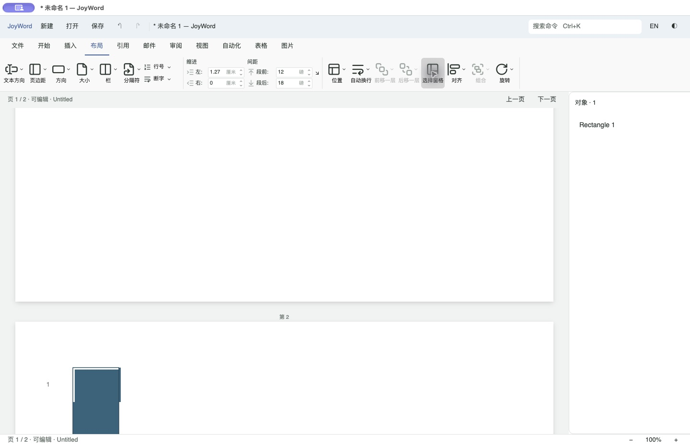
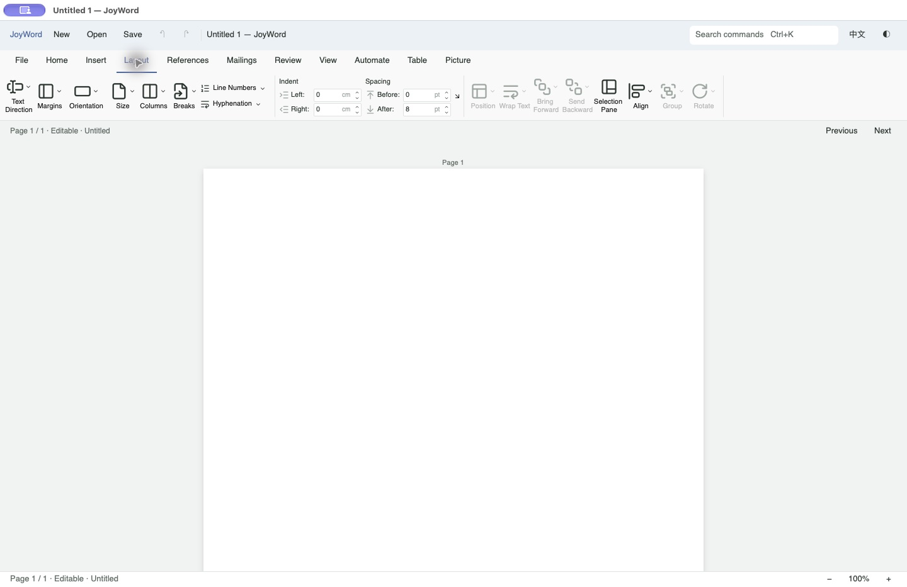
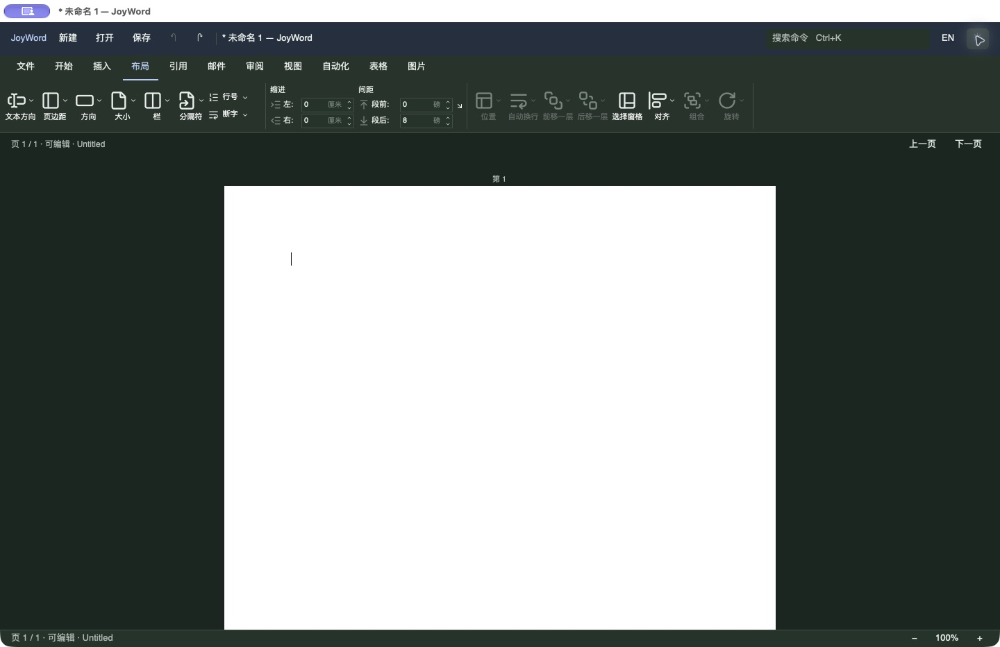

# JoyWord「布局」功能区对照

2026-11-08。参照本机 Microsoft Word for Mac **16.114.4（16.114.26110224）** 的中文「布局」页，在 JoyOffice R8 内完善原生 GPUI 界面。只观察应用界面；图标使用已有 Kit/Lucide，页面示意图由布局代码独立绘制，没有复制 Microsoft 资源或实现。

## 对照与实现

- 功能区从少量文字按钮调整为 Word 对应的三组布局。页面设置依次为文本方向、页边距、方向、大小、栏、分隔符，以及两行紧凑的行号／断字。段落组包含缩进、间距两列和四个数值框；排列组依次为位置、自动换行、前移一层、后移一层、选择窗格、对齐、组合、旋转。高度为 76 逻辑像素，没有额外的底部分组标题。
- 页边距使用现场 Word 的常规／窄／中等／宽／对称数值，显示独立绘制的页面示意图、厘米参数和当前匹配预设。常规为上下 72 pt、左右 90 pt，显示 2.54／3.18 厘米；没有改写引擎或文档原有的默认页边距。原有页面设置、更多纸张、更多分栏及完整段落设置继续可达。
- 分隔符菜单按分页符、分节符组织；页面、栏、下一页、连续、偶数页、奇数页均接入现有命令。文本方向、纸张、分栏、行号、自动断字与已有单一编辑会话共用事务和撤销。
- 左／右缩进按当前文档单位显示，段前／段后使用磅。Enter 或离开输入框提交；按钮与上下键步进，Escape 放弃草稿。混合值及无法作为长度显示的字符缩进保持空白，明确输入只修改对应字段。空白草稿不把混合选择归零；非有限或越界数值拒绝提交。菜单与草稿绑定文档身份、修订、呈现修订和选区，避免应用到后来切换的段落。
- 选择窗格通过只读的对象查询显示真实对象，选择项调用现有对象选择命令，再由真实命令预检决定位置、环绕、对齐、组合和旋转是否可用。新增只读查询白名单不会提交正在进行的输入法组合。插入和布局共用功能区按钮样式，其他产品的共享 UI 库未修改。

现场 Word、原 JoyWord 和改后 JoyWord 的功能区按相同比例排列：

共同裁取宽度为 1120 像素，保持 1:1，没有缩放图标；Word 窗口为 1120 × 720，JoyWord 为 1440 × 932。对比针对功能区，不代表整窗或逐像素一致。

边距菜单和对象选择窗格：

最终构建的英文长标签与深色显示也已实际核对：

## 原生数值框焦点修复

首次原生验收发现 Kit NumberInput 外框与内部 Input 跟踪相同焦点，触发 GPUI AccessKit 的 `set_focus called more than once in a single frame` 断言。自动 GUI 测试没有暴露这一原生辅助功能路径。

本轮在 JoyWord 内组合单一输入焦点、无焦点外框和上下箭头：外框提供 spinbutton 数值语义，内部输入负责文本焦点，箭头有独立辅助功能名称。修复后原生输入、步进、撤销、无效值拒绝、Escape 恢复及另存重开均已复验；没有为此修改 GPUI 或共享库。

2026-11-08 用户崩溃报告复核与新增焦点回归见[专门记录](LAYOUT-FOCUS-CRASH.md)。下文 3,610 项测试及原始构建索引保留为本切片当时的验证基线。

## 验证

| 范围 | 证据 |
| --- | --- |
| 产品工程入口 | `cargo xtask build joyword` 和 `cargo xtask check joyword`；格式、生产 `--lib --bins` 严格 Clippy、3,610 项测试通过，0 失败、2 项既有忽略 |
| 新增回归 | GUI：混合段距只改指定字段、撤销、导航后旧草稿不落到新段落、步进保留另一项段距；参数：单位换算、负值／非有限／越界拒绝；shell：布局与对象只读查询不提交输入法组合、不改变文档或呈现修订 |
| 原生编辑 | 输入左缩进 1.27 厘米，递增至 1.37 后撤销；失焦提交段前 12 磅；键盘步进后段后 18 磅；无效文字拒绝，Escape 恢复值 |
| 页面与对象 | 应用常规边距、横向、两栏、下一页分节符，界面变为两页；连续行号、自动断字；插入矩形后四周环绕、右转 90°，选择窗格重新选中对象并右对齐 |
| 保存读回 | 原生另存并重开 `layout-ui-qa.docx`；独立 Python ZIP/XML 核对正文、两节横向及两栏、720 twip 左缩进、240／360 twip 段前后距、连续行号、自动断字、四周环绕和 5,400,000 单位旋转 |
| 最终显示与保护 | 英文 Orientation／Line Numbers／Hyphenation 宽度调整后重建并再次核对；中文浅色、深色、空文档禁用状态和未保存确认期间的命令禁用；最终构建再次通过缩进输入、步进与撤销 |
| 文档与工程门禁 | `python3 scripts/check_docs.py`、`python3 scripts/check_gates.py` 和 `git diff --check` |

截图、实际构建指纹和其他检查见[证据索引](evidence/layout-ui/verification.json)；原始 Word 参照、构建日志和验收文稿保留于本机忽略目录 `artifacts/joyword-layout-ui-20261108/`。Word 独立分隔符／分栏浮窗的截图发生缩放失真，未用作视觉证据，菜单内容以现场辅助功能树核对。

## 尚未覆盖

- 前移一层／后移一层保持禁用：现有同名引擎命令改变的是文字环绕，而非对象实际层级，不能当成真正的层级编辑。手动断字目前也没有完整的交互入口。
- 选择窗格复用现有侧栏，只提供列举与选择；尚未补齐 Word 的可见性开关、重命名与拖动重排。对齐菜单当前提供已有的水平对齐能力，尚非 Word 的全部对象排列选项。
- 图标线条、所有图库／菜单预览和完整原生对话框没有实现逐像素一致。显示实际文档值，包括 JoyWord 默认段后 8 磅，不为截图将其改成 Word 的 7.92 磅。方向切换沿用现有引擎的页面几何与边距旋转语义。
- 本轮为 macOS ARM64 原生窗口与系统合成输入；未验收物理键盘、真实输入法或读屏流程、窄窗口／其他 DPI，以及 Windows、Linux 原生界面。没有据此关闭 R8 的完整功能、平台或发行验收。
