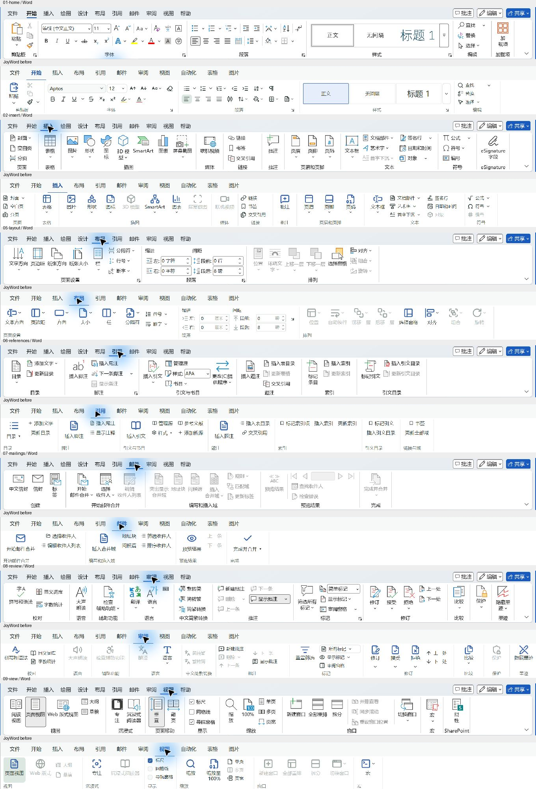
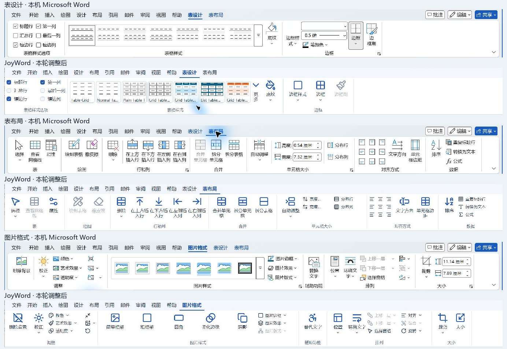

# Windows Word Ribbon 对照

2026-11-11，在本机 Windows 上打开 Microsoft Word `16.0.20527.20150` 的中文经典功能区，逐页截图，与 JoyWord `55b1507177ab1140a4fdf545cfceffe0b60ae4ff` 的实际界面比较。本记录依据本轮实屏，不把旧 Mac 对照继承为 Windows 验收。Word 的账户、加载项和服务配置属于本机状态，不代表全部 Word 版本。本轮完成常规选项卡及图片、表格上下文的对照和下列改动；完整 Word 功能并集仍开放。

## 对照步骤与改动

| 步骤 | 选项卡 | 原差异与本次处理 | 状态 |
| --- | --- | --- | --- |
| 1 | 文件 | 侧栏从 200 px 改为接近本机 Word 的 152 px，使用浅色／深色主题的功能区配色，调整返回区与底部选项位置；保留模板、最近文档、恢复、打印和导出。 | 导航界面已调整；云共享和账户服务仍开放 |
| 2 | 开始 | 补接中文拼音指南、带圈字符及文字轮廓／阴影；保留字体、段落、样式和编辑的真实命令。 | 实现、界面已复核；新表单未逐项实屏验收 |
| 3 | 插入 | 已有页面／表格／插图／媒体／链接／批注／页眉页脚／文本／符号分组；统一高度和图标规格。 | 界面已复核，沿用原命令回归 |
| 4 | 绘图 | 原桌面缺页。新增输入模式、撤消、绘图工具、模具、编辑、转换、插入、重播、帮助的布局；接通笔、铅笔、荧光笔、颜色粗细、会话自定义笔、套索选中／移动／删除、笔划转形状及橡皮擦路径。笔划在释放时落为一个事务，Esc 丢弃草稿。 | 实现、自动验证；红笔绘制、撤销、重做已实屏 |
| 5 | 设计 | 原桌面缺页。接通主题、样式集、颜色、字体、段落间距、水印、页面颜色和页面边框。自有主题沿用内核数据，不假冒 Word 的主题库。 | 实现、自动验证；页面背景、水印及保存已实屏 |
| 6 | 布局 | 校正“纸张方向”“纸张大小”“环绕文字”等 Windows 文案；保留页面设置、段落数值框和真实对象窗格。 | 界面已复核，数值控件回归通过 |
| 7 | 引用 | 重排目录、脚注、引文与书目、题注、索引、引文目录；补上脚注选项、下一脚注、更新表目录／引文目录；书目样式直接读内核清单。 | 实现、界面已复核；新表单未逐项实屏验收 |
| 8 | 邮件 | 补上创建组的信封和标签、合并类型菜单、合并域菜单、条件域、记录首末／跳转／查找和检查错误。标签生成独立 DOCX 副本，保留未保存的源文档。 | 实现、界面已复核；标签与合并自动回归通过 |
| 9 | 审阅 | 保留校对、语言、批注、标记、修订、比较等分组；修复“隐藏墨迹”未传到页面渲染的问题。 | 界面已复核；隐藏墨迹已自动及实屏验证 |
| 10 | 视图 | 增加阅读视图和页面移动分组，接通现有 Web／大纲／草稿排版。切换时刷新宿主场景；阅读视图拒绝键盘、IME、撤销、重做及宏运行编辑，并发布只读辅助信息，返回页面视图恢复编辑。打印始终使用页面排版。 | 实现、自动验证；阅读、只读提示和 Esc 返回已实屏 |
| 11 | 帮助 | 原桌面缺页。新增本地帮助、反馈说明和入门内容，F12 另存为快捷键。 | 实现、界面已复核 |
| 12 | 表设计 | 从常驻“表格”工具中拆出样式选项、样式缩略预览、底纹和边框；选中表格时出现。 | 实现；样式应用、撤销和显隐已实屏 |
| 13 | 表布局 | 按表、绘图、行和列、合并、单元格大小、对齐方式、数据分组；补接拆分表、九宫格对齐、文字方向、排序、重复标题行、转换文本和公式。 | 实现、自动回归；界面及上下文切换已实屏 |
| 14 | 图片格式 | 按调整、图片样式、辅助功能、排列、大小分组；补接删除背景、校正、颜色、艺术效果、透明度、压缩、样式和边框；选中图片时出现。 | 实现；艺术效果应用、撤销和显隐已实屏 |

常规选项卡顺序与本机 Word 一致，开发工具默认隐藏，可从文件选项临时显示。功能区支持按钮及 Ctrl+F1 折叠，选中选项卡后展开。功能区高度、选项卡间距及大小图标排布统一；菜单沿用文档身份、修订、视图版本和选区校验，过期菜单不能作用于后来选中的对象。

修复颜色菜单只改变第一强调色的问题，改为同步六个强调色并刷新绑定，显式格式保持原值。中文水印新增覆盖字形的字体回退，屏幕和 PDF 共用相同解析；新文字的边框按字体实际宽度测量，避免将短中文压缩成过高的文字。导入水印仅改颜色时保留原始尺寸。

## 本轮截图

截图只用作本机对照证据，不提取或重用 Word 的图标资产。JoyWord 使用宿主现有图标库。功能区裁图去掉文档正文、账户和最近文件信息。

[调整后常规选项卡](evidence/20261111-ribbon/strips/after-main-tabs.png) · [文件导航对照](evidence/20261111-ribbon/strips/file-navigation-comparison.png)

## 明确保留的差距

- 图形风格仍使用 JoyOffice 主题与现有图标库，Word 的彩色图标、缩略图图库、完整菜单内容和窄窗自动折叠尚未逐像素复刻。
- 绘图直尺、绘图画布、墨迹转公式和墨迹时间轴播放尚未接入桌面。自定义笔当前仅在会话内保留。
- 设计主题效果和设计默认值持久化未实现。相关按钮禁用，不接通内核里仅改变状态文字的旧接口。
- 联机图片、3D 模型、在线视频、签名／Office 加载项服务仍有缺口；不能把灰色入口算成功能完成。
- 大声朗读、翻译、中文简繁转换、完整辅助功能检查和桌面保护工作流仍开放。
- 多页并排、横向翻页、新建同文档窗口、窗口排列／拆分与同步滚动仍开放。
- 表格绘制／橡皮擦、边框刷及无边框单元格屏幕网格未接入。图片组合、真实层级调整和图片转 SmartArt 仍开放。
- 邮件合并的更新标签、人工字段重映射、真实批量打印和发送邮件仍开放。此任务不发送任何邮件。
- 形状、公式、图表和 SmartArt 的独立上下文选项卡仍需继续对照。

截图能证明位置、文案与显示结果，不能单独证明完整键盘、读屏或无障碍合规。各自动验证和本机操作将在下方分开记录；未实测的平台保持未验证。

## 验证

代码在独立工作区 `joyoffice-joyword-ribbon`、分支 `feat/joyword-windows-ribbon` 开发，原工作区的 Sheet 修改保留。无依赖、锁文件或共享 UI 改动，提交记录见该分支历史。

### 自动验证

- Windows x64、Rust 1.98.1：engine 1,159、fonts 106（1 项既有忽略）、PDF 70、render 71、shell 107、GPUI UI 23 项单元测试通过，共 1,536 项。另运行字体系统集成、MCP、metafile、model 及消费者测试，结果见[验证摘要](evidence/20261111-ribbon/verification.json)。
- 回归覆盖笔划草稿／提交／取消／过期拒绝、路径橡皮擦单步撤销、全部强调色与撤销、隐藏墨迹只影响屏幕且 DOCX 重开保留笔划、排版视图切换不修改文档且打印不变、阅读视图拒绝原生输入及命令编辑、标签输出不替换未保存或恢复文档、字段屏幕高亮和中文水印保存读回。
- `cargo xtask build joyword`（GUI 与 CLI）、全仓格式、相关生产库及二进制严格 Clippy、文档检查通过。
- 产品全量 `cargo xtask test joyword --headless` 未通过：在状态页已记录的 `joyword-layout::tests::pages::a_page_ends_when_a_multiple_spaced_lines_text_no_longer_fits` 失败。跳过该用例继续回归时，`incremental::tests::reuses_page_flow_for_single_line_edits_and_falls_back_on_wrapping` 也失败；后者用 `cargo test --locked -p joyword-layout` 过滤为单用例时通过。两处布局源码均与本轮基线相同；第二处未独立完成基线二进制复跑，不据此声称已排除环境、特性组合或其他原因。原始失败与运行范围保存在摘要中，不能把过滤后的回归当作产品全绿。

### 本机实际操作

用仓库示例的临时副本操作，未修改原样例或用户文档。红笔拖动出现真实笔划；撤销、重做恢复；审阅隐藏墨迹后图像消失，[认证只读检查](evidence/20261111-ribbon/native-hide-ink-inspect.json)的文档身份、修订及正文均未改变。另存 DOCX 后重开，笔划仍在，页面颜色 `FFF2CC` 和四边页面边框经独立 ZIP/XML 读回确认。中文草稿水印的字形回退和比例已实屏复验，F12 另存副本的[独立 XML 记录](evidence/20261111-ribbon/native-save-xml.json)保留文字、字体及实际边框尺寸。

混合图片、表格样例上，点击单元格出现表设计／表布局，点击图片出现图片格式；表格样式和图片反色效果可应用、可撤销，见[原生操作画面](evidence/20261111-ribbon/native-actions.png)。阅读视图重排正文，状态栏与辅助信息显示只读，输入不改变正文，[Ctrl+Z 明确拒绝编辑](evidence/20261111-ribbon/native-read-mode-undo.png)，Esc 返回页面视图。Ctrl+F1 折叠与选项卡点击展开已实屏。截图证明本轮列出的界面和操作结果，不能替代全部菜单、语言、高 DPI、键盘或读屏验收。

macOS、Linux、信创真机、完整打印队列、邮件发送、全部新表单和完整 Word 功能并集未验或未实现，保持开放。
