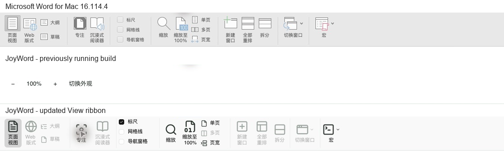
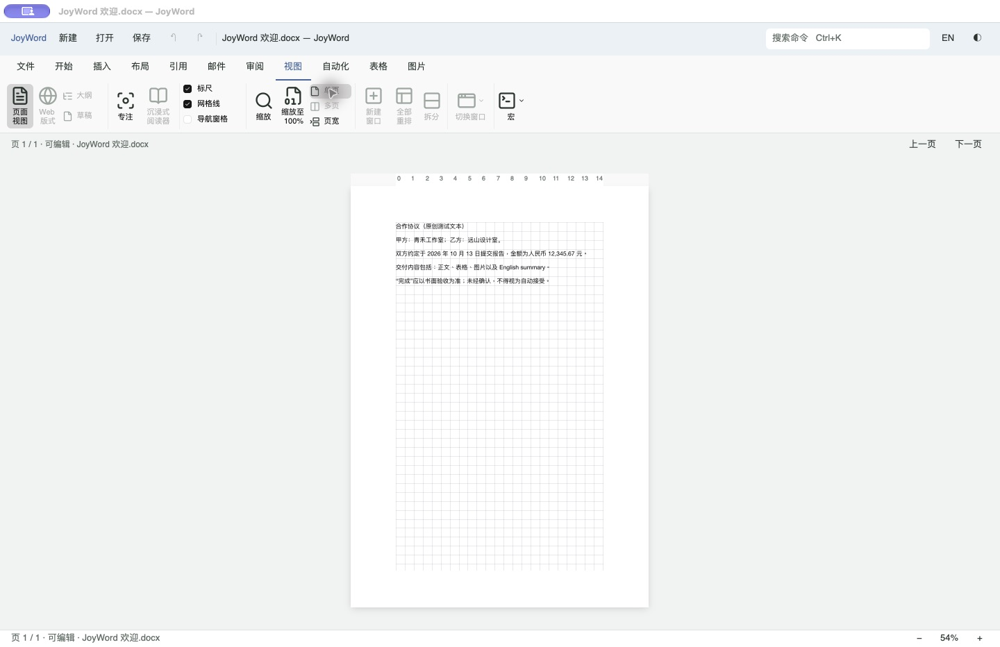
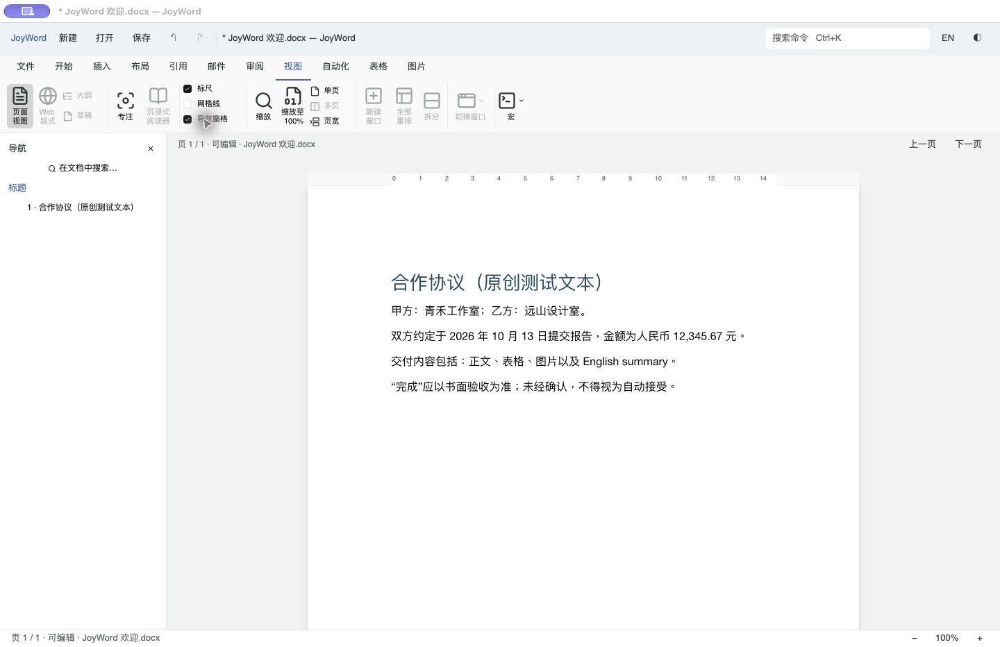

# JoyWord「视图」功能区对照

2026-11-08。现场查看本机 Microsoft Word for Mac **16.114.4（16.114.26110224）** 的中文「视图」页，在 JoyOffice R8 的 GPUI 桌面内调整布局与实际显示行为。只观察界面；图标使用已有 Kit/Lucide，没有提取 Microsoft 的图标、资源或代码。

## 界面对照

功能区改为 76 逻辑像素高，沿用已有插入／布局页的按钮组件。顺序对应 Word：页面视图／Web 版式／大纲／草稿、专注／沉浸式阅读器、标尺／网格线／导航窗格、缩放／100%／单页／多页／页宽、新建窗口／全部重排／拆分、切换窗口、宏。大图标配下方标签，大纲／草稿用两行紧凑按钮，显示与页面适配用三行；没有额外底部分组标题。英文标签使用单独宽度，浅深色沿用宿主主题。

以下依次为现场 Word、开始任务时运行中的 JoyWord、改后 JoyWord。共同裁取宽度 1120 像素，保持 1:1，未缩放图标。Word 整窗为 1432 × 720，JoyWord 为 1440 × 932；这里只比较功能区，不声称整窗或逐像素一致。运行中旧构建缺少源码当时已有的格式标记按钮，不能将该旧构建截图视为开始任务时全部未提交源码的构建证据。

本轮原生截图和上述联合构建证据来自包含此前未提交的「插入」「布局」工作的本机工作区。提交时仅纳入「视图」所需的代码、按钮基础与证据；独立检出的产品检查 3608 项通过、0 项失败、2 项忽略。其他功能区改动继续保留在原工作区。

## 实际行为

- 标尺显示当前页面宽度、正文边距与文档单位的水平刻度，随缩放和滚动移动；为只读标尺，不提供拖动缩进或制表位。复用原有 18 像素页码区域，不改变页面索引高度和鼠标命中坐标。
- 网格线按当前页面的真实正文区域绘制，仅在屏幕上显示，不进入页面场景、PDF 或文档。原生复验发现半像素线条在部分缩放比例下丢线，已改为整数像素定位和完整像素宽度。
- 导航窗格读取当前会话的正文标题，空文档显示引导文字，点击标题调用已有选区定位；保留文档身份与修订检查，防止旧项目应用到另一个版本。搜索按钮进入原有文档查找窗口，关闭按钮与功能区复选框共用状态。
- 缩放对话框接受 10–500 的数值或带 `%` 的百分比，拒绝非有限和越界值。单页／页宽根据真实页面尺寸和可见区域计算，随窗口及侧栏宽度变化重新适配。状态栏、键盘缩放与桌面控制的 `view.zoom` 共用引擎视图状态，打开文档时读取其已有缩放设置。
- 专注模式隐藏顶部工具区和左右工具窗格，提供退出按钮与 Esc 返回；保留文档、视图状态及单一编辑会话。当前实现是窗口内专注，不切换 macOS 系统全屏。
- 宏菜单接入现有查看／录制／停止录制入口，选择后收起菜单。沿用 JoyWord 的会话内文档命令宏，不宣称提供 Word VBA 兼容。
- 原有格式标记入口移到「开始 → 段落」，外观切换继续保留在窗口顶部。加载、输入法组合及未保存确认期间，相关视图控件遵守既有可用性检查。

## 验证步骤与结果

1. **参照采集：已完成。** 本轮直接打开本机 Word 空白文档并选择「视图」，读取辅助功能树和保存截图。缩放按钮没有打开可用的 Word 对话框，未以间接资料补造其对话框视觉证据。
2. **功能区与显示：按范围通过。** 原生 macOS 窗口核对中文浅色、英文浅色和英文深色；网格线、单页／页宽、100%、无效 900 拒绝、输入 `125%` 生效；临时为欢迎文档应用标题 1，导航出现真实标题并可点击，随后撤销并放弃临时编辑。专注模式和 Esc 返回、宏面板与菜单收起均已复验；没有保存或覆盖用户文档。
3. **自动回归：见证据索引。** 新增页面／窗口几何与缩放范围计算测试，以及真实 GPUI 窗口内的视图切换、正文修订和脏状态不变、状态栏共享缩放、适配退出与 Esc 回归。`cargo xtask check joyword` 通过格式、生产严格 Clippy 和 3,614 项测试（0 失败、2 项既有忽略）。其后补充 Esc 优先取消组合输入的处理，并重新通过 UI crate 17 项测试、严格 Clippy、格式和产品构建；没有重复其他未变更 crate 的测试。文档／工程门禁亦通过，日志及指纹记录在下方索引。

[最终检查、截图及构建指纹](evidence/view-ui/verification.json)。原始 Word 截图、构建与检查日志、独立测试配置和验收应用保留于本机忽略目录 `artifacts/joyword-view-ui-20261108/`。

其他现场证据：[越界输入](evidence/view-ui/joyword-zoom-invalid.png)、[专注](evidence/view-ui/joyword-focus-final.png)、[宏面板](evidence/view-ui/joyword-macros-final.png)、[英文](evidence/view-ui/joyword-view-english.png)、[深色英文](evidence/view-ui/joyword-view-dark-english.png)。

## 仍有差异及验收边界

- Web 版式、大纲、草稿、沉浸式阅读器、多页并排、新建窗口、全部重排、拆分和切换窗口保留 Word 对应位置并明确禁用。引擎有部分同名状态命令，当前 GPUI 页面管线仍以打印页面为基础，不能仅切换状态就视为真实支持。
- 导航只提供标题列表和进入已有查找窗口的按钮，尚非 Word 的完整标题层级、页面缩略图与即时搜索界面。标尺暂不提供竖向标尺或拖动编辑。缩放窗口复用现有数值表单，尚未复刻 Word 的完整原生对话框。
- 图标线条、配色和全部弹出界面未达到逐像素一致。标尺开关初值遵循已有引擎视图状态，没有为截图改写用户或文档默认值；深色显示仍沿用 Kit 的复选框样式。
- 本轮完成 macOS ARM64 原生窗口与系统合成输入验证；没有 Windows／Linux 原生、窄窗口／多 DPI、物理键盘、真实输入法或读屏完整验收。辅助功能树已确认复选框名称、状态和禁用语义，不能据此声称完整无障碍合规。
