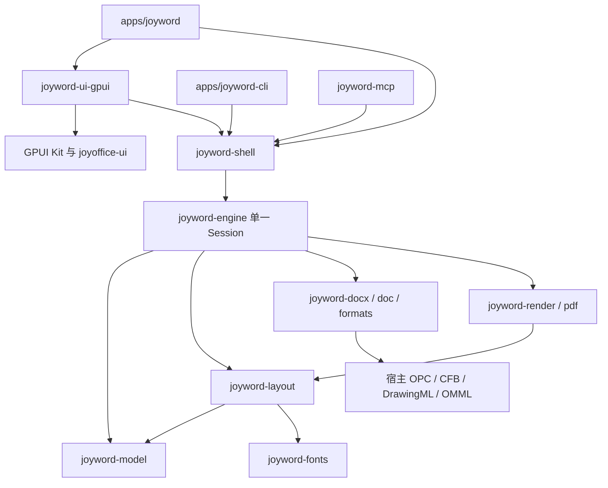

# JoyWord 目标架构

采用 Wordcraft 的单一文档和命令内核，连接 JoyOffice 风格的 GPUI 界面。公共组件和通用格式层来自宿主；与旧模型耦合的实现通过窄接口迁移。

## 依赖方向



图中 engine 到格式/渲染的依赖遵从现有 Wordcraft 闭包，避免迁移第一步强行拆引擎。IO、渲染任务的调度放在 shell/UI 边界；已有 engine 内部工作按证据逐步异步化。核心模型、布局、格式、PDF、CLI 不依赖 GPUI；文档编辑经 engine，layout 只读。

## 目标目录

```text
apps/
  joyword/                 # 薄桌面入口，产品元数据、启动和窗口组装
  joyword-cli/             # 无窗口命令和转换入口
crates/
  joyword-ui-gpui/          # GPUI 视图、动作绑定、IME 和桌面适配
  joyword-shell/            # EditorHost、后台任务、配置、IO 工作流
  joyword-model/            # 唯一文档语义，来自 Wordcraft doc
  joyword-geom/             # Wordcraft 几何和点单位
  joyword-fonts/
  joyword-layout/
  joyword-engine/
  joyword-docx/
  joyword-doc/              # 二进制 .doc 读取，来自 Wordcraft docbin
  joyword-formats/
  joyword-render/
  joyword-pdf/
  joyword-metafile/
  joyword-mcp/
  joyword-zotero/
  joyword-control-key/
  joyword-foundation/       # 按需保留现 JoyWord 的稳定基础类型
  joyword-agent/            # 复用现 AI 默认关闭与提案契约
  joyoffice-*/              # 临时固定来源，整合后使用宿主唯一版本
docs/joyword/
licenses/wordcraft/
licenses/joyoffice/
tests/fixtures/
scripts/
tools/xtask/
```

这是目标结构。R2 已迁入完整 geom/model/fonts/layout/engine/docx/doc/formats/render/pdf/metafile 闭包及桌面/CLI、shell/UI、公共 UI/OPC。MCP、AI、Zotero、Control Key、IME 和桌面编辑仍按后续任务迁入。新增 crate 必须有实际边界和调用方，不为对齐目录预建空壳。原 `joyword-epub`、`joyword-rtf`、`joyword-textfmt`、`joyword-protect` 是否保留为独立包，由新模型适配和宿主依赖决定；其用户能力都进入并集清单，不能因包删除而丢失。

## Wordcraft 包名映射

| 来源包 | 目标包 | 处理方式 |
| --- | --- | --- |
| wordcraft-geom | joyword-geom | 保留点单位及转换，避免与宿主 EMU 类型机械合并 |
| wordcraft-doc | joyword-model | 唯一模型；此处 doc 不是 .doc 文件读取器 |
| wordcraft-fonts | joyword-fonts | 字体字节、face、axes 和整形身份统一 |
| wordcraft-layout | joyword-layout | 保留断行/分页/显示列表和命中测试 |
| wordcraft-engine | joyword-engine | 保留 Session、命令、撤销和 typing 语义 |
| wordcraft-docx | joyword-docx | 语义迁入，容器逐步对接宿主公共格式层 |
| wordcraft-docbin | joyword-doc | 对齐现 JoyWord 中 .doc 读取包的角色 |
| wordcraft-formats | joyword-formats | 格式分派及新模型映射 |
| wordcraft-render / pdf | joyword-render / joyword-pdf | 共用内核显示列表；PDF fork 先完成适配 |
| wordcraft-metafile | joyword-metafile | 格式与渲染共用；不直接依赖产品应用 |
| wordcraft-mcp / zotero / control-key | joyword-mcp / joyword-zotero / joyword-control-key | 保留对应协议，调整产品路径和能力声明 |
| wordcraft-ui-egui | joyword-ui-gpui | 重建框架接线，复用行为契约和原创资源 |
| wordcraft / wordcraft-cli | joyword / joyword-cli | 桌面和无界面可执行文件 |
| wordcraft-web | 桌面迁移范围外 | 保留核心可移植性，网页单独评估 |

`wordcraft-proof` 是 `craft-proof` 的本地 alias，实际来自外部 Git。外部 `craft-*` 依赖保留其真实包名和来源，不批量改第三方品牌。用户可见名称、自己的包名、模块命名使用 `joyword`；上游归属和许可中的 Wordcraft 名称保留。

## 编辑与桌面适配接口

接口先用具体需求形成，不预建一个覆盖所有 Office 功能的抽象框架。最少包含：

| 接口 | 职责和约束 |
| --- | --- |
| EditorHost | 包装唯一 Session；执行带 document/view/revision 的命令，查询可用态、选区和历史 |
| CommandAdapter | 将现 JoyWord 命令映射到新内核 ID/参数；不支持时返回明确错误，无静默 no-op |
| DocumentView | 读取快照、当前布局、滚动锚点及页面命中；独立视图不复制可编辑模型 |
| TextInputAdapter | GPUI UTF-16 接口与内核 story/path/位置互转；组合预览、提交和取消有代次校验 |
| PageSceneAdapter | 从内核显示列表输出只读场景；保留字体身份、字形位置、Unicode cluster、图像和裁剪 |
| StorageAdapter | 接收已验证的候选 bytes、来源戳、版本及校验回调，复用安全发布流程 |
| PlatformServices | 文件选择、富剪贴板、系统打印、可访问性和窗口差异；不进入布局模型 |

现 `InputBackend` 返回旧 `Session` 和 `DocumentSnapshot`；它不能仅换一个泛型实现就连接新内核。应复用行为和 GPUI 接口接线，重写模型映射部分。现 storage 依赖旧 `ExportPlan`；先将候选输出与版本/来源证据抽离，再接新 exporter。

## 渲染路径

R2 的数据流为“文档快照 → Wordcraft layout → page/display list → CPU 光栅 → GPUI RenderImage”。这条路径能够保留现有显示结果，并复用宿主的异步页面调度。

R6 增加经过验证的原生字形/路径/图片消费路径。复杂效果允许按场景局部 CPU 回退；不能为适应 GPUI 文字布局而改变内核行宽、分页或字体。PDF、打印预览和屏幕使用同一稳定场景，PDF 正文保留可检索文字，不整体图片化。

原生绘制的 FontId 必须对应相同字体字节、collection face index、variation axes 和字形集合。GPUI 按字体名解析可能命中系统同名字体；没有身份一致性证明时继续走可靠的 CPU 页面路径。CPU 页面回退仍依赖 GPUI 窗口的 GPU 后端，不能宣称因此实现了无 GPU 桌面。

## 单位和位置

Wordcraft 的布局主要使用 point 浮点几何；现 JoyWord 的几何使用 i64 EMU。迁移期保留各自单位类型，通过边界显式换算，不能把旧布局数据当作新布局快照。缩放/DPI 只影响输出坐标和像素缓存，不改变文档分页。

UTF-16 仅是 GPUI IME 边界；内核的字节/字符/文档路径与 grapheme 边界必须分别处理。命中测试、原生组合候选框与画布叠加共用同一份版本匹配的坐标变换。

## 异步任务和保存

后台任务至少携带 document_id、view_id、文档 revision、打开/关闭代次、布局键、字体环境、取消信息。新任务取消旧任务；落地前再次核对全部身份。相同文档 revision 不足以证明是同一打开会话。

保存管线为“锁定快照 → 导出 → 独立校验 → 来源冲突复核 → 临时文件同步 → 原子发布 → 必要的读回 → 按已保存 revision 更新状态”。保存期间继续输入只能清除被保存版本的 dirty，不能把更新编辑标为已保存。恢复日志另有版本，不用 DOCX 存在来推断恢复数据已经迁移。

## 宿主公共层

`joyoffice-ui` 保持产品中立，只放视觉和通用交互，不放 Word 命令、文档模型或存储状态。OPC/CFB/DrawingML/OMML 同样保持格式层职责。

如确有两个产品都使用的新增能力，优先增量扩展宿主公共库；只有 Word 使用的适配保留在 `joyword-*` 中。禁止 `apps/joyword` 依赖 `apps/joydeck` 或 `apps/joysheet`，也不能让其他产品依赖新的 Word 内核获取通用格式功能。


## R2 实际接线

R2 时 `Reader` 持有唯一 engine::Session 及其只读 DocLayout 快照，后台以 Mutex 保护只读会话。R3 已改为下面的 UI 线程 Session 与不可变光栅场景，避免编辑与后台光栅抢锁。DOCX 继续经 joyoffice-opc 容器预算预检，再由 Wordcraft 语义读取和完整分页。

打开、布局和 CPU 光栅在后台执行；复用宿主 RasterRequestGate 请求身份，按文档代次/缩放/DPI/页号拒绝迟到结果。页面与邻页有 16 MP 总缓存、单页 4 MP 的光栅预算，RGBA → GPUI 预乘 BGRA。高缩放优先限制内存，可能降低页面清晰度；后续分块/原生场景绘制见 R6。

取消在阶段边界检查，当前同步导入/全文排版不可在内部抢占；关闭通过弱 Entity 更新拒绝迟到结果。R2 桌面只读，R3 编辑和保存接线见下。PDF 共享同一场景，经私有 stock Krilla 适配写入，不使用宿主根 krilla patch。

## R3 实际接线

UI 线程拥有唯一 Reader/Session。后台光栅只接收不可变的 Document（共享/COW 数据）与 DocLayout 场景快照，避免输入被页面光栅的 Mutex 阻塞。文本事件经过 GPUI EntityInputHandler；普通字符不再由 key-down 重复插入，控制键通过同一 engine 命令执行。

每份文档创建一个身份绑定的 InputBridge，旧实体的回调不能修改新 Session。原生周边文本采用模型 VisibleParagraph 的有界窗口，UTF-16 精确映射到可见 UTF-8，再映射回存储位置；代理对及字素中间的替换拒绝。跨段选区在无单段 surrounding context 时仍保留内核选区用于替换。

预编辑使用内核 edit_snapshot/restore：更新预编辑不会累加历史，取消恢复原文/选区/redo/dirty，提交形成一次独立撤销。预编辑禁止保存；失焦/窗口失活取消。光标、选区、预编辑下划线独立于页面像素；光标计时刷新不重排或重光栅。

保存是不可变、带文档身份和 revision 的后台 SaveJob。复用宿主来源戳、锁检测、同步临时文件、读回、原子新文件发布及原件替换。Job 完成只有匹配当前文档和版本才清 dirty；晚到旧版本不清更新的修改。原件元数据能力不足时默认另存，确认令牌绑定文档/版本。新建/打开/关闭的未保存提示保留原会话。

恢复复用内核独立工作线程，写入 migration-preview/r3-recovery；预编辑期间不产生恢复快照，旧恢复目录不改写。此轮完成接线，原生异常退出恢复和多平台 IME 仍需单独验收。

## R4 实际接线

功能区和键盘通过同一个 run_format → Reader::execute → Session::run 通道执行命令。字体选择和字段表单采用宿主同版 Kit 控件。字体目录来自实际布局用 FontDb，字体与中文字体可以分别设置；没有 UI 私有的可编辑格式模型。

格式状态是只读派生缓存：输入、选择、撤销或文档替换时失效，下一帧从唯一 Session 重新查询，光标闪烁不会重复扫描选区。format.state 保留原 boolean 语义并增补 mixed 列表；段落状态使用引擎 selected_paths（包含结束段边界与表格选择规则）解析每个段落，仅在一致时显示值。

表单打开时捕获文档身份、revision 和选区。字段先整体校验，仅把变化且非空的值作为 patch 提交给 format.set 或 para.set，形成一次撤销。未变化字段、混合空字段及取消都不写文档；不能用对话框中途的另一份 Session 实现预览。身份变化的表单和版本过期的弹层拒绝应用。组合输入、打开中和保存确认期间禁用格式入口，文档保护的不可用原因沿用 engine::why_disabled。

## R4 样式及对象增量

样式任务窗格复用宿主 uniform_list，仅创建可见行。样式目录和解析预览按文档/revision 派生缓存；文档仍只有 Session 中的 StyleSheet。段落/字符样式继承先验证存在、类型和无环，再整体修改；reset 清除样式自身的字体/段落覆盖以恢复继承。格式刷读取解析后的字符属性（包含继承），单次/连续状态留在引擎，鼠标选择及 Ctrl+Shift+C/V 共用命令。

表格选择/命中/边界/列宽分配直接使用内核 table_mouse/table_resize，图片选择使用 DocLayout 的 ObjectHit。Gesture 仅保存起止几何与文档/revision，在移动期间绘制预览，松开才执行一次命令；Esc、视口外释放或过期版本丢弃。表格预览和提交调用同一分配算法，选区覆盖按真实单元格矩形绘制。

原生图片文件框和后台读取/探测/解码沿用宿主异步 asset picker 模式，后台不持有可编辑 Session。32 MiB 输入、16 MP 和 128 MiB 解码预算先检查；回到 UI 线程验证请求代次及文档/revision/选区，才提交 insert.picture 或 picture.change。所有样式和对象字段表单同样绑定文档/revision/选区，先整体校验，再一次事务提交。

编辑区精确焦点时挂 JoyWordEditor key context，以 action 绑定 Tab/Shift+Tab；Kit Root 的 Tab action 在 raw key-down 前分派，不能只依靠 on_key_down。控件或对话框有焦点时不匹配编辑区 context，保留原生表单焦点遍历。新增包裹真实 Kit Root 的回归测试，避免只测试未包装的编辑视图而漏掉生产分派行为。
